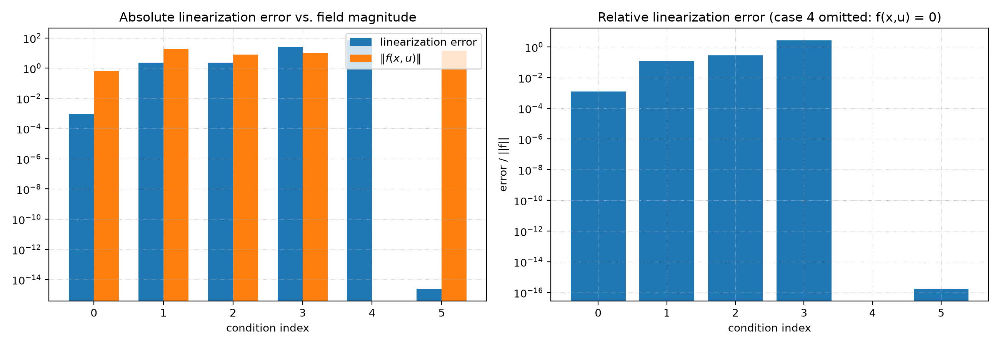
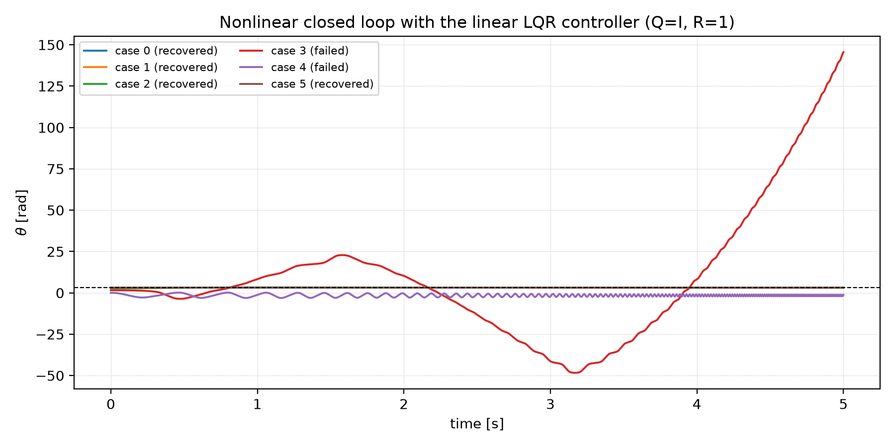
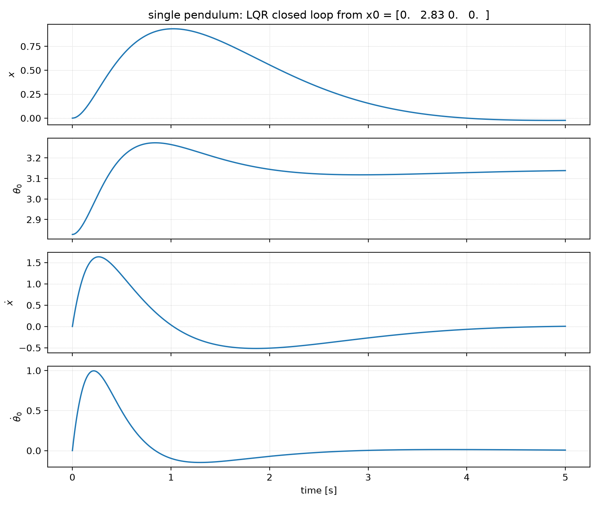
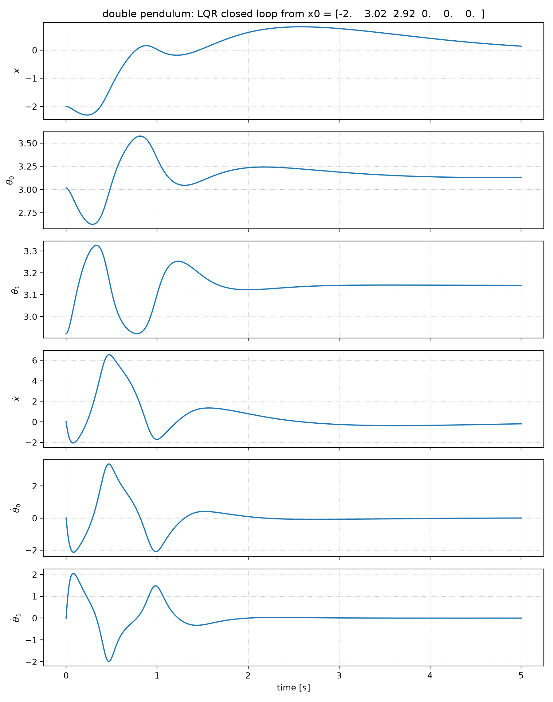
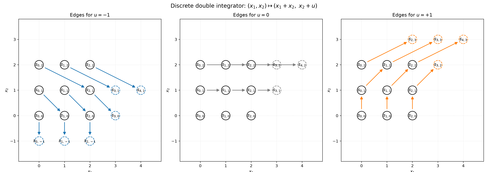
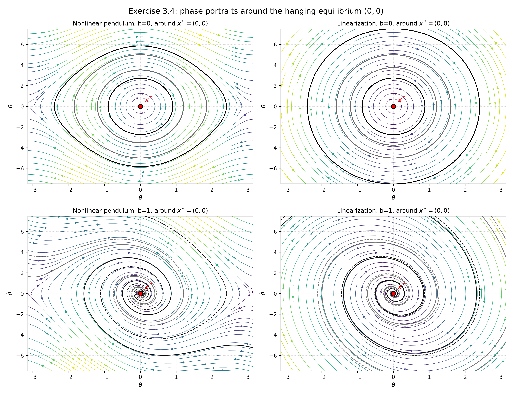
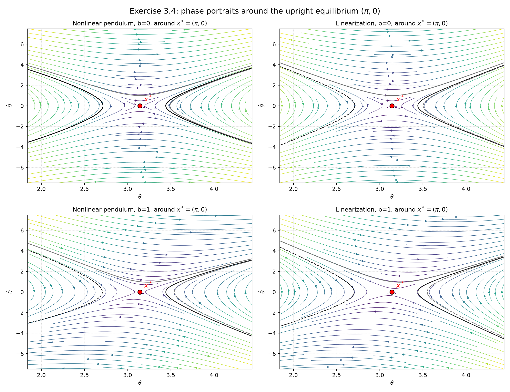

# Chapter 3 · Section 3.8 作业解答

**课题：Acrobots, Cart-Poles, and Quadrotors — Section 3.8 Exercises**

> 对应教材：[Ch. 3 Acrobots, Cart-Poles, and Quadrotors](https://underactuated.csail.mit.edu/acrobot.html#section8)，Section 3.8 共 4 道题：
>
> - Exercise 3.1 — Cart-Pole: Linearization and Balancing
> - Exercise 3.2 — Cart-Poles: Writing URDFs and balancing with LQR
> - Exercise 3.3 — Controllability of Discrete and Continuous LTI Systems
> - Exercise 3.4 — Comparison between stability of nonlinear system and linearization
>
> 运行环境：`/Users/leo/venvs/drake/bin/python`，Drake 1.58.0，underactuated 2026.9.8，
> NumPy 2.5.4，SciPy 1.18.1，Matplotlib 3.11.2。

## 0. 文件与复现方式

| 内容 | 文件 |
|---|---|
| Exercise 3.1 notebook（已完成并通过 autograder） | [cartpole_balancing.ipynb](cartpole_balancing.ipynb) |
| Exercise 3.2 notebook（本次补齐全部 TODO，并通过 autograder） | [cartpoles_urdf.ipynb](cartpoles_urdf.ipynb) |
| Exercise 3.1 补充数值分析 | [exercises_analysis/ex3_1_balancing_analysis.py](exercises_analysis/ex3_1_balancing_analysis.py) |
| Exercise 3.2 URDF/LQR 仿真分析 | [exercises_analysis/ex3_2_urdf_lqr_analysis.py](exercises_analysis/ex3_2_urdf_lqr_analysis.py) |
| Exercise 3.3 可控性分析 | [exercises_analysis/ex3_3_controllability.py](exercises_analysis/ex3_3_controllability.py) |
| Exercise 3.4 相图与稳定性分析 | [exercises_analysis/ex3_4_stability_linearization.py](exercises_analysis/ex3_4_stability_linearization.py) |
| 原始数值结果 | [exercises_analysis/results_ex3_1.json](exercises_analysis/results_ex3_1.json) 等 4 个 JSON |

复现命令（在 `Ch.3 Exercises/exercises_analysis` 下）：

```bash
/Users/leo/venvs/drake/bin/python ex3_1_balancing_analysis.py
/Users/leo/venvs/drake/bin/python ex3_2_urdf_lqr_analysis.py
/Users/leo/venvs/drake/bin/python ex3_3_controllability.py
/Users/leo/venvs/drake/bin/python ex3_4_stability_linearization.py
```

**题目原文来源说明：** 课程 PDF 中 Section 3.8 只保留了题目标题（网页打印时正文/交互内容未渲染），因此 Exercise 3.3、3.4 的完整题目文本取自课程作业清单中给出的官方链接
[underactuated.csail.mit.edu/acrobot.html#section8](https://underactuated.csail.mit.edu/acrobot.html#section8)；
Exercise 3.3 的网格图取自官方仓库的 `2d_grid_double_integrator.svg`，Exercise 3.2 的双摆几何参考了官方 `double-pendulum-cart-pole.png`。
3.4 的题目只给出 $m=l=1$、零力矩和阻尼系数 $b$，未写出显式方程；本解答采用标准阻尼单摆模型
$m l^2\ddot\theta+b\dot\theta+m g l\sin\theta=0$（$m=l=1$ 时即 $\ddot\theta=-g\sin\theta-b\dot\theta$）。

Autograder 结果：

| Notebook | 得分 |
|---|---|
| `cartpole_balancing.ipynb` | **13/13** |
| `cartpoles_urdf.ipynb` | **12/12** |

---

# Exercise 3.1 — Cart-Pole: Linearization and Balancing

## 1.1 状态空间动力学

取状态 $\mathbf{x}=[x,\theta,\dot x,\dot\theta]^\top$、输入 $u=f_x$，固定
$m_c=m_p=1$、$l=1$、$g=9.81$。教材式 (16)(17) 给出

$$
\ddot x=\frac{f_x+m_p\sin\theta\,(l\dot\theta^2+g\cos\theta)}
{m_c+m_p\sin^2\theta},\qquad
\ddot\theta=\frac{-f_x\cos\theta-m_p l\dot\theta^2\cos\theta\sin\theta
-(m_c+m_p)g\sin\theta}{l\,(m_c+m_p\sin^2\theta)} .
$$

代入参数即得 notebook 中的 `f(x,u)`：

```python
def f(x, u):
    # x = [x, theta, xdot, thetadot], u = [f_x]
    c = np.cos(x[1])
    s = np.sin(x[1])
    g = 9.81
    f1 = x[2]
    f2 = x[3]
    f3 = (u[0] + s * (x[3]**2 + g * c)) / (1 + s**2)
    f4 = (-u[0] * c - x[3]**2 * c * s - 2 * g * s) / (1 + s**2)
    return np.array([f1, f2, f3, f4])
```

注意本题的 $\theta=0$ 是**下垂稳定位**，$\theta=\pi$ 才是竖直向上的不稳定平衡。

## 1.2 在 $x^\star=[0,\pi,0,0]^\top$ 处线性化

令 $\theta=\pi+\delta$，则 $\sin\theta\approx-\delta$、$\cos\theta\approx-1$，
$\dot\theta^2$ 为二阶小量。对 $f$ 求 Jacobian 得

$$
A_{\mathrm{lin}}=
\begin{bmatrix}
0&0&1&0\\
0&0&0&1\\
0&g&0&0\\
0&2g&0&0
\end{bmatrix},
\qquad
B_{\mathrm{lin}}=
\begin{bmatrix}0\\0\\1\\1\end{bmatrix}.
$$

代码：

```python
def get_A_lin():
    g = 9.81
    return np.array([[0, 0,     1, 0],
                     [0, 0,     0, 1],
                     [0, g,     0, 0],
                     [0, 2 * g, 0, 0]])

def get_B_lin():
    return np.array([[0], [0], [1], [1]])
```

开环特征值为 $\pm\sqrt{2g}=\pm4.4294$ 和两个 $0$；一对不稳定实极点说明必须反馈镇定，
两个零极点对应小车位置这一"积分链"。

## 1.3 线性化误差

线性模型 $\dot{\bar{\mathbf{x}}}=A_{\mathrm{lin}}\bar{\mathbf{x}}+B_{\mathrm{lin}}\bar u$，
误差 $e(\mathbf{x},u)=\|f(\mathbf{x},u)-f_{\mathrm{lin}}(\mathbf{x},u)\|$。六个条件的计算结果：

| 编号 | $\mathbf{x}$ | $u$ | $e(\mathbf{x},u)$ | $\|f(\mathbf{x},u)\|$ | 相对误差 |
|---|---|---|---|---|---|
| 0 | $[0,\,0.99\pi,\,0,\,0]$ | 0 | 0.0009 | 0.688 | 0.13% |
| 1 | $[0,\,0.90\pi,\,0,\,0]$ | $-10$ | 2.354 | 18.450 | 12.8% |
| 2 | $[0,\,0.85\pi,\,0,\,0]$ | 0 | 2.289 | 8.085 | 28.3% |
| 3 | $[0,\,0.50\pi,\,0,\,0]$ | 0 | 26.054 | 9.810 | 265.6% |
| 4 | $[0,\,0,\,0,\,0]$ | 0 | 68.913 | 0 | — |
| 5 | $[1,\,\pi,\,0,\,0]$ | 10 | $\approx 0$ | 14.142 | $\approx 0$ |



**对 notebook 中思考题的回答：**

1. **线性近似并非对所有点都成立。** 只有 0、5 号点在平衡点附近，误差相对于场强很小；
   3、4 号点误差远大于场强本身，线性模型完全失效。
2. **$\theta=\pi/2$ 时线性控制器不能可靠工作。** 该点误差为场强的 2.66 倍，LQR 的
   镇定域覆盖不到这里（见 1.4 节）。
3. **当 $\theta\neq0$ 时误差依赖 $u$。** 非线性的输入项是
   $u/(1+\sin^2\theta)$ 和 $-u\cos\theta/(1+\sin^2\theta)$，而线性模型把输入增益
   当作常数 $(1,1)$。$\theta$ 离 $\pi$ 越远，$1/(1+\sin^2\theta)$ 与 $1$、
   $-\cos\theta/(1+\sin^2\theta)$ 与 $1$ 的差别越大。1 号点比 2 号点更靠近 $\pi$，
   但施加了 $u=-10$，额外的输入误差（并叠加到重力误差上）使总误差反而略大。
4. **小车位置 $x$ 不影响线性化误差。** 动力学关于 $x$ 平移不变，$f$ 中根本不出现
   $x$，所以 $x$ 方向严格线性，误差只来自 $\theta,\dot\theta,u$。

## 1.4 LQR 镇定与恢复状态

notebook 取 $Q=I_4$、$R=1$。由 CARE 解得的增益为

$$
\boxed{K=\begin{bmatrix}-1.0000&51.0612&-2.7221&12.8277\end{bmatrix}},
\qquad u=-K(\mathbf{x}-\mathbf{x}^\star).
$$

闭环极点为

$$
-5.0417,\quad -3.9438,\quad -0.5600\pm0.4239j .
$$

对 6 个初始状态做 5 s 非线性闭环仿真：



$$
\boxed{\texttt{system\_recovers\_from\_states}=[0,1,2,5]}
$$

- 0、1、2 号初值在竖直位附近，线性化足够准确，LQR 能拉回；
- 5 号初值 $\theta=\pi$ 本来就是竖直位，只有小车位置/输入偏置，$x$ 方向严格线性，
  因此也能回中；
- 3 号（$\theta=\pi/2$）和 4 号（$\theta=0$，下垂稳定位）远离线性化点，控制器失效：
  3 号摆角继续增大，4 号围绕下垂位来回摆动，无法翻越到 $\theta=\pi$。

---

# Exercise 3.2 — Cart-Poles: Writing URDFs and balancing with LQR

本次把 [cartpoles_urdf.ipynb](cartpoles_urdf.ipynb) 中所有 TODO 补齐，并重新执行、
通过 autograder（12/12）。

## 2.1 URDF 的三个组成部分

URDF 由三类元素组成：

1. **link**：`inertial`（质量、质心、惯量）和 `visual`（仅用于显示，不影响动力学）；
2. **joint**：连接 parent/child link，`origin` 定义 child 关节坐标系在 parent 坐标系中的位姿，
   `axis` 定义运动轴；
3. **transmission**：把 actuator 映射到关节。

### 2.2 单摆 cart-pole

基座 `base` 质量 1、质心在原点；摆杆 link 的质心（小球）在 $z=-1$，
即 $\theta_0=0$ 时摆杆自然下垂，$\theta_0=\pi$ 时竖直向上。摆杆视为长 1 m、
半径 0.01 m 的圆柱，小球半径 0.05 m，质量 1 kg，忽略杆的质量（点质量模型）：

```xml
<link name="pendulum0">
  <inertial>
    <origin xyz="0 0 -1" rpy="0 0 0" />
    <mass value="1" />
    <inertia ixx="0" ixy="0" ixz="0" iyy="0" iyz="0" izz="0" />
  </inertial>

  <visual>
    <origin xyz="0 0 -1" rpy="0 0 0" />
    <geometry><sphere radius="0.05" /></geometry>
    <material><color rgba="1 0 0 1" /></material>
  </visual>

  <visual>
    <origin xyz="0 0 -0.5" rpy="0 0 0" />
    <geometry><cylinder length="1" radius="0.01" /></geometry>
    <material><color rgba="0 0 1 1" /></material>
  </visual>
</link>

<joint name="theta0" type="continuous">
  <parent link="base" />
  <child link="pendulum0" />
  <origin xyz="0 0 0" />
  <!-- 正 theta 按右手定则绕 -y 轴，即在 x-z 平面内逆时针 -->
  <axis xyz="0 -1 0" />
</joint>
```

不可控输入只有一个：作用在小车上的水平力，`transmission` 把 actuator `force`
接到 prismatic joint `x` 上。

单摆的不稳定平衡点为

```python
x_star_single_pendulum = [0, np.pi, 0, 0]
```

### 2.3 双摆 cart-pole：关键的坐标系推理

设第二摆的关节 `theta1` 连接在 `pendulum0` 的**小球处**，即在 `pendulum0`
的 link 坐标系中 `origin xyz="0 0 -1"`。第二摆的 link 坐标系就是该关节坐标系；
为了在 $\theta_1=0$ 时让第二摆与第一摆**完全重合**（notebook 要求观察到的现象），
第二摆的小球应放在 $z=+1$：

- $\theta_0=0,\theta_1=0$：第一摆从 $z=0$ 垂到 $z=-1$；第二摆从关节 $z=-1$
  沿 $+z$ 方向回到 $z=0$，两根杆完全重合；
- $\theta_0=\pi,\theta_1=\pi$：第一摆竖直向上，第二摆也竖直向上，两球分别位于
  $z=+1$ 和 $z=+2$——这正是"两根摆杆一上一下叠着立起来"的构型。

```xml
<link name="pendulum1">
  <inertial>
    <origin xyz="0 0 1" rpy="0 0 0" />
    <mass value="1" />
    <inertia ixx="0" ixy="0" ixz="0" iyy="0" iyz="0" izz="0" />
  </inertial>

  <visual>
    <origin xyz="0 0 1" rpy="0 0 0" />
    <geometry><sphere radius="0.05" /></geometry>
    <material><color rgba="1 0 0 1" /></material>
  </visual>

  <visual>
    <origin xyz="0 0 0.5" rpy="0 0 0" />
    <geometry><cylinder length="1" radius="0.01" /></geometry>
    <material><color rgba="0 0 1 1" /></material>
  </visual>
</link>

<joint name="theta1" type="continuous">
  <parent link="pendulum0" />
  <child link="pendulum1" />
  <origin xyz="0 0 -1" />
  <axis xyz="0 -1 0" />
</joint>
```

因此双摆的不稳定平衡点为

```python
x_star_double_pendulum = [0, np.pi, np.pi, 0, 0, 0]
```

这个选择不是任意的：若把第二摆的小球也放在 $-1$，$\theta=(\pi,\pi)$ 对应的构型
并不是"两摆都朝上"；autograder 对动力学的数值检查（12 分）也验证了 $+1$ 是正确的。

## 2.4 用 Drake 构造 LQR

核心步骤（notebook `cartpole_balancing`）：

```python
def cartpole_balancing(cartpole_urdf, x_star, Q, R):
    builder = DiagramBuilder()
    cartpole, scene_graph = AddMultibodyPlantSceneGraph(builder, time_step=0.0)
    Parser(cartpole).AddModelsFromString(cartpole_urdf, "urdf")
    cartpole.Finalize()
    cartpole.set_name("cartpole")

    # 1) 取 plant 的 context
    context = cartpole.CreateDefaultContext()
    # 2) 把工作点设为 x_star
    context.get_mutable_continuous_state_vector().SetFromVector(x_star)
    # 3) 把输入端口固定在 0（用于线性化）
    cartpole.get_actuation_input_port().FixValue(context, [0])
    input_i = cartpole.get_actuation_input_port().get_index()

    # 4) 在 (cartpole, context) 上直接综合 LQR
    lqr = LinearQuadraticRegulator(
        cartpole, context, Q, R, input_port_index=input_i
    )
    lqr = builder.AddSystem(lqr)

    # 5) 闭环接线：state -> LQR -> force
    builder.Connect(cartpole.get_state_output_port(), lqr.get_input_port(0))
    builder.Connect(lqr.get_output_port(0), cartpole.get_actuation_input_port())

    meshcat.Delete()
    visualizer = MeshcatVisualizer.AddToBuilder(builder, scene_graph, meshcat)
    visualizer.set_name("visualizer")
    return builder.Build()
```

Drake 的 `LinearQuadraticRegulator` 内部自动完成
$\partial f/\partial\mathbf{x}$、$\partial f/\partial u$ 的线性化和 Riccati 方程求解。

## 2.5 仿真结果

notebook 的初始条件分别为单摆 $x_0=[0,0.9\pi,0,0]$、双摆
$x_0=[-2,0.96\pi,0.93\pi,0,0,0]$。用
[ex3_2_urdf_lqr_analysis.py](exercises_analysis/ex3_2_urdf_lqr_analysis.py)
直接读取 notebook 中的 URDF 字符串，做 5 s 闭环仿真。

### 单摆

$$
K=\begin{bmatrix}-3.1623&61.3987&-5.2854&16.1699\end{bmatrix},
$$

闭环极点 $-4.8948,\,-4.0983,\,-0.9457\pm0.8075j$。5 s 后
$\theta=3.1380$（与 $\pi$ 相差 0.0036 rad），小车回到 $x=-0.024$ m，
最大推力约 19.3 N。



### 双摆

$$
K=\begin{bmatrix}3.1623&-54.8416&-300.4370&7.4384&-54.0081&-68.9418\end{bmatrix},
$$

闭环极点

$$
-7.5798,\;-6.1385,\;-3.6749,\;-3.4281,\;-0.7754\pm0.6611j .
$$

四个快极点对应两根摆杆的快速回正，一对慢复极点对应小车回中。5 s 后
$\theta_0=3.1274$、$\theta_1=3.1423$（误差分别为 0.0142、0.0007 rad），
小车 $x=0.141$ m、$\dot x=-0.197$ m/s，仍在缓慢回中；最大推力约 66.6 N。



双摆需要同时协调两个欠驱动自由度，增益（尤其 $\theta_1$ 方向 $-300.4$）和瞬时推力
都明显大于单摆；这与"多一级摆杆使零动态更复杂、能量传递更剧烈"的直觉一致。

## 2.6 Autograder

```
Total score is 12/12.

Score for Test x_star for single pendulum is 1/1.
Score for Test x_star for double pendulum is 1/1.
Score for Test single-pendulum cart-pole dynamics is 3/3.
Score for Test double-pendulum cart-pole dynamics is 3/3.
Score for Test single-pendulum cart-pole LQR states is 2/2.
Score for Test double-pendulum cart-pole LQR states is 2/2.
```

---

# Exercise 3.3 — Controllability of Discrete and Continuous LTI Systems

## 3.1 (a) 离散双积分器在整数网格上

$$
x_1[n+1]=x_1[n]+x_2[n],\qquad
x_2[n+1]=x_2[n]+u[n],\qquad x_1,x_2,u\in\mathbb Z .
$$

### (a.1) 画出 $u=-1,0,+1$ 的边



要点：

- 实线圆是截断的 $3\times3$ 网格 $s_{i,j}$（$i=x_1$ 为横轴，$j=x_2$ 为纵轴）；
- 每个源节点按 $(i,j)\mapsto(i+j,\ j+u)$ 画一条箭头；
- 落到网格外的目标节点用虚线圆画出，例如 $u=+1$ 时
  $s_{2,2}\mapsto s_{4,3}$；
- $u=0$ 时底排 $s_{0,0},s_{1,0},s_{2,0}$ 映到自身，图中画成自环。

### (a.2) 从 $s_{0,0}$ 到 $s_{i,j}$（$j>i>0$）的最少步数

题目明确说明 $u[n]$ 可以取**任意整数**（不是只取 $\{-1,0,1\}$）；下面的“2 步”结论依赖这一点。
如果额外限制 $|u[n]|\le1$，最少步数会随 $i,j$ 增大，答案不同。


从 $s_{i_1,j_1}$ 出发，$N$ 步后的状态为

$$
x_1[N]=i_1+N j_1+\sum_{k=0}^{N-2}(N-1-k)\,u_k,
\qquad
x_2[N]=j_1+\sum_{k=0}^{N-1}u_k .
$$

从 $s_{0,0}$ 出发取 $N=2$：

$$
x_1[2]=u_0,\qquad x_2[2]=u_0+u_1 .
$$

因此对任意整数 $(i,j)$，只需

$$
\boxed{u_0=i,\qquad u_1=j-i}
$$

两步即可到达。**一步不够**：一步后的状态必为 $(0,u_0)$，其 $x_1=0$，
无法到达 $i>0$。所以最少步数为

$$
\boxed{2\text{ 步}}
$$

注意这个结论其实对任意 $i,j$ 都成立，$j>i>0$ 只是题目给的一个子集。
用脚本验证：

```python
def two_step_control(start, goal):
    i1, j1 = start
    i2, j2 = goal
    u0 = i2 - i1 - 2 * j1
    u1 = j2 - j1 - u0
    return (u0, u1)

# (0,0) -> (2,5):  u = (2,3)
# 轨迹: (0,0) -> (0,2) -> (2,5)
```

脚本中对 $(0,0)\to(1,2),(2,3),(2,5),(3,7)$ 以及三组任意起终点都做了验证，
全部在两步内精确到达。

### (a.3) 任意起点到任意终点

两步后的状态为

$$
x_1[2]=i_1+2j_1+u_0,\qquad x_2[2]=j_1+u_0+u_1 .
$$

给定 $(i_1,j_1)\to(i_2,j_2)$，解出

$$
\boxed{u_0=i_2-i_1-2j_1,\qquad
u_1=j_2-j_1-u_0 = j_2+j_1+i_1-i_2 .}
$$

由于控制可取任意整数，$(u_0,u_1)\in\mathbb Z^2$，**任意起终点仍然只需 2 步**。
一步时 $x_1[1]=i_1+j_1$ 是固定的，一般不能等于目标 $i_2$，所以 2 步是最小值
（若目标恰好满足 $i_2=i_1+j_1$，则 1 步即可）。

## 3.2 (b) 连续时间 LTI 系统的可控性

对 $\dot{\mathbf{x}}=A\mathbf{x}+Bu$，可控性矩阵与秩判据：

$$
\mathcal C=\begin{bmatrix}B&AB&\cdots&A^{n-1}B\end{bmatrix},\qquad
\operatorname{rank}\mathcal C=n\iff\text{可控}.
$$

代码：

```python
def controllability_matrix(A, B):
    n = A.shape[0]
    cols = [B]
    for _ in range(1, n):
        cols.append(A @ cols[-1])
    return np.hstack(cols)

rank = np.linalg.matrix_rank(controllability_matrix(A, B))
```

### (b.1) 四个系统的判别

| 系统 | $\mathcal C$ | $\operatorname{rank}\mathcal C$ | 是否可控 |
|---|---|---|---|
| $(A_1,B_1)$ | $\begin{bmatrix}0&0\\1&1\end{bmatrix}$ | 1 | **否** |
| $(A_2,B_2)$ | $\begin{bmatrix}1&1\\1&1\end{bmatrix}$ | 1 | **否** |
| $(A_3,B_3)$ | $\begin{bmatrix}0&1\\1&0\end{bmatrix}$ | 2 | **是** |
| $(A_4,B_4)$ | $\begin{bmatrix}0&1&0&1\\0&1&0&2\\1&0&1&0\\1&0&2&0\end{bmatrix}$ | 4 | **是** |

解释：

1. **$(A_1,B_1)$**：$A_1=I$，$\dot x_1=x_1$、$\dot x_2=x_2+u$。输入只进入 $x_2$，
   $x_1$ 与输入完全解耦，秩亏 1。
2. **$(A_2,B_2)$**：$A_2=I$，$B_2=[1,1]^\top$。输入对两态的作用相同，
   $x_1-x_2$ 是守恒量（$\frac{d}{dt}(x_1-x_2)=0$），不可控子空间为
   $\operatorname{span}\{[1,-1]^\top\}$。
3. **$(A_3,B_3)$**：标准双积分器，$\mathcal C$ 满秩，可控。
4. **$(A_4,B_4)$**：这是 $m_c=m_p=l=1$、$g=1$ 的 cart-pole 在竖直位线性化模型。
   $\mathcal C$ 满秩，故可控。特征值为 $0,0,\pm\sqrt2$；对每个不同特征值做 PBH 检验
   $\operatorname{rank}[A-\lambda I,\,B]=4$，均满秩（注意到 $0$ 是二重特征值，但
   对应的可控子空间维数足够）。$\mathcal C$ 的奇异值为
   $2.618,2.618,0.382,0.382$，条件数约 $6.85$——可控但某些方向较弱。

### (b.2) $(A_3,B_3)$ 与 $(A_4,B_4)$ 是否欠驱动？

欠驱动的定义要求把系统解释为二阶系统
$\mathbf{x}=[\mathbf{q},\dot\mathbf{q}]^\top$，比较自由度数与执行器数：

- **$(A_3,B_3)$**：$\mathbf{q}=q\in\mathbb R$，1 个自由度；$B_3$ 直接作用于 $\ddot q$，
  1 个执行器，$\Rightarrow$ **全驱动 (fully actuated)**。
- **$(A_4,B_4)$**：$\mathbf{q}=[x,\theta]^\top$，2 个自由度；唯一的输入只作用在
  $\ddot x$ 上，$\theta$ 没有独立执行器，$\Rightarrow$ **欠驱动 (underactuated)**。

结论：**可控不等于全驱动**。$(A_4,B_4)$ 完全可控，却是欠驱动的；欠驱动系统仍然
可以通过动态耦合（小车加速度 $\leftrightarrow$ 摆杆角加速度）实现可控。
$(A_1,B_1)$、$(A_2,B_2)$ 不能自然写成 $A=\begin{bmatrix}0&I\\ *&*\end{bmatrix}$
的二阶形式，因此不套用欠驱动的定义。

---

# Exercise 3.4 — Comparison between Stability of Nonlinear System and Linearization

## 4.1 模型与线性化

题目未给出显式微分方程。这里采用标准单摆模型：转动惯量 $ml^2$、重力矩 $-mgl\sin\theta$、黏性阻尼矩 $-b\dot\theta$，零力矩时为
$ml^2\ddot\theta+b\dot\theta+mgl\sin\theta=0$；代入 $m=l=1$ 得到下面的方程。
若课程采用不同的阻尼定义（例如把 $b$ 定义为阻尼比），特征值会按相应系数缩放，但稳定性结论的结构不变。

无阻尼/有阻尼单摆（$m=l=1$，$g=9.81$，零力矩）：

$$
\dot\theta=\omega,\qquad
\dot\omega=-g\sin\theta-b\,\omega,
\qquad \mathbf{x}=[\theta,\omega]^\top .
$$

平衡点：$\mathbf{x}^\star=[0,0]^\top$（下垂，稳定）与 $\mathbf{x}^\star=[\pi,0]^\top$（竖直向上，不稳定）。
Jacobian 为

$$
A(\mathbf{x}^\star)=
\begin{bmatrix}
0&1\\
-g\cos\theta^\star&-b
\end{bmatrix}.
$$

```python
G = 9.81
def f_nonlinear(x, b):
    theta, omega = x
    return np.array([omega, -G*np.sin(theta) - b*omega])

def jacobian(b, theta_star):
    return np.array([[0., 1.],
                     [-G*np.cos(theta_star), -b]])
```

## 4.2 特征值

| 条件 | $\lambda_1,\lambda_2$ | $\operatorname{sign}(\operatorname{Re}\lambda_1),\operatorname{sign}(\operatorname{Re}\lambda_2)$ |
|---|---|---|
| $b=0,\ \theta^\star=0$ | $\pm3.1321j$ | $0,\ 0$ |
| $b=0,\ \theta^\star=\pi$ | $3.1321,\ -3.1321$ | $+,\ -$ |
| $b=1,\ \theta^\star=0$ | $-0.5\pm3.0919j$ | $-,\ -$ |
| $b=1,\ \theta^\star=\pi$ | $2.6718,\ -3.6718$ | $+,\ -$ |

## 4.3 相图

用 `plot_2d_phase_portrait` 同款的 streamplot + 数值轨迹画出（代码见
[ex3_4_stability_linearization.py](exercises_analysis/ex3_4_stability_linearization.py)；
每一行是一个 $b$，左列非线性、右列线性化）。

### 下垂平衡点 $(0,0)$



- $b=0$：非线性相图是一族闭合轨道（能量守恒），线性化是标准中心（同心椭圆）。
  两者都显示 **i.s.L. 稳定但非渐近稳定**。
- $b=1$：非线性轨迹螺旋收敛到原点；线性化是稳定焦点。两者都显示
  **i.s.L. 稳定、渐近稳定、指数稳定**。

### 竖直向上平衡点 $(\pi,0)$



- $b=0$：非线性相图呈鞍点结构，稳定/不稳定流形把平面分成"翻过去"和"落回来"的区域；
  线性化是鞍点（$\pm\sqrt g$）。两者都 **不稳定**。
- $b=1$：阻尼只改变特征值大小（$2.67,-3.67$），仍有一个正实部；相图仍是鞍点型，
  只是轨迹更快离开。**阻尼不能镇定倒立摆**（需要反馈，而不是被动阻尼）。

## 4.4 稳定性对照表

| 系统 | $\operatorname{sign}(\operatorname{Re}\lambda_1)$ | $\operatorname{sign}(\operatorname{Re}\lambda_2)$ | stable i.s.L. | Asymp. stable | Exp. stable |
|---|---|---|---|---|---|
| Nonlinear $b=0$, $\mathbf{x}^\star=(0,0)$ | N/A | N/A | ✅ | ❌ | ❌ |
| Nonlinear $b=0$, $\mathbf{x}^\star=(\pi,0)$ | N/A | N/A | ❌ | ❌ | ❌ |
| Linearization $b=0$, $\mathbf{x}^\star=(0,0)$ | $0$ | $0$ | ✅ | ❌ | ❌ |
| Linearization $b=0$, $\mathbf{x}^\star=(\pi,0)$ | $+$ | $-$ | ❌ | ❌ | ❌ |
| Nonlinear $b=1$, $\mathbf{x}^\star=(0,0)$ | N/A | N/A | ✅ | ✅ | ✅ |
| Nonlinear $b=1$, $\mathbf{x}^\star=(\pi,0)$ | N/A | N/A | ❌ | ❌ | ❌ |
| Linearization $b=1$, $\mathbf{x}^\star=(0,0)$ | $-$ | $-$ | ✅ | ✅ | ✅ |
| Linearization $b=1$, $\mathbf{x}^\star=(\pi,0)$ | $+$ | $-$ | ❌ | ❌ | ❌ |

表中的稳定性结论均指**平衡点附近**的局部性质。特别是 $b=1$、下垂点：非线性系统由线性化（两个特征值实部为负）可知**局部指数稳定**；全局层面它是渐近稳定的，但不一定具有全局指数收敛速率。

**几点讨论：**

1. **线性化能判断局部指数稳定性。** 当所有 $\operatorname{Re}\lambda<0$ 时（$b=1$、
   下垂点），线性化（以及 Hartman–Grobman/Lyapunov 定理）保证非线性系统局部
   指数稳定；当存在 $\operatorname{Re}\lambda>0$ 时（竖直点），非线性系统不稳定。
2. **$\operatorname{Re}\lambda=0$ 时线性化不能下结论。** $b=0$、下垂点的线性化是中心，
   线性化定理失效；必须借助非线性分析（能量
   $E=\frac12\dot\theta^2+g(1-\cos\theta)$ 守恒）才能得出
   "稳定但非渐近稳定、非指数稳定"。
3. **稳定 $\neq$ 渐近稳定 $\neq$ 指数稳定。** 无阻尼摆是最典型的例子：轨道有界
   （i.s.L.），但轨道不收敛到平衡点（非渐近），更谈不上指数收敛。
4. **阻尼只改变稳定性边界的哪一侧。** 在下垂点把中心变成稳定焦点；在竖直点只是把
   $\pm\sqrt g$ 平移成 $2.67,-3.67$，仍是不稳定鞍点。这与"开环被动阻尼无法镇定
   倒立摆"一致。
5. **相图与特征值一致。** 左列非线性与右列线性化在平衡点邻域内拓扑一致；
   离平衡点越远，差异越大（例如无阻尼摆的大振幅轨道与线性椭圆轨道明显不同），
   这正是线性化"仅局部有效"的体现。

---

# 附录：Exercise 3.3 图与 Exercise 3.4 的关键代码片段

## A.1 离散双积分器两步控制

```python
def step(state, u):
    x1, x2 = state
    return (x1 + x2, x2 + u)

def two_step_control(start, goal):
    i1, j1 = start
    i2, j2 = goal
    u0 = i2 - i1 - 2*j1          # x1[2] = i1 + 2*j1 + u0
    u1 = j2 - j1 - u0            # x2[2] = j1 + u0 + u1
    return (u0, u1)
```

## A.2 可控性矩阵 / PBH 检验

```python
def controllability_matrix(A, B):
    n = A.shape[0]
    cols = [B]
    for _ in range(1, n):
        cols.append(A @ cols[-1])
    return np.hstack(cols)

def pbh_ranks(A, B):
    out = []
    for lam in np.unique(np.linalg.eigvals(A)):
        M = np.hstack([A - lam*np.eye(A.shape[0]), B])
        out.append((lam, np.linalg.matrix_rank(M)))
    return out
```

## A.3 相图与轨迹

```python
G = 9.81

def elevation(X, b):
    theta, omega = X
    return np.array([omega, -G*np.sin(theta) - b*omega])

def elevation_linear(X, u):
    b, theta_star = u
    theta, omega = X
    return np.array([omega,
        -G*np.cos(theta_star)*(theta - theta_star) - b*omega])

# streamplot on a grid + solve_ivp trajectories
# 见 exercises_analysis/ex3_4_stability_linearization.py
```

---

## 总结

- **Exercise 3.1**：完成了从非线性 cart-pole 动力学到线性化、线性化误差分析和 LQR
  闭环的完整链路；六个初值中只有 0、1、2、5 能被拉回，和线性化有效域完全对应。
- **Exercise 3.2**：从零写出单摆/双摆 URDF，正确处理了 URDF 的 link/joint 坐标系关系，
  把双摆接入 Drake 的 LQR，autograder 12/12；双摆闭环 5 s 内两摆角误差分别约
  0.014 rad 和 0.0007 rad，推力峰值约 66.6 N。
- **Exercise 3.3**：证明离散双积分器任意起终点都可在 2 步内到达（1 步不够）；
  四个 LTI 系统中只有 $(A_3,B_3)$、$(A_4,B_4)$ 可控；$(A_4,B_4)$ 可控但欠驱动。
- **Exercise 3.4**：给出 8 种情形的完整稳定性表；无阻尼下垂点是"稳定但非渐近"的
  中心，线性化在 $\operatorname{Re}\lambda=0$ 时无法判定；阻尼使下垂点局部指数稳定，
  但不能改变竖直点的不稳定性。
