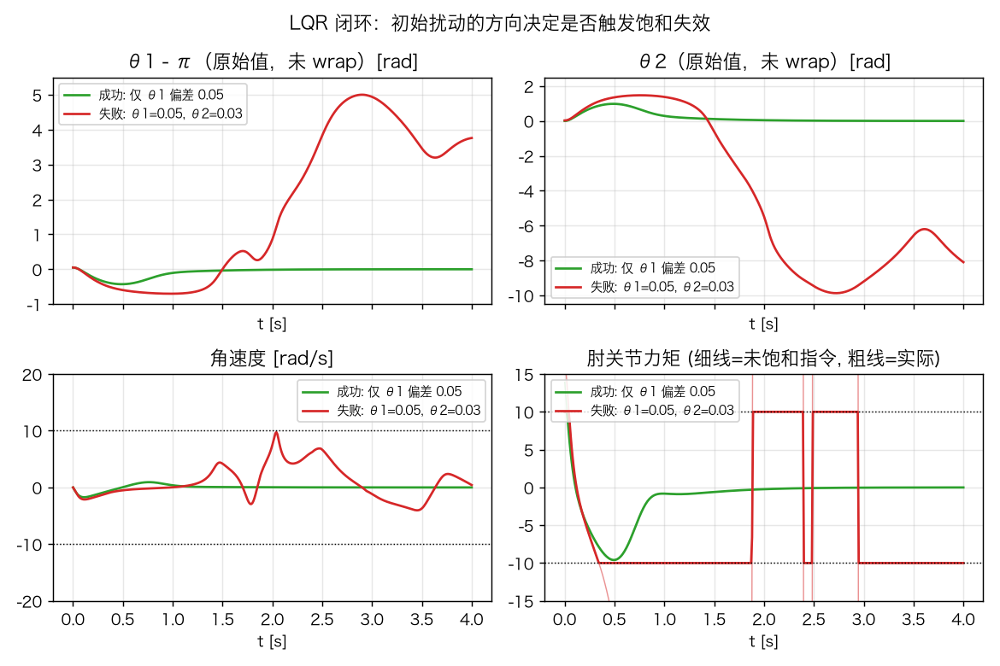
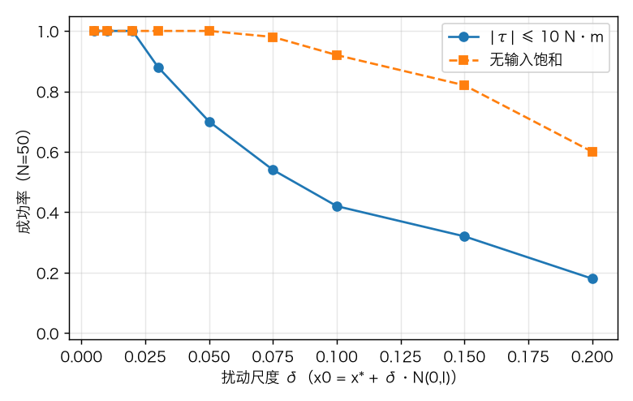
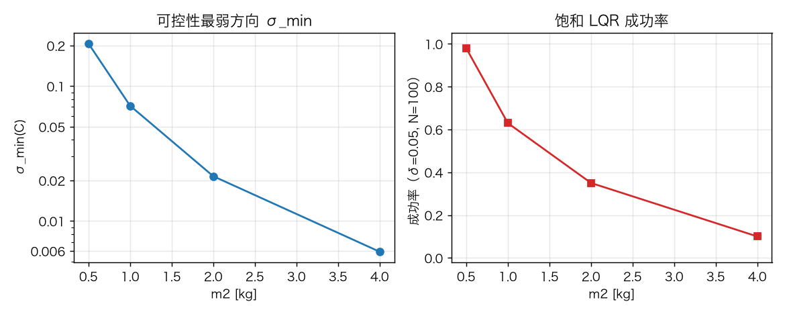

# Acrobot 作业解答：运行结果、理论解读与敏感性分析

> 对应 notebook：[Exp3'1-acrobot.ipynb](Exp3'1-acrobot.ipynb)（含分析 cell 的副本：[Exp3'1-acrobot-analysis.ipynb](Exp3'1-acrobot-analysis.ipynb)）；课程笔记：`Ch3_Acrobot_CartPole_Quadrotor_深度推导笔记.md` §3.1、§3.4。
> 运行环境：`/Users/leo/venvs/drake/bin/python`，Drake 1.58.0，underactuated 2026.9.8。
> 全部数值可用 `exp1_analysis/exp1_analysis.py` 复现，原始数据在 `exp1_analysis/results.json`。

模型：肩关节无电机、肘关节有电机（$u=\tau$）的两连杆欠驱动系统

$$
M(q)\ddot q + C(q,\dot q)\dot q + G(q) = \begin{bmatrix}0\\ u\end{bmatrix},
\qquad x=[\theta_1,\theta_2,\dot\theta_1,\dot\theta_2]^\top,\quad x^*=[\pi,0,0,0]^\top .
$$

---

## 1. 第一个演示（cell 5）：恒定肘力矩下的动力学

**运行现象.** 初始状态 $x_0=[1,0,0,0]$（肩关节偏离下垂 1 rad，肘伸直）。滑块 $u=0$ 时，重力使其摆下并持续摆动（阻尼很小，$b_1=b_2=0.1$）；拖动滑块施加恒定力矩后，摆动幅度和平衡位置都发生变化，关节响应呈现出明显的"甩动"，而不是肩关节直接转动。

**理论解释.**

1. 肩关节没有驱动器，$\theta_1$ 只能通过动力学耦合被"间接"驱动。质量矩阵 $M(q)$ 的非对角项把肘力矩传递到肩关节，因此肘力矩会同时改变两个关节，这是欠驱动系统的典型特征。
2. 对任意 $u\neq 0$，竖直位置 $(\pi,0)$ **不再是平衡点**：平衡条件是 $G(q)=[0,u]^\top$，而在 $(\pi,0)$ 处 $G=0$、第二分量要求 $u=0$。所以恒定力矩必然使机器人偏离竖直位，最终在某个"倾斜平衡点"附近振荡，而**不可能靠恒定力矩把 Acrobot 平衡在顶端**。稳定在 $x^*$ 必须依赖状态反馈（见 §3）。
3. 这也是本章后续"能量整定 + LQR"两阶段控制思路的动机：先用摆动能量的方式把系统"甩"到顶端附近，再由局部控制器接管。

---

## 2. 可控性分析（cell 8）

### 2.1 实际运行输出

Drake `AcrobotPlant` 的默认参数（从 context 读出，注意与课程笔记的参数不同）：

| 参数 | 值 | 参数 | 值 |
| --- | --- | --- | --- |
| $m_1,m_2$ | 1.0, 1.0 kg | $l_1,l_2$ | 1.0, 2.0 m |
| $l_{c1},l_{c2}$ | 0.5, 1.0 m | $I_{c1},I_{c2}$（绕质心） | 0.083, 0.33 kg·m² |
| $b_1,b_2$ | 0.1, 0.1 | $g$ | 9.81 m/s² |

在 $x^*$ 处线性化得到

$$
A=\begin{bmatrix}
0&0&1&0\\
0&0&0&1\\
12.6292&-12.6926&-0.1721&0.3015\\
-14.7488&29.6119&0.3015&-0.6033
\end{bmatrix},\qquad
B=\begin{bmatrix}0\\0\\-3.0147\\6.0332\end{bmatrix}.
$$

开环特征值：$-6.492,\;-2.249,\;+2.231,\;+5.734$（两正两负，竖直位不稳定）。

能控性矩阵 $\mathcal C=[B,AB,A^2B,A^3B]$ 的奇异值：

$$
\boxed{\sigma(\mathcal C)=[\,511.72,\;123.08,\;0.0807,\;0.0715\,]},\qquad
\operatorname{rank}\mathcal C=4,\qquad \operatorname{cond}\approx 7.15\times10^3 .
$$

即 notebook 打印的结果：**秩为 4（完全可控），但后两个奇异值比最大的小约 4 个数量级**。

### 2.2 模态解释

对 $A$ 做模态分解 $x=Vr$，$\dot r=\Lambda r+(V^{-1}B)u$。各模态的输入参与因子 $|(V^{-1}B)_i|$ 为：

| 开环特征值 | $-6.492$ | $-2.249$ | $+2.231$ | $+5.734$ |
| --- | --- | --- | --- | --- |
| 模态 | 快稳定 | 慢稳定 | 快不稳定 | 慢不稳定 |
| $\lvert\beta_i\rvert$ | 3.62 | **0.048** | 3.21 | **0.048** |

慢模态（$\lambda\approx\pm2.25$）的输入参与度只有快模态的约 $1/75$，正是它们对应着 $\mathcal C$ 的两个小奇异值。因此"弱可控"不是说不能控，而是说**沿这些方向驱动需要非常大的输入/很长的轨迹**——这与 §4 中饱和导致失败的结论直接相连。

每个特征值处的 PBH 秩 $\operatorname{rank}[\lambda_i I-A,\ B]=4$，从另一个角度确认了模态层面没有"完全不可控"的模态。

### 2.3 两点重要评论

1. **欠驱动 ≠ 不可控。** 肩关节没有电机，但线性化系统仍满秩可控（与笔记 §3.4.5 的结论一致）。欠驱动限制的是"能否跟踪任意轨迹"，并不意味着不能到达任意状态。反过来说，可镇定性（§3.4.6）也成立，因为 $(A,B)$ 可控。
2. **奇异值的绝对值依赖状态单位与坐标选取。** 角度用 rad、角速度用 rad/s，两者量纲不同，$\mathcal C$ 的奇异值会随单位缩放而改变，因此本文把 $[511,123,0.08,0.07]$ 只作为**定性指标**使用；更严格的做法是做状态归一化/平衡实现后比较 Gramian，或直接比较模态参与因子 $|\beta_i|$（后者同样对坐标尺度敏感，但物理含义更清楚）。

---

## 3. LQR 镇定（cell 9）

### 3.1 设计结果

取 $Q=\operatorname{diag}(10,10,1,1)$，$R=1$，在 $x^*$ 处解 ARE 得到（控制器形式 $u=D\,(x-x^*)$）：

$$
\boxed{D=[\,278.44,\;112.29,\;119.72,\;56.83\,]} .
$$

闭环特征值：

$$
\lambda_{\rm cl}=-10.126,\quad -4.238,\quad -2.242\pm0.039j,
$$

全部在左半平面。按笔记 §3.4.4 的第一条结论，线性化在原点局部指数稳定，因此**只要初始偏差足够小且不触发饱和**，非线性闭环会收敛到 $x^*$。

### 3.2 仿真结果（notebook 原代码）

用与 notebook 完全相同的结构（`Saturation(±10)`、`WrapToSystem`、$x_0=x^*+0.05\,\mathcal N(0,I_4)$、$T=4$ s）做统计：

| 条件 | 成功率 | 备注 |
| --- | --- | --- |
| notebook 5 次试验（固定随机种子复现） | **4/5** | 单次结果波动大 |
| 100 次随机试验，$\lvert\tau\rvert\le10$ N·m | **63/100** | 前 0.5 s 峰值指令中位数 11.2 N·m，90 分位 29.7 N·m |
| 100 次随机试验，**无饱和** | **98/100** | 同样的初始扰动 |

成功的试验中，状态最大偏离角（$\sqrt{\delta\theta_1^2+\delta\theta_2^2}$ 的峰值）中位数为 **0.855 rad ≈ 49°**，调节时间中位数 1.63 s。

**结果解读（关键）：**

1. **线性 LQR 是局部结论。** 无饱和时 98% 成功，说明在 $x^*$ 附近线性化确实有效；但代码里加入了 $\pm10$ N·m 的物理饱和，问题就变成了**带输入约束的非线性镇定**，LQR 的最优性/稳定性保证不再成立。100 次中约 37 次失败，全部是机器人最终大幅摆离顶端/持续旋转，而不是"收敛慢"。
2. **饱和在初始阶段就被触发。** 初始指令中位数已经超过 10 N·m；虽然饱和时间占比很小（前 0.5 s 中位数约 2%），但恰好发生在最关键的"先把状态拉回"阶段，足以改变轨迹走向。
3. **非最小相位导致大偏移。** 该线性化有两个右半平面零点（$u\to\theta_1$：$\pm2.052$；$u\to\theta_2$：$+2.283$、$-2.304$）。由笔记 §3.4.8，状态反馈不改变零点，因此闭环仍是非最小相位系统：有些误差必须**先让状态远离原点**才能最终收回。Fig. 1 的成功轨迹中，仅 $\theta_1$ 偏差 0.05 rad 时，肘角 $\theta_2$ 先摆到约 1 rad 再回零，这就是"undershoot"的直观体现；失败轨迹则在回摆过程中触发持续饱和，最终翻转。



*Fig. 1：绿线（成功）只有 0.05 rad 的肩角偏差；红线（失败）额外有 0.03 rad 肘角偏差。注意绿线的肘角先大幅远离再收敛（非最小相位），红线的力矩在 ±10 N·m 间反复饱和并最终失控。*

---

## 4. 敏感性分析

> 方法：固定 $Q,R$ 与控制器结构，只改一个因素；每个条件 $N=50$ 或 $N=100$ 次随机扰动，初始状态 $x_0=x^*+\delta\,\mathcal N(0,I_4)$。成功判据：$t=4$ s 时 $|\delta\theta_1|,|\delta\theta_2|<0.05$ rad 且 $|\dot\theta_1|,|\dot\theta_2|<0.2$ rad/s。随机种子固定，因而可重复。

### 4.1 初始扰动尺度 $\delta$

| $\delta$ | 0.005 | 0.01 | 0.02 | 0.03 | 0.05 | 0.075 | 0.10 | 0.15 | 0.20 |
| --- | --- | --- | --- | --- | --- | --- | --- | --- | --- |
| 成功率（$\pm10$ N·m） | 1.00 | 1.00 | 1.00 | 0.88 | 0.70 | 0.54 | 0.42 | 0.32 | 0.18 |
| 成功率（无饱和） | 1.00 | 1.00 | 1.00 | 1.00 | 1.00 | 0.98 | 0.92 | 0.82 | 0.60 |
| 前 0.5 s 峰值指令中位数 [N·m] | 1.2 | 2.4 | 4.8 | 7.1 | 11.9 | 20.6 | 26.4 | — | — |

> $\delta\ge0.15$ 时失败轨迹本身已经发散，反馈增益会把（无界的）状态误差放大成极大的力矩指令，峰值统计不再有参考意义，故不列出。



*Fig. 2：有/无输入饱和的吸引域对比。*

**结论.**

- 小扰动（$\delta\le0.02$）时 LQR 几乎 100% 成功，验证了局部稳定性；
- 扰动增大后成功率单调下降，说明**吸引域有限**；即使去掉饱和，非线性和非最小相位仍会使 $\delta\gtrsim0.1$ 时失败（0.92→0.60）；
- 饱和使吸引域进一步显著收缩（$\delta=0.05$：1.00→0.70；$\delta=0.1$：0.92→0.42）。因此"LQR 能镇定 Acrobot"这一结论必须附带**工作范围/输入约束**才有工程意义。
- 吸引域边界不是球形的：Fig. 1 中同为 0.05 量级的扰动，仅肩角偏差能成功，叠加 0.03 rad 肘角偏差即失败。原因是饱和由 $|D\delta|$ 决定，而 $D$ 各分量权重差别很大。

### 4.2 LQR 权重 $R$ 与 $Q$

| $R$ | 0.1 | 1 | 10 | 100 |
| --- | --- | --- | --- | --- |
| $\lVert D\rVert$ | 577.1 | 328.2 | 289.7 | 285.5 |
| 闭环极点 | $-22.8,\,-3.38,\,-2.25\pm0.08j$ | $-10.13,\,-4.24,\,-2.24\pm0.04j$ | $-7.22,\,-5.24,\,-2.24\pm0.01j$ | $-6.60,\,-5.65,\,-2.25,\,-2.25$ |
| 成功率（$\delta=0.05$） | 0.65 | 0.63 | 0.62 | 0.62 |
| 峰值指令中位数 [N·m] | 19.8 | 11.2 | 9.8 | 9.7 |

| 角度权重 $Q_\theta$（$Q=\operatorname{diag}(w,w,1,1)$） | 1 | 10 | 100 |
| --- | --- | --- | --- |
| $\lVert D\rVert$ | 303.9 | 328.2 | 488.9 |
| 成功率 | 0.65 | 0.63 | 0.61 |
| 峰值指令中位数 [N·m] | 10.3 | 11.2 | 16.8 |

**结论.**

- **增大 $R$ 并不能把增益降到任意小。** 当 $R\to\infty$（"昂贵控制"极限）时，闭环极点趋于开环稳定极点与不稳定极点的镜像，即 $\{-6.49,-2.25\}$ 与 $\{-5.73,-2.23\}$，因此 $D$ 收敛到有限值（这里约 285），而不是趋于 0。物理上：Acrobot 在顶端开环不稳定，必须至少用足以镇定不稳定模态的力矩，才能保持平衡。
- 因此 $R$ 从 1 增到 100 时，成功率几乎不变（0.63→0.62），峰值力矩仅从 11.2 降到 9.7 N·m。**但在实际系统中，若执行器饱和更严格，较小的指令峰值仍有价值**；在本例 $\pm10$ N·m 下差别不明显。
- 减小 $R$（0.1）会显著提高增益与力矩，使饱和更严重。提高角度权重（$w=100$）同理：控制更"激进"，峰值指令升到 16.8 N·m，成功率略降。
- 与笔记 §3.4.7 一致：LQR 对无约束线性模型最优，但**不保证最大化非线性吸引域**；想在饱和下获得更大吸引域，需要显式考虑约束（如 MPC）或鲁棒控制。

### 4.3 物理参数：末端质量 $m_2$ 与质心距 $l_{c2}$

| $m_2$ [kg] | 0.5 | 1.0 | 2.0 | 4.0 |
| --- | --- | --- | --- | --- |
| $\sigma_{\min}(\mathcal C)$ | 0.207 | 0.0715 | 0.0215 | **0.0059** |
| $\operatorname{cond}(\mathcal C)$ | $1.52\times10^3$ | $7.15\times10^3$ | $4.24\times10^4$ | $2.89\times10^5$ |
| $\lVert D\rVert$ | 153.2 | 328.2 | 864.3 | **2655.7** |
| 成功率（$\delta=0.05$） | 0.98 | 0.63 | 0.35 | **0.10** |
| 峰值指令中位数 [N·m] | 5.1 | 11.2 | 47.8 | 317.0 |

| $l_{c2}$ [m] | 0.5 | 1.0 | 1.5 |
| --- | --- | --- | --- |
| $\sigma_{\min}(\mathcal C)$ | 0.179 | 0.0715 | 0.0411 |
| $\lVert D\rVert$ | 222.8 | 328.2 | 418.7 |
| 成功率（$\delta=0.05$） | 0.70 | 0.63 | 0.62 |



*Fig. 3：末端质量增大时，最弱可控方向的奇异值快速下降，饱和 LQR 的成功率随之崩塌。*

**结论.**

- $m_2$ 从 0.5 kg 增到 4 kg 时，$\sigma_{\min}(\mathcal C)$ 下降约 **35 倍**，条件数上升约 **190 倍**，LQR 需要把增益提高到约 17 倍，峰值力矩提高约 60 倍，成功率由 98% 跌到 10%。
- 直观解释：$B=M^{-1}[0,1]^\top$，末端质量/惯量越大，$M$ 越大，同样力矩产生的加速度越小，输入对状态的"杠杆"越弱——这正是"弱可控"的物理来源。
- $l_{c2}$ 的影响弱得多：它同时增大惯量与重力力矩，两种效应部分抵消，因此可控性指标变差但成功率只小幅下降。这说明**末端质量是更关键的设计参数**：如果要在真实硬件上做平衡控制，应尽量减轻末端质量或提高肘关节力矩上限。
- 对课程作业的启示：分析"能不能控"不能只看秩，还要看**奇异值/条件数**和**执行器约束**；秩=4 只说明理论可行，$m_2$ 增大后实际可能已经"控不动"。

### 4.4 与讲义参数的对照（验证 + 参数敏感性）

课程笔记 §3.4.2 取 $m_1=m_2=l_1=1$、$l_{c1}=l_{c2}=0.5$、绕轴惯量 $I_1=I_2=0.25$、无阻尼。把这些参数换算成 Drake 的绕质心惯量（$I_{c}=I-m l_c^2$）后重新运行，得到

$$
A=\begin{bmatrix}
0&0&1&0\\0&0&0&1\\19.62&-39.24&0&0\\-39.24&137.34&0&0
\end{bmatrix},\quad
B=\begin{bmatrix}0\\0\\-12\\40\end{bmatrix},
$$

特征值 $\pm12.2156,\ \pm2.7819$，与笔记 §3.4.2 **完全一致**；零点为 $u\to\theta_1$：$\pm2.557$，$u\to\theta_2$：$\pm2.801$，也与笔记 §3.4.8 的 $\pm2.56,\pm2.80$ 一致。这验证了讲义推导与 Drake 模型的一致性。

但该参数下 $\sigma(\mathcal C)=[6231.8,6231.8,0.1007,0.1007]$、$\operatorname{cond}\approx6.19\times10^4$，与 Drake 默认参数的 $[511.7,123.1,0.0807,0.0715]$ 不同。**结论：奇异值的具体数值对物理参数（以及状态单位）非常敏感，不能跨模型直接比较绝对大小；"秩满 + 最小奇异值比最大奇异值小 3~4 个数量级"这一"弱可控"的定性结论则保持不变。** 写报告时应说明所用参数，否则数值没有可比性。

---

## 5. 总结

1. **模型层面**：Acrobot 肩关节无驱动，但线性化后 $(A,B)$ 满秩可控、可镇定；竖直平衡点开环不稳定（两正特征值）。
2. **可控性**：$\operatorname{rank}\mathcal C=4$，但 $\sigma_{\min}/\sigma_{\max}\sim10^{-3.8}$，慢模态的输入参与因子很小，属于"弱可控"；奇异值的大小依赖参数与单位，应结合模态参与因子和物理参数解读。
3. **LQR**：$Q=\operatorname{diag}(10,10,1,1)$、$R=1$ 时 $D=[278,112,120,57]$，闭环极点全部在左半平面，局部指数稳定；无饱和时 98% 的 0.05 量级扰动可在 4 s 内镇定，状态最大偏离约 0.86 rad——非最小相位（右半平面零点）导致"先远离再回来"。
4. **饱和与吸引域**：加入 $\pm10$ N·m 饱和后成功率降到约 63%；扰动增大时成功率单调下降，饱和显著收缩吸引域。LQR 的稳定性是**局部**结论，不能把"无约束线性最优"直接等同于"带约束非线性全局可用"。
5. **参数敏感性**：末端质量 $m_2$ 是最敏感的物理参数（$\sigma_{\min}$ 下降 35 倍、成功率 98%→10%）；$l_{c2}$ 影响较弱；增大 $R$ 不能无限降低增益（昂贵控制极限），对成功率改善有限。
6. **工程含义**：真实 Acrobot 的平衡控制需要（i）先做摆起/能量整定把状态送入吸引域，（ii）在顶端附近用局部控制器，（iii）显式考虑力矩上限并评估吸引域，或采用 MPC/鲁棒控制。

---

## 6. 复现方式

```bash
cd "Embodied-AI/Ch.3-examples/exp1_analysis"
/Users/leo/venvs/drake/bin/python exp1_analysis.py
```

输出：`results.json`（全部数值）、`figures/fig1~fig4`（本文图）。notebook 本身的 cell 8/9 输出可用 `Exp3'1-acrobot.ipynb` 直接运行得到；`Exp3'1-acrobot-analysis.ipynb` 里追加了与本报告对应的分析 cell；cell 5 的交互演示需在浏览器打开 MeshCat 页面，用滑块施加力矩、点击 "Stop Simulation" 结束。

> 说明：表中成功率来自有限样本（$N=50/100$）的蒙特卡洛统计，不同随机种子会有几个百分点的波动；notebook 原始代码只跑 5 次且不检查成败，因此"看到某次失败"是正常现象，不是代码错误。
