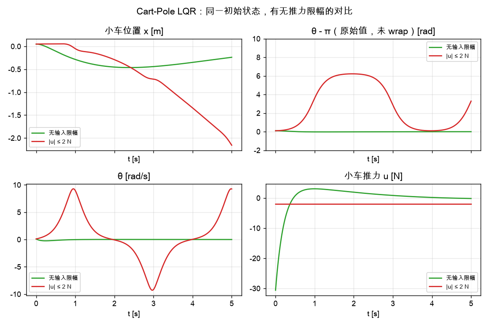
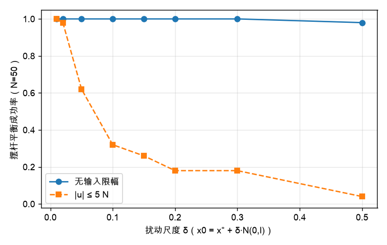
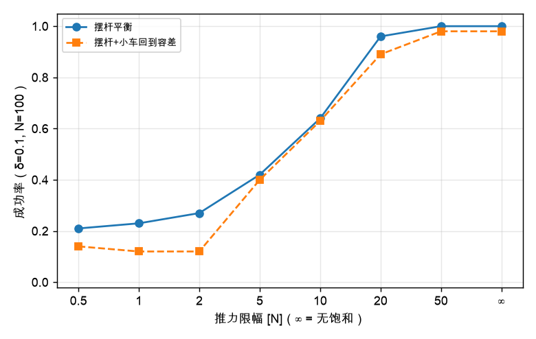
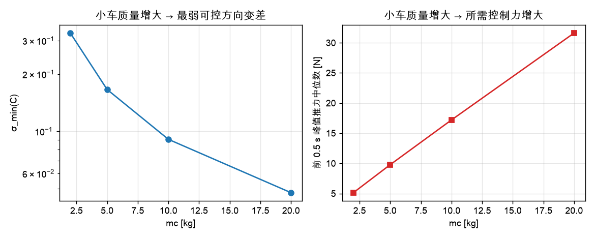

# Cart-Pole 作业解答：运行结果、理论解读与敏感性分析

> 对应 notebook：[Exp3'2-cartpole.ipynb](Exp3'2-cartpole.ipynb)（含分析 cell 的副本：[Exp3'2-cartpole-analysis.ipynb](Exp3'2-cartpole-analysis.ipynb)）；课程笔记：`Ch3_Acrobot_CartPole_Quadrotor_深度推导笔记.md` §3.2、§3.4。
> 运行环境：`/Users/leo/venvs/drake/bin/python`，Drake 1.58.0，underactuated 2026.9.8。
> 全部数值可用 `exp3_2_analysis/cp_analysis.py` 复现，原始数据在 `exp3_2_analysis/results.json`。

模型（`underactuated/models/cartpole.urdf`）：小车质量 $m_c=10$ kg，摆杆质量 $m_p=1$ kg，质心距 $l_c=0.5$ m，重力 $9.81$ m/s²，关节无阻尼；状态取
$x=[x,\theta,\dot x,\dot\theta]^\top$，输入为小车推力 $u=F_x$，目标平衡点 $x^*=[0,\pi,0,0]^\top$（摆杆竖直向上，小车在原点）。

> 注：本文把"摆杆平衡成功"与"完整状态（含小车回中）成功"分开统计。
> 摆杆平衡：$t=5$ s 时 $|\theta-\pi|<0.05$ rad 且 $|\dot\theta|<0.2$ rad/s；
> 完整状态：在此基础上还要求 $|x|<0.5$ m 且 $|\dot x|<0.5$ m/s。
> 这样区分是因为 LQR 闭环中"小车位置"对应一对很慢的极点，5 s 内不一定回到原点，但这不代表摆杆没稳住。

---

## 1. 演示（cell 5）：推力作用下的摆

**运行现象.** 初始状态 $[0,1,0,0]$，即摆杆偏离下垂约 1 rad。没有手柄时使用 MeshCat 滑块施加推力：小车被推动后，摆杆通过铰链被动摆动；来回改变推力方向可以逐渐把摆杆"甩"起来。

**理论解释.**

1. 系统欠驱动：只有一个小车推力，却要同时控制小车位置和摆杆角度两个自由度；摆杆角加速度只能通过小车加速度的耦合产生。
2. 恒定推力不会使系统静止在某个"竖直"位置（竖直位需要 $u=0$ 且无扰动）；要起摆必须周期性地泵入能量，这也是本章后续"能量整定/摆起 + LQR 平衡"两阶段策略的动机。
3. 若插上手柄，`GamepadTeleop` 直接读取左摇杆作为推力，实质与滑块相同。

---

## 2. 线性化与可控性（cell 7）

### 2.1 实际运行输出

在 $x^*$ 处线性化得到

$$
A=\begin{bmatrix}
0&0&1&0\\
0&0&0&1\\
0&0.981&0&0\\
0&21.582&0&0
\end{bmatrix},\qquad
B=\begin{bmatrix}0\\0\\0.1\\0.2\end{bmatrix}.
$$

开环特征值：$\pm4.6456,\;0,\;0$。能控性矩阵的奇异值：

$$
\boxed{\sigma(\mathcal C)=[\,4.3257,\;4.3257,\;0.0907,\;0.0907\,]},\qquad
\operatorname{rank}\mathcal C=4,\qquad \operatorname{cond}\approx 47.7 .
$$

每个不同特征值处的 PBH 秩均为 4。零点（Rosenbrock 铅笔）为：

- $u\to x$：$\pm4.4294$（其中 $+4.43$ 位于右半平面）；
- $u\to\theta$：$0,\;0$（原点处二重零点，相对阶为 2）。

### 2.2 理论解读

1. **两个零特征值**来自小车位置：$x$ 没有重力回复力，是一个"积分链"；它本身不稳定也不发散，但与摆杆耦合后是可控的。这与笔记 §3.4.3 的归一化模型 $A$ 中 $s^2(s^2-2)$ 的结构一致。
2. **满秩但弱可控**：$\operatorname{rank}\mathcal C=4$，但两个奇异值只有 0.09，约为另两个的 $1/48$。它们对应的正是小车位置方向的慢模态。需要注意，$\sigma(\mathcal C)$ 的量纲依赖状态单位（m、rad、m/s、rad/s），绝对数值只作定性参考。
3. **非最小相位**：$u\to x$ 存在右半平面零点 $+4.43$。由笔记 §3.4.8，状态反馈不改变零点，因此闭环仍是非最小相位系统。物理上：要把摆杆往一个方向拉回，小车必须先向相反方向加速；这解释了下面仿真中小车的"反向偏移"（0.1 的扰动会引起约 0.3 m 的小车反向运动）。

### 2.3 与讲义归一化模型对照

取 $m_c=m_p=1$、$l_c=1$、$g=1$ 时（通过 `MultibodyPlant` 的 context 参数修改），线性化结果与笔记 §3.4.3 完全一致：

$$
A=\begin{bmatrix}0&0&1&0\\0&0&0&1\\0&1&0&0\\0&2&0&0\end{bmatrix},\quad
B=\begin{bmatrix}0\\0\\1\\1\end{bmatrix},
$$

特征值 $\pm\sqrt2,0,0$，零点 $\pm1$。取 $Q=\operatorname{diag}(10,10,1,1)$、$R=1$ 时

$$
K=-D=[-3.1623,\;16.1213,\;-9.5032,\;14.7870],
$$

闭环极点为 $-1.8895\pm1.0062j,\;-0.7523\pm0.3522j$，与笔记 §3.4.3 的数值**逐位一致**。这说明 URDF 模型、Drake 线性化和笔记推导三者是对得上的。

---

## 3. LQR 镇定（cell 7）

### 3.1 设计结果（默认参数）

$$
\boxed{D=[\,3.1623,\;-254.3925,\;9.7692,\;-55.1774\,]},\qquad u=D\,(x-x^*).
$$

闭环极点为

$$
-4.7206,\quad -4.5739,\quad -0.3820\pm0.3761j .
$$

两个快极点对应摆杆的快速回正；一对慢复极点对应**小车位置回中**，其时间常数约 $1/0.382\approx2.6$ s。因此 5 s 的仿真时域只覆盖约两个时间常数，小车往往还没完全回到原点，而摆杆早已稳定。

### 3.2 仿真统计

| 条件 | 摆杆平衡 | 完整状态 | 峰值推力（中位 / 90 分位 / 最大） |
| --- | --- | --- | --- |
| notebook 5 次试验复现 | 5/5 | 5/5 | 16.5 N |
| 100 次随机试验，无推力限幅 | **100%** | **98%** | 17.2 / 40.0 / 64.6 N |

- 摆杆调节时间中位数约 **0.18 s**；
- 小车最大反向偏离中位数 **0.295 m**，5 s 时 $|x|$ 中位数 0.142 m——慢模态尚未完全收敛；
- 初始扰动为 $x_0=x^*+0.1\,\mathcal N(0,I_4)$，与 notebook 完全一致。

**结论.** 原 notebook 的 LQR 演示没有输入饱和，100 次随机扰动中摆杆全部平衡；代码里 5 次试验全部成功也就不奇怪。但这个"成功"依赖**无约束推力**：峰值推力中位数约 17 N，90 分位约 40 N，最大约 65 N。对于真实小车电机，这是一个不能忽略的约束。



*Fig. 1：同一初始状态，无限幅（绿）时摆杆回正、小车先反向再回中；±2 N 限幅（红）时推力不足，摆杆越过顶端后持续旋转，系统失控。*

---

## 4. 敏感性分析

> 方法：固定 $Q,R$ 与控制器结构，只改一个因素；每个条件 $N=50$ 或 $N=100$ 次随机扰动，$x_0=x^*+\delta\,\mathcal N(0,I_4)$，$T=5$ s。随机种子固定，可重复。

### 4.1 初始扰动尺度 δ

| $\delta$ | 0.01 | 0.02 | 0.05 | 0.10 | 0.15 | 0.20 | 0.30 | 0.50 |
| --- | --- | --- | --- | --- | --- | --- | --- | --- |
| 摆杆平衡（无饱和） | 100% | 100% | 100% | 100% | 100% | 100% | 100% | 98% |
| 摆杆平衡（$\lvert u\rvert\le5$ N） | 100% | 98% | 62% | 32% | 26% | 18% | 18% | 4% |
| 完整状态（无饱和） | 100% | 100% | 100% | 98% | 84% | 68% | 46% | 38% |
| 峰值推力中位数 [N] | 2.1 | 4.1 | 10.3 | 20.7 | 31.0 | 41.3 | 62.0 | 103.3 |



*Fig. 2：无输入限幅时，LQR 在 $\delta\le0.3$ 范围内几乎总能稳住摆杆；加入 $\pm5$ N 限幅后，吸引域迅速缩小。*

**解读.**

- 无饱和时，摆杆平衡对扰动非常鲁棒（到 $\delta=0.5$ 仍有 98%），说明 LQR 在该平衡点附近的局部吸引域很大（这里的能控性条件数也远好于 Acrobot）；
- 但"完整状态"成功率随 δ 增大而下降，主要原因是小车回中越来越慢（5 s 内 $|x|$ 超过 0.5 m），而不是摆杆倒了；
- 一旦加入 $\pm5$ N 限幅，失败就是真正的摆杆失控（Fig. 1），说明**执行器能力**是这里最关键的限制，而不是线性化本身。

### 4.2 LQR 权重 R 与 Q

| $R$ | 0.01 | 0.1 | 1 | 10 | 100 |
| --- | --- | --- | --- | --- | --- |
| $\lVert D\rVert$ | 383.7 | 297.7 | 260.5 | 242.2 | 232.5 |
| 慢极点 | $-1.258\pm1.082j$ | $-0.689\pm0.656j$ | $-0.382\pm0.376j$ | $-0.214\pm0.213j$ | $-0.120\pm0.120j$ |
| 峰值推力中位数 [N] | 25.5 | 19.6 | 17.2 | 16.1 | 15.6 |
| 摆杆平衡成功率 | 100% | 100% | 100% | 100% | 100% |
| 完整状态成功率 | 100% | 100% | 98% | 55% | 37% |
| 5 s 时 $\lvert x\rvert$ 中位数 [m] | 0.00 | 0.00 | 0.14 | 0.46 | 0.78 |

**解读.**

- 增大 $R$ 使控制器更"省力"：增益、峰值推力下降，但下降幅度有限——当 $R\to\infty$ 时，闭环极点趋于开环稳定极点与不稳定极点的镜像（快极点趋近 $-4.65$），所以增益存在一个下限（约 232），不会趋于 0。这是不稳定系统"昂贵控制极限"的体现。
- 摆杆平衡对 $R$ 不敏感（全部 100%）；真正变化的是**小车回中速度**：$R$ 越大，控制器越不愿意为了小车位置使用推力，慢极点越靠近原点（$R=100$ 时 $-0.12$，时间常数约 8 s），5 s 内自然回不来。
- 角度权重 $Q_\theta$ 在 1–100 范围内几乎没有影响：$\lVert D\rVert$ 从 260.47 变到 260.89，峰值推力不变。原因是摆杆很轻、角度方向的增益本来就很大，控制代价 $R$ 已经把这个方向"卡住"了；只有把 $Q_\theta$ 提到 $10^4$ 量级，角度增益才会明显上升。
- 工程上：若关心小车回中，应减小 $R$ 或增大 $x$ 的权重，但要接受更大的推力；若只关心摆杆平衡，$R$ 可以在较大范围内选取。

### 4.3 推力限幅（原代码没有，但物理上必须有）

| 限幅 $F$ [N] | 0.5 | 1 | 2 | 5 | 10 | 20 | 50 | ∞ |
| --- | --- | --- | --- | --- | --- | --- | --- | --- |
| 摆杆平衡成功率 | 21% | 23% | 27% | 42% | 64% | **96%** | 100% | 100% |
| 完整状态成功率 | 14% | 12% | 12% | 40% | 63% | 89% | 98% | 98% |
| $\max\lvert x\rvert$ 中位数 [m] | 0.58 | 1.03 | 2.16 | 5.25 | 0.36 | 0.30 | 0.30 | 0.30 |



*Fig. 3：δ=0.1 时，推力上限对摆杆平衡与完整状态成功率的影响。*

**解读.**

- 该例的 LQR 需要约 17 N（中位）的峰值推力；限幅降到 10 N 以下时，饱和会破坏非最小相位所需的"先反向再回拉"轨迹，摆杆随即失控。
- 限幅过低（≤5 N）时还出现"小车越跑越远"的分支：控制器长期饱和，无法同时回中，$\max|x|$ 可达 5 m；因此成功率在极小限幅处不是单调的（部分初始误差很小的样本仍能勉强成功）。
- 对作业的启示：**比较控制器时必须在相同的执行器约束下比较**。原 notebook 没有饱和，展示的是理想执行器下的局部线性最优；真实系统需要把力上限纳入设计（饱和感知控制、MPC 或鲁棒控制）。

### 4.4 物理参数 $m_c$、$m_p$、$l_c$

**(a) 小车质量 $m_c$**

| $m_c$ [kg] | 2 | 5 | 10 | 20 |
| --- | --- | --- | --- | --- |
| $\sigma_{\min}(\mathcal C)$ | 0.329 | 0.166 | 0.0907 | 0.0475 |
| $\operatorname{cond}(\mathcal C)$ | 90.9 | 57.0 | 47.7 | 43.4 |
| $\lVert D\rVert$ | 79.8 | 149.4 | 260.5 | 476.6 |
| 峰值推力中位数 [N] | 5.1 | 9.8 | 17.2 | 31.6 |
| 摆杆平衡成功率 | 100% | 100% | 100% | 100% |
| 完整状态成功率 | 100% | 100% | 98% | 68% |
| 5 s 时 $\lvert x\rvert$ [m] | 0.00 | 0.04 | 0.14 | 0.32 |

**(b) 摆杆质量 $m_p$**

| $m_p$ [kg] | 0.1 | 0.5 | 1 | 2 |
| --- | --- | --- | --- | --- |
| $\sigma_{\min}(\mathcal C)$ | 0.0989 | 0.0951 | 0.0907 | 0.0830 |
| 峰值推力中位数 [N] | 16.1 | 16.6 | 17.2 | 18.6 |
| 摆杆平衡成功率 | 100% | 100% | 100% | 100% |
| 完整状态成功率 | 99% | 98% | 98% | 98% |

**(c) 摆杆质心距 $l_c$**

| $l_c$ [m] | 0.25 | 0.5 | 1.0 |
| --- | --- | --- | --- |
| $\sigma_{\min}(\mathcal C)$ | 0.0909 | 0.0907 | 0.0901 |
| $\operatorname{cond}(\mathcal C)$ | 190.1 | 47.7 | 12.1 |
| 峰值推力中位数 [N] | 17.2 | 17.2 | 17.7 |
| 摆杆平衡成功率 | 100% | 100% | 100% |
| 完整状态成功率 | 100% | 98% | 87% |
| 5 s 时 $\lvert x\rvert$ [m] | 0.09 | 0.14 | 0.22 |



*Fig. 4：小车质量增大时，最弱可控方向变差、所需推力增大。*

**解读.**

- **小车质量是最主要的参数**：$m_c$ 从 2 增到 20 kg，所需推力从约 5 N 增到 32 N，$\sigma_{\min}(\mathcal C)$ 下降约 7 倍。物理上，同样推力产生的加速度 $\sim 1/(m_c+m_p)$ 变小；控制器必须加大增益，因而更容易触及执行器上限。摆杆本身仍能平衡（无饱和时），但小车回中变慢。
- **摆杆质量影响很小**（0.1–2 kg 范围内成功率 98–100%、推力 16–19 N）：因为摆杆本来就很轻，且其重力力矩与惯量同时随质量变化，部分抵消。
- **$l_c$ 影响较弱**：更长的摆杆改善了条件数（190→12），但小车最大偏移和回中时间变大（完整状态成功率 100%→87%）；摆杆平衡不受影响。这与"长摆更慢、但更容易感知/控制角度"的直觉一致。
- 若要在真实小车上平衡这根杆，**优先关注小车质量与推力上限**；摆杆质量不是主要矛盾。

---

## 5. 总结

1. **模型与可控性**：Cart-Pole 欠驱动（1 个推力、2 个自由度），但线性化后 $(A,B)$ 满秩可控（rank 4）；开环有两个零特征值（小车位置的积分链）和两个不稳定特征值 $\pm4.65$（摆杆）。能控性矩阵的两个小奇异值对应小车位置方向，说明它"可控但弱"。
2. **非最小相位**：$u\to x$ 有右半平面零点 $+4.43$，状态反馈不能消除；闭环必须让小车先向相反方向移动再回拉，导致约 0.3 m 的反向偏移。
3. **LQR**：$D=[3.16,-254.39,9.77,-55.18]$，闭环极点 $-4.72,-4.57,-0.382\pm0.376j$，局部指数稳定。摆杆约 0.2 s 回正；小车位置对应慢模态，5 s 内往往尚未完全回中——这一点在评价"成功"时必须区分。
4. **原代码没有推力饱和**：100 次 0.1 级扰动中摆杆 100% 平衡，但峰值推力中位数 17.2 N、90 分位 40 N。加入真实力限幅后，限幅 20 N → 96%、10 N → 64%、5 N → 42%（摆杆平衡率），说明**执行器约束**比线性化误差更致命。
5. **参数敏感性**：$m_c$ 影响最大（推力与回中时间），$m_p$ 几乎无影响，$l_c$ 主要影响小车回中；增大 $R$ 能略降推力但显著拖慢小车回中，$Q_\theta$ 在常用范围内几乎无影响。
6. **讲义验证**：取 $m_c=m_p=1$、$l_c=1$、$g=1$ 时，$A,B$、零点 $\pm1$、LQR 增益和闭环极点与课程笔记 §3.4.3/§3.4.8 完全一致。

---

## 6. 复现方式

```bash
cd "Embodied-AI/Ch.3-examples/exp3_2_analysis"
/Users/leo/venvs/drake/bin/python cp_analysis.py
```

输出：`results.json`（全部数值）、`figures/fig1~fig4`（本文图）。notebook 本身的 cell 7 输出可用 `Exp3'2-cartpole.ipynb` 直接运行得到；`Exp3'2-cartpole-analysis.ipynb` 中追加了与本报告对应的全部分析 cell。

> 说明：所有成功率来自有限样本（$N=50/100$）的蒙特卡洛统计，不同随机种子会有几个百分点的波动；notebook 原始代码只跑 5 次且不做成败判定，看到偶尔失败/小车没完全回中都是正常的。
