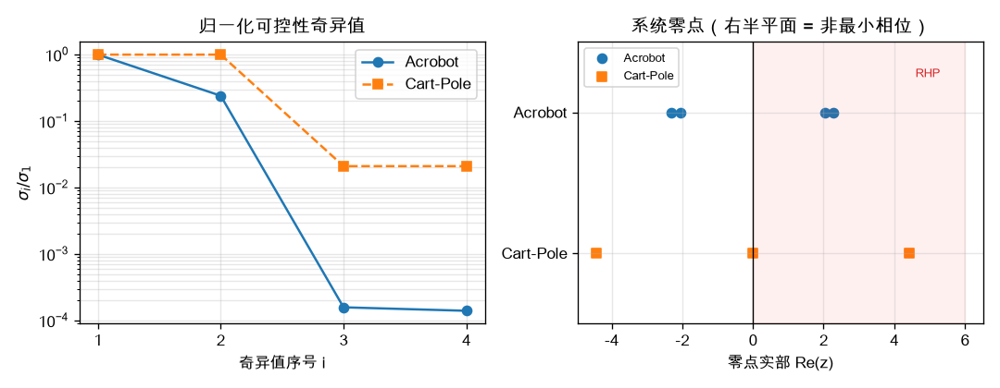
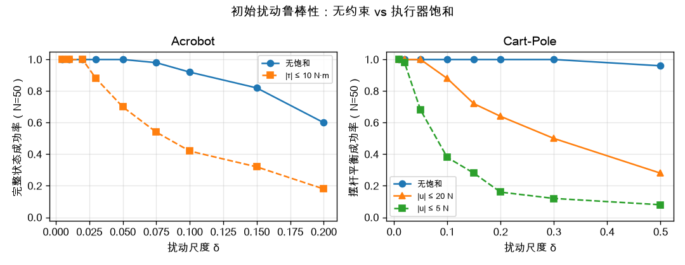
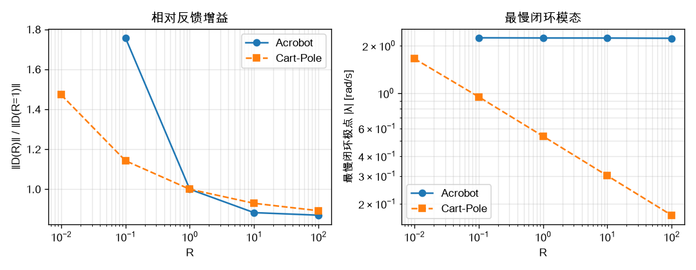
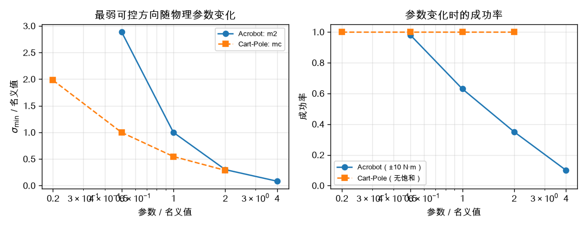

# Example 3.5 作业解答：Acrobot 与 Cart-Pole 的 LQR

> 对应实验文件：[Exp3'5-acrobot.ipynb](Exp3'5-acrobot.ipynb)、[Exp3'5-cartpole.ipynb](Exp3'5-cartpole.ipynb)（未修改）。
> 分析 notebook：[Exp3'5-LQR-analysis.ipynb](Exp3'5-LQR-analysis.ipynb)；批量脚本：[exp3_5_analysis/lqr_comparison.py](exp3_5_analysis/lqr_comparison.py)；原始数据：`exp3_5_analysis/results.json`。
> 课程笔记：`Ch3_Acrobot_CartPole_Quadrotor_深度推导笔记.md` §3.4；课件 Example 3.5: *LQR for the Acrobot and Cart-Pole*。
> 运行环境：`/Users/leo/venvs/drake/bin/python`，Drake 1.58.0。

本报告只分析 **LQR 部分**：线性化、可控性、LQR 权重、非最小相位、鲁棒性与执行器饱和；不重复讨论 MeshCat 动力学演示。

---

## 1. 两个系统与实验设置

| | Acrobot | Cart-Pole |
| --- | --- | --- |
| 状态 | $[\theta_1,\theta_2,\dot\theta_1,\dot\theta_2]$ | $[x,\theta,\dot x,\dot\theta]$ |
| 输入 | 肘关节力矩 $\tau$（肩关节无电机） | 小车推力 $F_x$ |
| 目标 | $x^*=[\pi,0,0,0]^\top$ | $x^*=[0,\pi,0,0]^\top$ |
| LQR 权重 | $Q=\operatorname{diag}(10,10,1,1)$，$R=1$ | 同左 |
| 名义扰动 | $\delta=0.05$ | $\delta=0.1$ |
| 仿真时域 | 4 s | 5 s |
| 原代码中的饱和 | $\lvert\tau\rvert\le10$ N·m | **没有**（本报告额外测试 20 N / 5 N） |
| 确定性判据 | 最终角度/角速度误差 | 摆杆平衡 / 完整状态（含小车回中）|

> 说明：两个系统的 $\delta$ 单位不同（Acrobot 是 rad 与 rad/s，Cart-Pole 还包含 m 与 m/s），因此 $\delta$ 的绝对值不能直接横向比较，只能比较**趋势**和**相对收缩幅度**。

---

## 2. 理论框架

1. **线性化与局部稳定性**：在平衡点 $x^*$ 处取 $A=\partial f/\partial x$、$B=\partial f/\partial u$。若 $\operatorname{Re}\lambda(A-BK)<0$，则非线性闭环在 $x^*$ 局部指数稳定（笔记 §3.4.4 的第一条结论）。
2. **可控性**：Kalman 秩判据 $\operatorname{rank}[B,AB,\dots,A^{n-1}B]=n$。秩只回答"能不能"，**奇异值/条件数**回答"有多难"。对 4 维状态，$\sigma_4/\sigma_1$ 越小，某些方向越需要大输入。
3. **LQR**：最小化 $\int_0^\infty (x^\top Qx+u^\top Ru)\,dt$，解 ARE 得 $K=R^{-1}B^\top P$，最优控制 $u=-K(x-x^*)$。$Q/R$ 的比值决定"状态误差"与"控制代价"的权衡。
4. **非最小相位**：若线性化传递函数存在右半平面零点，状态反馈不能消除它（零点在状态反馈下不变，笔记 §3.4.8）。闭环会先向"错误方向"运动，表现为明显的反向偏移和有限的吸引域。
5. **输入饱和**：LQR 的最优性/稳定性保证针对无约束线性模型；一旦执行器饱和，闭环变成带约束的非线性系统，局部结论不能直接外推，吸引域会显著缩小。

---

## 3. 线性化与可控性结果

### 3.1 Acrobot（Drake 默认参数）

$$
A=\begin{bmatrix}
0&0&1&0\\0&0&0&1\\
12.629&-12.693&-0.172&0.301\\
-14.749&29.612&0.301&-0.603
\end{bmatrix},\quad
B=\begin{bmatrix}0\\0\\-3.0147\\6.0332\end{bmatrix},
$$

开环特征值 $-6.49,-2.25,+2.23,+5.73$；能控性奇异值

$$
\sigma(\mathcal C)=[511.7,\;123.1,\;0.0807,\;0.0715],\quad \operatorname{cond}\approx7.15\times10^3 .
$$

RHP 零点：$u\to\theta_1$ 为 $+2.05$，$u\to\theta_2$ 为 $+2.28$。

### 3.2 Cart-Pole（URDF 默认参数）

$$
A=\begin{bmatrix}
0&0&1&0\\0&0&0&1\\
0&0.981&0&0\\
0&21.582&0&0
\end{bmatrix},\quad
B=\begin{bmatrix}0\\0\\0.1\\0.2\end{bmatrix},
$$

开环特征值 $0,0,\pm4.65$；能控性奇异值

$$
\sigma(\mathcal C)=[4.326,\;4.326,\;0.0907,\;0.0907],\quad \operatorname{cond}\approx47.7 .
$$

RHP 零点：$u\to x$ 为 $+4.43$；$u\to\theta$ 为 $0,0$。

### 3.3 对比

| 指标 | Acrobot | Cart-Pole |
| --- | --- | --- |
| $\operatorname{rank}\mathcal C$ | 4 | 4 |
| $\operatorname{cond}\mathcal C$ | **7154** | **47.7** |
| $\sigma_{\min}/\sigma_{\max}$ | $1.4\times10^{-4}$ | $2.1\times10^{-2}$ |
| 右半平面零点 | +2.05, +2.28 | +4.43 |
| $\lVert D\rVert$（$u=D(x-x^*)$） | 328.2 | 260.5 |
| 最慢闭环 $\lvert\lambda\rvert$ | 2.242 | 0.536 |



*Fig. 1：左图为归一化奇异值（两者都满秩，但 Acrobot 的最小方向弱约 150 倍）；右图为零点分布，两者都存在右半平面零点。*

**解读.**

- 两者都**完全可控**，再次说明"欠驱动 ≠ 不可控"：Acrobot 没有肩电机，Cart-Pole 只有一个推力，但线性化后都能到达任意状态。
- Acrobot 的条件数比 Cart-Pole 差约 150 倍，说明它的"弱可控方向"更弱：肩部被动、肘部驱动的耦合效率低。
- Cart-Pole 有两个**零特征值**（小车位置的积分链），这不会破坏可控性，但会产生一对很慢的闭环极点（见 §4）。

---

## 4. LQR 设计与基线成绩

### 4.1 反馈增益与闭环极点

| | Acrobot | Cart-Pole |
| --- | --- | --- |
| $D$（$u=D(x-x^*)$） | $[278.44,112.29,119.72,56.83]$ | $[3.16,-254.39,9.77,-55.18]$ |
| 闭环极点 | $-10.13,\,-4.24,\,-2.242\pm0.039j$ | $-4.72,\,-4.57,\,-0.382\pm0.376j$ |
| 物理含义 | 四个模态都快（最慢 2.24 rad/s） | 两个快模态 + 一对慢的**小车位置**模态 |

### 4.2 基线统计（100 次随机扰动）

| 系统 | 输入约束 | 成功率 | 峰值控制量 |
| --- | --- | --- | --- |
| Acrobot | 无饱和 | 98% | 力矩中位 11.2 N·m，90 分位 29.7 N·m |
| Acrobot | $\lvert\tau\rvert\le10$ N·m | **63%** | — |
| Cart-Pole | 无饱和 | 摆杆 100%，完整状态 99% | 推力中位 18.4 N，90 分位 47.3 N |
| Cart-Pole | $\lvert u\rvert\le20$ N | 摆杆 90%，完整状态 82% | — |
| Cart-Pole | $\lvert u\rvert\le5$ N | 摆杆 36%，完整状态 33% | — |

**解读.**

- 原 Acrobot 代码自带 ±10 N·m 饱和，成功率只有 63%；去掉饱和后为 98%。**线性 LQR 本身是稳定的，失败主要来自饱和。**
- 原 Cart-Pole 代码**没有饱和**，所以摆杆几乎总能平衡（100%）。但真实小车推力通常有限：把限幅降到 20 N，摆杆成功率降到 90%；降到 5 N，只剩 36%。这说明"不饱和的 LQR 成功"不能直接迁移到硬件。
- Cart-Pole 的"完整状态"包括小车回中；它的失败常常只是小车在 5 s 内还没回到容差，而不是摆杆倒了——这与下一节的慢模态一致。

---

## 5. 敏感性分析

> 所有条件使用固定随机种子，$N=50$ 或 $N=100$。成功率判据与各自实验一致；Cart-Pole 同时报告"摆杆平衡"和"完整状态"。

### 5.1 初始扰动尺度 δ 与执行器饱和

| Acrobot $\delta$ | 0.005 | 0.01 | 0.02 | 0.03 | 0.05 | 0.075 | 0.10 | 0.15 | 0.20 |
| --- | --- | --- | --- | --- | --- | --- | --- | --- | --- |
| 无饱和 | 100% | 100% | 100% | 100% | 100% | 98% | 92% | 82% | 60% |
| $\lvert\tau\rvert\le10$ N·m | 100% | 100% | 100% | 88% | 70% | 54% | 42% | 32% | 18% |

| Cart-Pole $\delta$ | 0.01 | 0.02 | 0.05 | 0.10 | 0.15 | 0.20 | 0.30 | 0.50 |
| --- | --- | --- | --- | --- | --- | --- | --- | --- |
| 无饱和（摆杆） | 100% | 100% | 100% | 100% | 100% | 100% | 100% | 96% |
| $\lvert u\rvert\le20$ N（摆杆） | 100% | 100% | 100% | 88% | 72% | 64% | 50% | 28% |
| $\lvert u\rvert\le5$ N（摆杆） | 100% | 98% | 68% | 38% | 28% | 16% | 12% | 8% |



*Fig. 2：左：Acrobot 有/无 ±10 N·m；右：Cart-Pole 无饱和 / 20 N / 5 N。*

**"90% 成功率"对应的约化吸引域（只作趋势比较，δ 单位不同）：**

| 系统 | 无饱和 | 饱和 1 | 饱和 2 |
| --- | --- | --- | --- |
| Acrobot | $\delta\approx0.1$ | ±10 N·m：$\delta\approx0.02$ | — |
| Cart-Pole | $\delta\approx0.5$ | 20 N：$\delta\approx0.05$ | 5 N：$\delta\approx0.02$ |

**解读.** 无饱和时两者的局部吸引域都相当大（Acrobot 到 $\delta=0.1$ 仍有 92%，Cart-Pole 到 $\delta=0.5$ 仍有 96%）；一旦加入执行器限制，吸引域显著收缩。Acrobot 的 ±10 N·m 约束把 90% 吸引域压到约 0.02；Cart-Pole 的 5 N 约束也压到约 0.02。**执行器能力是这两个例子的共同瓶颈。**

### 5.2 LQR 权重 $R$

**Acrobot（$Q$ 固定，$\delta=0.05$，饱和 ±10 N·m）**

| $R$ | 0.1 | 1 | 10 | 100 |
| --- | --- | --- | --- | --- |
| $\lVert D\rVert$ | 577.1 | 328.2 | 289.7 | 285.5 |
| 最慢闭环 $\lvert\lambda\rvert$ | 2.248 | 2.242 | 2.240 | 2.233 |
| 成功率 | 65% | 63% | 62% | 62% |
| 峰值力矩中位数 [N·m] | 19.8 | 11.2 | 9.8 | 9.7 |

**Cart-Pole（$Q$ 固定，$\delta=0.1$，无饱和）**

| $R$ | 0.01 | 0.1 | 1 | 10 | 100 |
| --- | --- | --- | --- | --- | --- |
| $\lVert D\rVert$ | 383.7 | 297.7 | 260.5 | 242.2 | 232.5 |
| 最慢闭环 $\lvert\lambda\rvert$ | 1.659 | 0.951 | 0.536 | 0.302 | 0.170 |
| 摆杆成功率 | 100% | 100% | 100% | 100% | 100% |
| 完整状态成功率 | 100% | 100% | 99% | 47% | 27% |
| 5 s 时 $\lvert x\rvert$ 中位数 [m] | 0.00 | 0.00 | 0.17 | 0.53 | 0.90 |



*Fig. 3：左：相对反馈增益随 R 的变化；右：最慢闭环极点。*

**解读.**

- 两者的增益都存在**有限下限**（Acrobot 约 286，Cart-Pole 约 233）：开环有正特征值（Acrobot 的 $+2.23,+5.73$；Cart-Pole 的 $+4.65$），$R\to\infty$ 的"昂贵控制极限"要求闭环极点趋于开环稳定极点与不稳定极点的镜像，因此 $D$ 不会趋于 0。
- 关键区别在**慢模态**：Acrobot 的最慢闭环极点始终约 2.24 rad/s（很快），所以增大 R 只是略微降低力矩，对轨迹影响不大；Cart-Pole 的最慢极点从 1.66 一路降到 0.17 rad/s，小车回中越来越慢，5 s 内回不到原点的比例急剧上升。
- 工程上：对 Cart-Pole，如果要求小车回到原点，**不能一味增大 R**；对 Acrobot，R 的作用有限，主要矛盾在执行器力矩和初始吸引域。

### 5.3 物理参数敏感性

**Acrobot：末端质量 $m_2$（$\delta=0.05$，饱和 ±10 N·m）**

| $m_2$ [kg] | 0.5 | 1.0 | 2.0 | 4.0 |
| --- | --- | --- | --- | --- |
| $\sigma_{\min}(\mathcal C)$ | 0.2067 | 0.0715 | 0.0215 | **0.0059** |
| $\lVert D\rVert$ | 153.2 | 328.2 | 864.3 | 2655.7 |
| 成功率 | 98% | 63% | 35% | **10%** |
| 峰值力矩中位数 [N·m] | 5.1 | 11.2 | 47.8 | 317.0 |

**Cart-Pole：小车质量 $m_c$（$\delta=0.1$，无饱和）**

| $m_c$ [kg] | 2 | 5 | 10 | 20 |
| --- | --- | --- | --- | --- |
| $\sigma_{\min}(\mathcal C)$ | 0.3286 | 0.1659 | 0.0907 | 0.0475 |
| $\lVert D\rVert$ | 79.8 | 149.4 | 260.5 | 476.6 |
| 摆杆成功率 | 100% | 100% | 100% | 100% |
| 完整状态成功率 | 100% | 100% | 99% | 68% |
| 峰值推力中位数 [N] | 5.6 | 10.3 | 18.4 | 34.2 |



*Fig. 4：左：最弱可控方向随参数变化；右：成功率随参数变化。*

**解读.**

- Acrobot 对 $m_2$ 极其敏感：质量增大使 $B=M^{-1}[0,1]^\top$ 的"杠杆"变小，$\sigma_{\min}$ 下降约 35 倍，所需力矩和增益暴涨，饱和很容易被触发，成功率从 98% 掉到 10%。
- Cart-Pole 对 $m_c$ 的敏感性表现为"需要更大的推力、且小车回中更慢"，但**摆杆本身仍能平衡**（无饱和时 100%）。这是两种不同的失效机制：Acrobot 是"摆杆本身控不住"，Cart-Pole 是"小车位置回不去/推力不够"。
- 实际设计中，Acrobot 应尽量减小末端质量或提高肘关节力矩上限；Cart-Pole 应优先保证推力能力，并根据是否需要小车回中来选择 R 和 $x$ 的权重。

---

## 6. 总结与工程启示

1. **可控性 ≠ 好控**：两个系统都满秩可控，但 Acrobot 的条件数（7154）比 Cart-Pole（47.7）差约 150 倍；奇异值分析才能揭示"弱可控方向"。
2. **两者都是非最小相位**：右半平面零点无法被状态反馈消除，LQR 必须让状态先反向运动，这也解释了轨迹中的大偏移和有限吸引域。
3. **模态结构不同**：Cart-Pole 的两个零特征值（小车位置）产生慢闭环模态，R 越大越慢；Acrobot 没有零模态，最慢极点约 2.24 rad/s，四个模态都较快。
4. **饱和是实际系统的决定性约束**：Acrobot 原代码的 ±10 N·m 使 0.05 级扰动成功率从 98% 降到 63%；Cart-Pole 无饱和时摆杆 100%，5 N 限幅下只剩 36%。**必须在与执行器一致的限制下评估控制器**。
5. **参数敏感性**：Acrobot 对 $m_2$ 极敏感（$\sigma_{\min}$ 下降 35 倍、成功率 98%→10%）；Cart-Pole 对 $m_c$ 敏感（推力 5.6→34 N、完整状态成功率 100%→68%），但摆杆平衡本身鲁棒。
6. **控制策略**：两者都只能局部稳定。Acrobot 需要先做能量整定/摆起，再在顶端附近用 LQR；Cart-Pole 需要确保推力上限，并针对"小车慢模态"选择权重。若要在约束下最大化吸引域，应使用饱和感知控制、MPC 或鲁棒控制。

---

## 7. 复现方式

```bash
cd "Embodied-AI/Ch-3/Ch.3-examples/exp3_5_analysis"
/Users/leo/venvs/drake/bin/python lqr_comparison.py
```

输出：`results.json`、`figures/fig1~fig4`。也可直接运行 `Exp3'5-LQR-analysis.ipynb`（它复用 `exp1_analysis` 与 `exp3_2_analysis` 中已验证的 helper，并展示同一组图）。

> 说明：所有成功率均为固定随机种子下的有限样本统计（$N=50/100$），不同种子会有几个百分点的波动；成功率判据见 §1。
