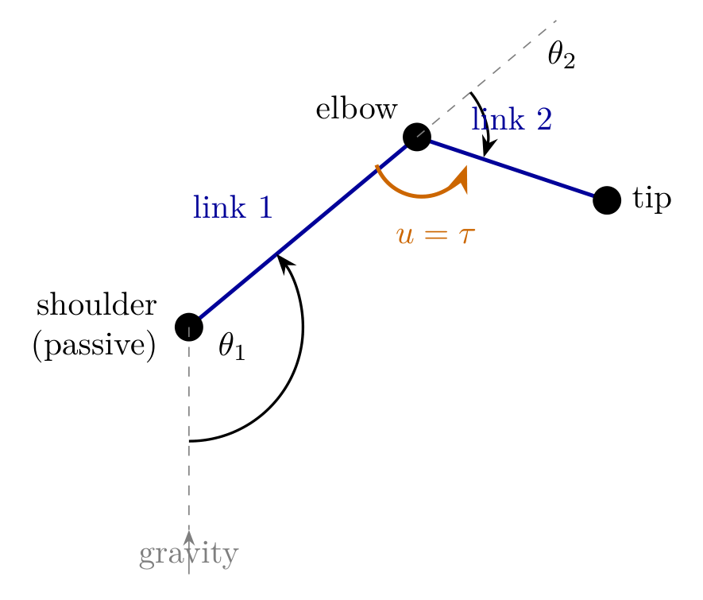
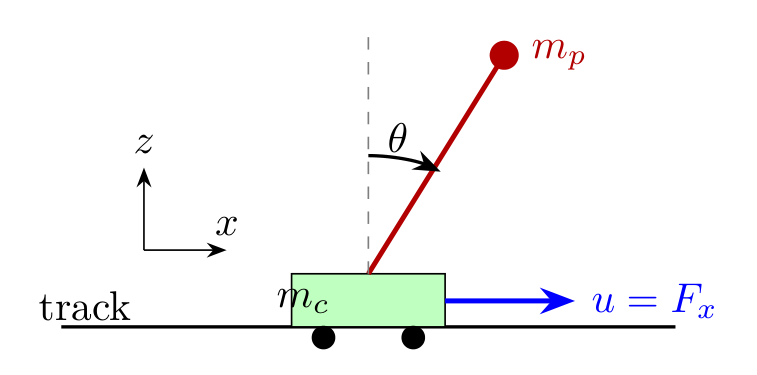
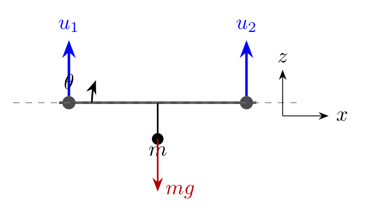
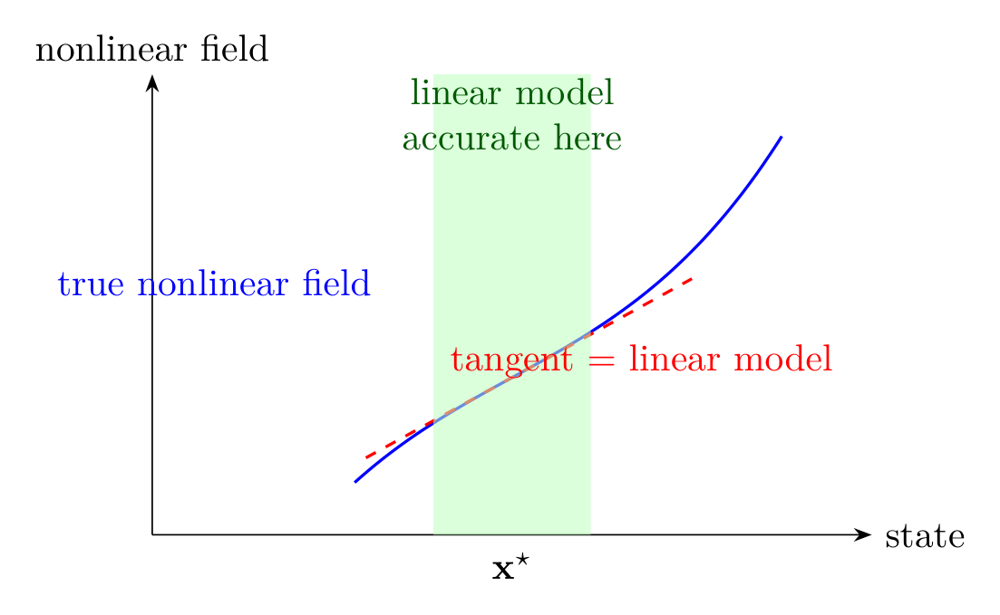
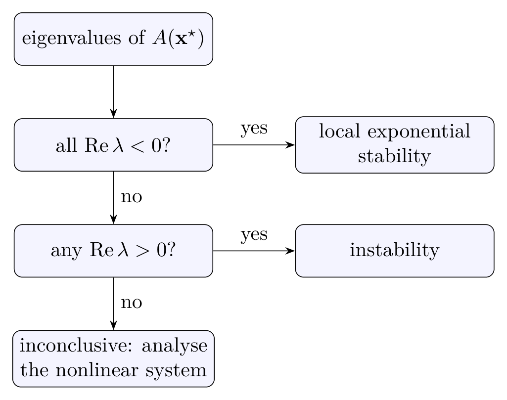
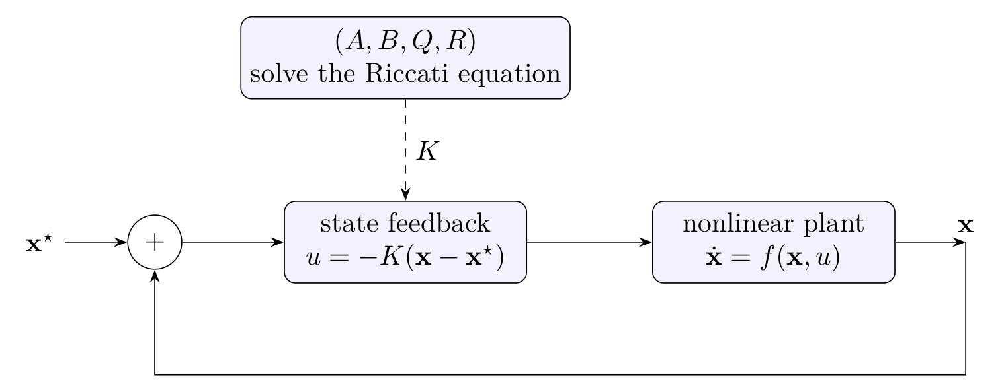
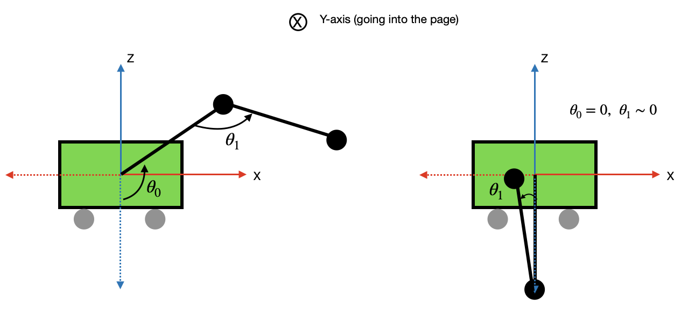
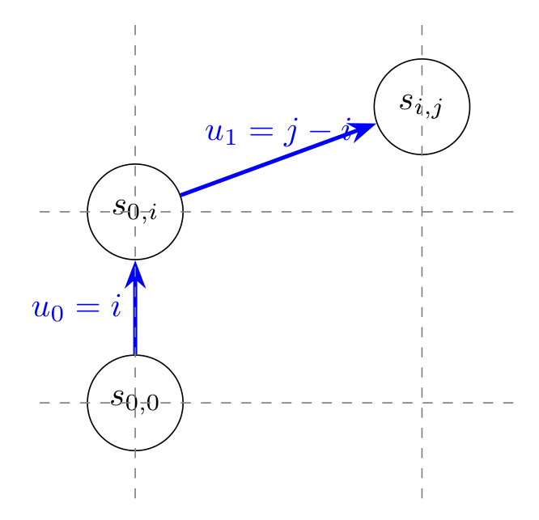
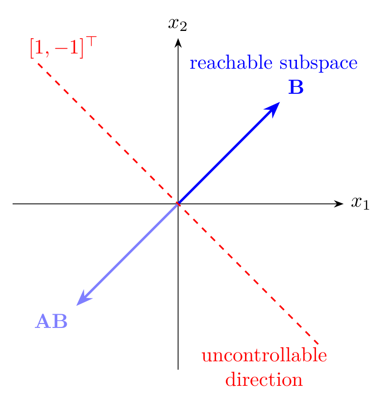

# 第 3 章 Acrobot、Cart-Pole 与 Quadrotor —— 深度推导笔记

> **来源**：Russ Tedrake, *Underactuated Robotics*, Ch. 3（underactuated.csail.mit.edu/acrobot.html，2024/2026 版）。
> 公式编号 `(n)` 沿用原书；`[笔记]` 标记的是原书省略、本笔记补全的推导。
> 所有数值结果均由附录 A 的脚本验证。

---

## 0. 本章地图与符号

### 0.1 本章要解决的问题

欠驱动系统的**执行器数少于自由度数**。本章不追求一般理论，而是把问题压缩到三个**低维模型系统**上：

| 系统 | 自由度 | 执行器 | 欠驱动的物理来源 |
|---|---|---|---|
| Acrobot | 2（肩、肘） | 1（肘） | 肩关节无电机 |
| Cart-Pole | 2（小车、摆） | 1（小车水平力） | 摆无驱动 |
| Quadrotor（平面） | 3（x, y, θ） | 2（两个推力） | 姿态与位置强耦合 |
| Quadrotor（3D） | 6 | 4 | 只有 4 个推力输入 |

**术语澄清**：本章前后 "trivially underactuated" 有两种用法，别混。

1. 章首：**执行器数 < 自由度数**的机械系统（相对于非完整约束等更"本质"的欠驱动）。
2. §3.5 PFL：输入矩阵可写成块结构 $B=\begin{bmatrix}0\\ I\end{bmatrix}$，即"部分关节有直接力矩、其余关节完全没有"。这是**强得多**的假设，PFL 的全局结论依赖它。

### 0.2 统一符号

| 符号 | 含义 |
|---|---|
| $q\in\mathbb{R}^n$ | 广义坐标 |
| $x=[q^\top,\dot q^\top]^\top$ | 状态 |
| $M(q)$ | 质量/惯性矩阵，一致正定 |
| $C(q,\dot q)$ | 科氏/离心项（注意不唯一） |
| $\tau_g(q)$ | 重力项，**约定** $\tau_g=-\partial U/\partial q$ |
| $B(q)$ | 输入矩阵 |
| $u$ | 输入（力/力矩） |
| $U,T$ | 势能、动能 |

标准机械臂方程（全书通用）：

$$
M(q)\ddot q + C(q,\dot q)\dot q = \tau_g(q) + B(q)u. \tag{★}
$$

**不动点的定义**（后面反复用）：$f(x^*,u^*)=0$ 等价于

$$
\dot q^*=0,\qquad \tau_g(q^*)+B(q^*)u^*=0. \tag{★★}
$$

注意这个式子**同时**固定了构型 $q^*$ 和平衡输入 $u^*$。Acrobot 在竖直向上时 $u^*=0$；四旋翼悬停时 $u^*$ 是抵消重力的推力——两者都由 (★★) 统一描述。

### 0.3 全章技术路线

```
       建模：由拉格朗日方程得到 (M, C, τg, B)
                        │
                        ▼
        线性化：A_lin, B_lin（在工作点展开）
                        │
                        ▼
        可控性 / 可镇定性分析（模态分解 / Kalman 秩）
                        │
                        ▼
        LQR：局部最优镇定（不动点附近）
                        │
                        ▼
        PFL：用反馈精确线性化“一部分”动力学
                        │
                        ▼
        能量整形：swing-up（全局，远离不动点）
                        │
                        ▼
        切换：起摆 → 顶部附近切 LQR
```

---

## 3.1 Acrobot（两连杆欠驱动臂）

### 3.1.1 模型与坐标

平面两连杆，肩关节铰接在固定点，**肩无电机、肘有电机**。

- $\theta_1$：肩关节**绝对**角，从竖直向下量起，逆时针为正。
- $\theta_2$：肘关节**相对**角。
- 零位配置：两杆都竖直向下。
- $l_1,l_2$：两杆长度；$l_{c1},l_{c2}$：质心到各自转轴的距离。
- $I_1$：绕肩轴的转动惯量；$I_2$：**绕肘轴的转动惯量**。
- $m_1,m_2$：质量；$g$：重力。
- 目标不动点：$x^*=[\pi,0,0,0]^\top$（两杆竖直向上）。

缩写约定：$s_1=\sin\theta_1$，$c_1=\cos\theta_1$，$s_{1+2}=\sin(\theta_1+\theta_2)$，等等。

> **注意**：原书只说 "moments of inertia taken about the pivots"。对第二杆，pivot 是**肘**，所以 $I_2$ 已包含 $m_2l_{c2}^2$。若你的建模工具给的是绕质心的 $I_{cm2}$，必须用平行轴定理换成 $I_2=I_{cm2}+m_2l_{c2}^2$，否则推导出多出一项 $m_2l_{c2}^2$。



*图：Acrobot 的坐标与输入。肩关节没有电机，肘关节力矩 $u=\tau$ 是唯一输入；$\theta_1$ 从竖直向下量起，$\theta_2$ 相对第一杆的延长线。两杆通过惯性耦合，所以“少一个电机”不等于“不可控”。*

### 3.1.2 运动学

取 $x$ 向右、$y$ 向上。零位时 $\theta_1=0$，质心在轴正下方：

$$
\mathbf p_{c1}=\begin{bmatrix}l_{c1}s_1\\ -l_{c1}c_1\end{bmatrix},\qquad
\mathbf p_{c2}=\begin{bmatrix}l_1s_1+l_{c2}s_{1+2}\\ -l_1c_1-l_{c2}c_{1+2}\end{bmatrix}. \tag{1}
$$

对时间求导：

$$
\dot{\mathbf p}_{c1}=l_{c1}\dot\theta_1\begin{bmatrix}c_1\\ s_1\end{bmatrix},\qquad
|\dot{\mathbf p}_{c1}|^2=l_{c1}^2\dot\theta_1^2.
$$

$$
\dot{\mathbf p}_{c2}=
\begin{bmatrix}
l_1c_1\dot\theta_1+l_{c2}c_{1+2}(\dot\theta_1+\dot\theta_2)\\
l_1s_1\dot\theta_1+l_{c2}s_{1+2}(\dot\theta_1+\dot\theta_2)
\end{bmatrix}.
$$

求模方，交叉项利用余弦差公式

$$
c_1c_{1+2}+s_1s_{1+2}=\cos\big((\theta_1+\theta_2)-\theta_1\big)=\cos\theta_2=c_2,
$$

得

$$
|\dot{\mathbf p}_{c2}|^2
=l_1^2\dot\theta_1^2+l_{c2}^2(\dot\theta_1+\dot\theta_2)^2+2l_1l_{c2}c_2\dot\theta_1(\dot\theta_1+\dot\theta_2).
$$

### 3.1.3 动能（含平行轴定理的完整展开）

第一杆绕固定轴转动，直接用绕轴惯量：

$$
T_1=\frac12 I_1\dot\theta_1^2. \tag{2}
$$

第二杆是平面刚体：

$$
T_2=\underbrace{\frac12 m_2|\dot{\mathbf p}_{c2}|^2}_{\text{质心平动}}
+\underbrace{\frac12 I_{cm2}(\dot\theta_1+\dot\theta_2)^2}_{\text{绕质心转动}},\qquad
I_{cm2}=I_2-m_2l_{c2}^2.
$$

逐项展开（这是原书跳过的步骤）：

- 平动部分：
  $$
  \frac12m_2|\dot{\mathbf p}_{c2}|^2
  =\frac12m_2\big[(l_1^2+l_{c2}^2+2l_1l_{c2}c_2)\dot\theta_1^2
  +2(l_{c2}^2+l_1l_{c2}c_2)\dot\theta_1\dot\theta_2
  +l_{c2}^2\dot\theta_2^2\big].
  $$
- 转动部分：
  $$
  \frac12(I_2-m_2l_{c2}^2)(\dot\theta_1^2+2\dot\theta_1\dot\theta_2+\dot\theta_2^2).
  $$

合并，注意 $m_2l_{c2}^2$ 恰好抵消：

$$
\boxed{
T_2=\frac12\big(m_2l_1^2+I_2+2m_2l_1l_{c2}c_2\big)\dot\theta_1^2
+\frac12I_2\dot\theta_2^2
+\big(I_2+m_2l_1l_{c2}c_2\big)\dot\theta_1\dot\theta_2
} \tag{3}
$$

### 3.1.4 势能

高度为 $-l\cos\theta$，故

$$
U=-m_1gl_{c1}c_1-m_2g\big(l_1c_1+l_{c2}c_{1+2}\big). \tag{4}
$$

### 3.1.5 拉格朗日方程：逐项推导

令 $L=T-U$，欧拉–拉格朗日方程：

$$
\frac{d}{dt}\frac{\partial L}{\partial\dot\theta_i}-\frac{\partial L}{\partial\theta_i}=\tau_i,
\qquad \tau_1=0,\ \tau_2=\tau .
$$

#### (a) 对 $\theta_1$ 的方程

$$
\frac{\partial L}{\partial\dot\theta_1}
=(I_1+I_2+m_2l_1^2+2m_2l_1l_{c2}c_2)\dot\theta_1
+(I_2+m_2l_1l_{c2}c_2)\dot\theta_2 .
$$

求全导数（$c_2$ 也依赖时间）：

$$
\frac{d}{dt}\frac{\partial L}{\partial\dot\theta_1}
=(I_1+I_2+m_2l_1^2+2m_2l_1l_{c2}c_2)\ddot\theta_1
-2m_2l_1l_{c2}s_2\dot\theta_1\dot\theta_2
+(I_2+m_2l_1l_{c2}c_2)\ddot\theta_2
-m_2l_1l_{c2}s_2\dot\theta_2^2 .
$$

又

$$
\frac{\partial L}{\partial\theta_1}
=-\frac{\partial U}{\partial\theta_1}
=-m_1gl_{c1}s_1-m_2gl_1s_1-m_2gl_{c2}s_{1+2}.
$$

代入欧拉–拉格朗日方程、移项：

$$
\boxed{
(I_1+I_2+m_2l_1^2+2m_2l_1l_{c2}c_2)\ddot\theta_1
+(I_2+m_2l_1l_{c2}c_2)\ddot\theta_2
-2m_2l_1l_{c2}s_2\dot\theta_1\dot\theta_2
-m_2l_1l_{c2}s_2\dot\theta_2^2
+m_1gl_{c1}s_1+m_2g(l_1s_1+l_{c2}s_{1+2})=0
} \tag{5–6}
$$

#### (b) 对 $\theta_2$ 的方程

$$
\frac{\partial L}{\partial\dot\theta_2}
=I_2\dot\theta_2+(I_2+m_2l_1l_{c2}c_2)\dot\theta_1,
$$

$$
\frac{d}{dt}\frac{\partial L}{\partial\dot\theta_2}
=I_2\ddot\theta_2+(I_2+m_2l_1l_{c2}c_2)\ddot\theta_1
-m_2l_1l_{c2}s_2\dot\theta_1\dot\theta_2 .
$$

$$
\frac{\partial L}{\partial\theta_2}
=-m_2l_1l_{c2}s_2\dot\theta_1^2-m_2l_1l_{c2}s_2\dot\theta_1\dot\theta_2
-m_2gl_{c2}s_{1+2}.
$$

相减，$\dot\theta_1\dot\theta_2$ 项两两抵消：

$$
\boxed{
(I_2+m_2l_1l_{c2}c_2)\ddot\theta_1+I_2\ddot\theta_2
+m_2l_1l_{c2}s_2\dot\theta_1^2+m_2gl_{c2}s_{1+2}=\tau
} \tag{7}
$$

### 3.1.6 标准机械臂形式

把 (5)–(7) 写成 $M\ddot q+C\dot q=\tau_g+Bu$，$q=[\theta_1,\theta_2]^\top$：

$$
M(q)=
\begin{bmatrix}
I_1+I_2+m_2l_1^2+2m_2l_1l_{c2}c_2 & I_2+m_2l_1l_{c2}c_2\\[4pt]
I_2+m_2l_1l_{c2}c_2 & I_2
\end{bmatrix}, \tag{8}
$$

$$
C(q,\dot q)=
\begin{bmatrix}
-2m_2l_1l_{c2}s_2\dot\theta_2 & -m_2l_1l_{c2}s_2\dot\theta_2\\[4pt]
m_2l_1l_{c2}s_2\dot\theta_1 & 0
\end{bmatrix}, \tag{9}
$$

$$
\tau_g(q)=
\begin{bmatrix}
-m_1gl_{c1}s_1-m_2g(l_1s_1+l_{c2}s_{1+2})\\
-m_2gl_{c2}s_{1+2}
\end{bmatrix},
\qquad
B=\begin{bmatrix}0\\1\end{bmatrix}. \tag{10}
$$

**$B=[0;1]$ 就是"欠驱动"的全部数学内容**：输入只出现在第二个方程（肘）里，肩关节的运动只能通过 $M_{21}$、$C$、$\tau_g$ 的耦合间接影响。

> **技术注记（C 矩阵不唯一）**
> 书中的 $C$ 不是 Christoffel 形式。真正的 Christoffel 形式为
> $$
> C_{\text{Chr}}=\begin{bmatrix}
> -m_2l_1l_{c2}s_2\dot\theta_2 & -m_2l_1l_{c2}s_2(\dot\theta_1+\dot\theta_2)\\
> m_2l_1l_{c2}s_2\dot\theta_1 & 0
> \end{bmatrix},
> $$
> 它满足 $\dot M-2C_{\text{Chr}}$ 反对称。书中的 $C$ 与它**乘积相同**（$C\dot q$ 完全一致），动力学因此等价；但 $\dot M-2C$ 不再反对称。
> 能量恒等式仍成立，因为只需要弱性质 $\dot q^\top(\dot M-2C)\dot q=0$（可直接代入验证）。
> 若后面要写 Lyapunov 函数或做无源性分析，建议统一换成 $C_{\text{Chr}}$。

### 3.1.7 平衡点

由 (★★)，$u=0$ 时要求 $\tau_g(q)=0$：

$$
-m_2gl_{c2}s_{1+2}=0\ \Rightarrow\ \theta_1+\theta_2\in\{0,\pi\}.
$$

再代入第一分量：

- 若 $\theta_2=0$：$s_{1+2}=s_1$，得 $s_1=0$；
- 若 $\theta_2=\pi$：$s_{1+2}=-s_1$，同样得 $s_1=0$。

所以有 **4 个平衡点**：

$$
(\theta_1,\theta_2)\in\{(0,0),\,(\pi,0),\,(0,\pi),\,(\pi,\pi)\}.
$$

- $(0,0)$：两杆下垂，势能最低，**稳定**；
- $(\pi,0)$：两杆竖直向上，势能最高，**不稳定**——本章的目标；
- 另外两个是"一杆上、一杆下"的鞍点型平衡。

---

## 3.2 Cart-Pole（小车–摆）

### 3.2.1 运动学与能量

- $x$：小车水平位置；$\theta$：摆角，**从竖直向下量起、逆时针为正**（注意：零位是下垂，不是上摆）。
- $m_c$：小车质量；$m_p$：摆锤质量；$l$：摆长（质点模型）。
- 输入 $f_x$：作用在小车上的水平力。
- 目标：$x^*=[0,\pi,0,0]^\top$。

摆锤位置与速度（式 11）：

$$
\mathbf p_{\text{cart}}=\begin{bmatrix}x\\0\end{bmatrix},\qquad
\mathbf p_{\text{pend}}=\begin{bmatrix}x+l\sin\theta\\-l\cos\theta\end{bmatrix},
$$

$$
\dot{\mathbf p}_{\text{pend}}
=\begin{bmatrix}\dot x+l\dot\theta\cos\theta\\ l\dot\theta\sin\theta\end{bmatrix},
\qquad
|\dot{\mathbf p}_{\text{pend}}|^2=\dot x^2+2l\dot x\dot\theta\cos\theta+l^2\dot\theta^2.
$$

动能、势能：

$$
T=\frac12m_c\dot x^2+\frac12m_p\big(\dot x^2+2l\dot x\dot\theta c+l^2\dot\theta^2\big)
=\frac12(m_c+m_p)\dot x^2+m_pl\,c\,\dot x\dot\theta+\frac12m_pl^2\dot\theta^2, \tag{12}
$$

$$
U=-m_pgl\cos\theta. \tag{13}
$$



*图：Cart-Pole。小车只有一个水平推力 $u=F_x$，却要同时控制小车位置 $x$ 和摆杆角度 $\theta$ 两个自由度；这是本章最典型的欠驱动例子。摆动杆的动力学只能通过小车加速度耦合过来。*

### 3.2.2 拉格朗日推导

$L=T-U$。

对 $x$：

$$
\frac{\partial L}{\partial\dot x}=(m_c+m_p)\dot x+m_pl\,c\,\dot\theta,
\qquad \frac{\partial L}{\partial x}=0,
$$

$$
\frac{d}{dt}\frac{\partial L}{\partial\dot x}
=(m_c+m_p)\ddot x+m_pl\,c\,\ddot\theta-m_pl\,s\,\dot\theta^2=f_x. \tag{14}
$$

对 $\theta$：

$$
\frac{\partial L}{\partial\dot\theta}=m_pl\,c\,\dot x+m_pl^2\dot\theta,
$$

$$
\frac{\partial L}{\partial\theta}
=-m_pl\,s\,\dot x\dot\theta-m_pgl\,s,
$$

$$
\frac{d}{dt}\frac{\partial L}{\partial\dot\theta}
=m_pl\,c\,\ddot x-m_pl\,s\,\dot x\dot\theta+m_pl^2\ddot\theta.
$$

相减，$-m_pl\,s\,\dot x\dot\theta$ 抵消：

$$
m_pl\,c\,\ddot x+m_pl^2\ddot\theta+m_pgl\,s=0
\ \xRightarrow{\ \div m_pl\ }\
c\,\ddot x+l\,\ddot\theta+g\,s=0. \tag{15}
$$

标准形式：

$$
M(q)=\begin{bmatrix}m_c+m_p & m_pl\,c\\ m_pl\,c & m_pl^2\end{bmatrix},\quad
C(q,\dot q)=\begin{bmatrix}0 & -m_pl\dot\theta\,s\\ 0 & 0\end{bmatrix},\quad
\tau_g=\begin{bmatrix}0\\-m_pgl\,s\end{bmatrix},\quad
B=\begin{bmatrix}1\\0\end{bmatrix}.
$$

（此处的 $C$ 恰好就是 Christoffel 形式，$\dot M-2C$ 反对称。）

### 3.2.3 显式解出加速度（原书省掉的代数）

$\det M=(m_c+m_p)m_pl^2-m_p^2l^2c^2=m_pl^2(m_c+m_p s^2)>0$。

由 (15)：

$$
\ddot\theta=\frac{g s-c\ddot x}{l}.
$$

代入 (14)：

$$
(m_c+m_p)\ddot x+m_pc(g s-c\ddot x)-m_pl\,s\,\dot\theta^2=f_x,
$$

$$
\ddot x\,(m_c+m_p-m_pc^2)=f_x+m_pl\,s\,\dot\theta^2-m_pg\,s c,
$$

$$
\boxed{
\ddot x=\frac{f_x+m_ps(l\dot\theta^2+gc)}{m_c+m_p s^2}
} \tag{16}
$$

$$
\boxed{
\ddot\theta=\frac{-f_xc-m_pl\dot\theta^2sc-(m_c+m_p)gs}{l(m_c+m_p s^2)}
} \tag{17}
$$

这两个式子后面做线性化误差分析和 LQR 仿真时会直接用。

### 3.2.4 归一化模型

令所有常数 $m_c=m_p=l=g=1$（此时 $m_c+m_p=2$）：

$$
\boxed{2\ddot x+\ddot\theta\,c-\dot\theta^2s=f_x} \tag{18}
$$
$$
\boxed{\ddot x\,c+\ddot\theta+s=0} \tag{19}
$$

**这两条是本章使用频率最高的方程**，PFL、能量整形都在它上面做。

### 3.2.5 平衡点

由 (★★)，$f_x=0$ 且 $\sin\theta=0$：

$$
(x,\theta)\in\{(x_0,0)\}\cup\{(x_0,\pi)\},\qquad x_0\in\mathbb{R}\ \text{任意}.
$$

即**平衡点是一条连续的流形**（小车位置不影响动力学）。线性化在任意 $x_0$ 处都相同，所以取 $x_0=0$ 不失一般性。

---

## 3.3 Quadrotor（四旋翼）

### 3.3.1 平面四旋翼

两个对称安装的推进器，距中心 $r$；推力 $u_1,u_2$ 沿机体法向；$\theta$ 为机体相对水平面的俯仰角；$m,I$ 为质量与惯量。

牛顿–欧拉方程（式 20–22）：

$$
m\ddot x=-(u_1+u_2)\sin\theta, \tag{20}
$$
$$
m\ddot y=(u_1+u_2)\cos\theta-mg, \tag{21}
$$
$$
I\ddot\theta=r(u_1-u_2). \tag{22}
$$

**物理读法**：
- 合推力 $u_1+u_2$ 控制**沿机体轴的加速度**，通过 $\theta$ 投影到世界坐标 → 推力差控制**姿态**，姿态又决定加速度方向。
- 这是一个**级联**：输入 → 姿态 → 水平加速度 → 位置。欠驱动就体现在"想往水平方向加速，必须先倾斜"。

写成 (★) 的形式：

$$
M=\operatorname{diag}(m,m,I),\quad C=0,\quad
\tau_g=\begin{bmatrix}0\\-mg\\0\end{bmatrix},\quad
B(q)=\begin{bmatrix}-\sin\theta & -\sin\theta\\ \cos\theta & \cos\theta\\ r & -r\end{bmatrix}.
$$

（注意 $M^{-1}B$ 才是状态方程里实际出现的输入矩阵。）

**$B$ 依赖构型**——这正是四旋翼与其他两个模型的关键区别，也直接导致线性化中 $\partial B/\partial q$ 项不可忽略（见 3.3.3）。



*图：平面四旋翼。两个推力先合成总推力，再通过倾角 $\theta$ 产生水平分力；悬停时 $u_1+u_2=mg$、$\theta=0$。线性化是在“非零推力”的悬停点做的，不是在零推力处。*

### 3.3.2 悬停平衡点

由 (★★)：

$$
\tau_g(q^*)+B(q^*)u^*=0.
$$

取 $\theta^*=0$，$u_1^*=u_2^*=\dfrac{mg}{2}$：合推力 $mg$ 竖直向上平衡重力，力矩 $r(u_1^*-u_2^*)=0$。位置任意 → 悬停是**平衡流形**。

### 3.3.3 显式线性化：$\partial B/\partial q$ 项在这里现身

以 $x=[x,y,\theta,\dot x,\dot y,\dot\theta]^\top$ 在悬停点展开。由 3.3.1：

$$
\frac{\partial}{\partial\theta}\begin{bmatrix}\ddot x\\ \ddot y\\ \ddot\theta\end{bmatrix}
=\begin{bmatrix}-(u_1+u_2)\cos\theta/m\\ -(u_1+u_2)\sin\theta/m\\ 0\end{bmatrix}
\ \xrightarrow{\ \text{悬停}\ }\
\begin{bmatrix}-g\\0\\0\end{bmatrix},
$$

$$
\frac{\partial}{\partial(u_1,u_2)}\begin{bmatrix}\ddot x\\ \ddot y\\ \ddot\theta\end{bmatrix}
=\begin{bmatrix}-\sin\theta/m & -\sin\theta/m\\ \cos\theta/m & \cos\theta/m\\ r/I & -r/I\end{bmatrix}
\ \xrightarrow{\ \text{悬停}\ }\
\begin{bmatrix}0&0\\ 1/m&1/m\\ r/I&-r/I\end{bmatrix}.
$$

所以

$$
A_{\text{lin}}=
\begin{bmatrix}
0&0&0&1&0&0\\
0&0&0&0&1&0\\
0&0&0&0&0&1\\
0&0&-g&0&0&0\\
0&0&0&0&0&0\\
0&0&0&0&0&0
\end{bmatrix},\qquad
B_{\text{lin}}=
\begin{bmatrix}
0&0\\0&0\\0&0\\0&0\\1/m&1/m\\r/I&-r/I
\end{bmatrix}.
$$

**关键观察**：$\partial\tau_g/\partial q=0$（重力项不依赖姿态），所以 $A_{\text{lin}}$ 中 $(4,3)$ 位置的 $-g$ **完全来自 $\partial B/\partial q\cdot u^*$**：

$$
M^{-1}\frac{\partial B}{\partial\theta}u^*
=\operatorname{diag}\!\Big(\frac1m,\frac1m,\frac1I\Big)
\begin{bmatrix}-\cos\theta&-\cos\theta\\-\sin\theta&-\sin\theta\\0&0\end{bmatrix}_{u_1=u_2=mg/2}
\begin{bmatrix}mg/2\\mg/2\end{bmatrix}
=\begin{bmatrix}-g\\0\\0\end{bmatrix}.
$$

> **结论**：如果线性化时偷懒把 $B$ 当常数、丢掉 $\partial B/\partial q$ 项，$A_{\text{lin}}(4,3)=0$，水平位置 $x$ 将**不可控**。原书 §3.4.1 特别提醒"many cases, **but not the Quadrotors**"，说的就是这里。

线性化后系统可控：$u_1-u_2$ 经 $\ddot\theta$ 积分三次到达 $x$（三阶积分链），$u_1+u_2$ 直接控制 $y$。

### 3.3.4 三维四旋翼的三个实现陷阱

**(1) 桨叶反作用力矩（propeller moments）**

3D 四旋翼的滚转/俯仰力矩来自推力差，但**偏航力矩**来自桨叶旋转的反作用力矩（以及桨叶阻力矩）。原书指出：

> 如果模型里**不含这些力矩**，绕悬停点线性化后系统**实际上不可控**——偏航通道没有任何输入。

**(2) 单位四元数表示**

`MultibodyPlant` 默认用单位四元数表示漂浮体姿态。若直接把四元数当作 4 个独立状态线性化，**不施加单位范数约束**，会多出一个不可控方向，线性化模型同样不可控。

**(3) 手工 RPY 漂浮基座的代价**

作者的做法是手工加一个 roll–pitch–yaw 漂浮基座：线性化简单，但引入 **gimbal lock 奇异性**（$\beta=\pm90^\circ$）。原书明确说后续尽量避免大范围 3D 旋转，把这个问题留到专门章节。

---

## 3.4 Balancing（镇定）

思路固定为三步：**线性化 → 判可控 → LQR**。

### 3.4.1 机械臂方程线性化的完整推导

状态 $x=[q;\dot q]$，

$$
\dot x=f(x,u)=\begin{bmatrix}\dot q\\ M(q)^{-1}\big(\tau_g(q)+B(q)u-C(q,\dot q)\dot q\big)\end{bmatrix}.
$$

在不动点 $(x^*,u^*)$ 做一阶 Taylor 展开：

$$
\dot x\approx \underbrace{f(x^*,u^*)}_{=0}
+\left.\frac{\partial f}{\partial x}\right_* (x-x^*)
+\left.\frac{\partial f}{\partial u}\right_* (u-u^*).
$$

逐块计算。

**上两块**：

$$
\frac{\partial \dot q}{\partial q}=0,\qquad
\frac{\partial \dot q}{\partial \dot q}=I.
$$

**右下块**（对 $\dot q$ 求导）：

$$
\frac{\partial}{\partial\dot q}\Big[M^{-1}\big(\tau_g+Bu-C\dot q\big)\Big]
=-M^{-1}\frac{\partial (C\dot q)}{\partial\dot q}.
$$

在 $\dot q^*=0$ 处，$C(q,\dot q)\dot q$ 对每个分量都是速度的二次型，其 Jacobian 在零速度处为零（无论用哪种 $C$）。故**右下块 $=0$**。

**左下块**（对 $q$ 求导）：

$$
\frac{\partial}{\partial q}\Big[M^{-1}\big(\tau_g+Bu-C\dot q\big)\Big]
=\frac{\partial M^{-1}}{\partial q}(\tau_g+Bu)
+M^{-1}\Big(\frac{\partial\tau_g}{\partial q}+\sum_{j}\frac{\partial B_j}{\partial q}u_j\Big)
-\frac{\partial(C\dot q)}{\partial q}.
$$

在不动点：$\tau_g+B u^*=0$（由 (★★)）且 $\dot q^*=0$，前一项和最后一项都消失，于是

$$
\boxed{
A_{\text{lin}}=
\begin{bmatrix}
0 & I\\[4pt]
M^{-1}\dfrac{\partial\tau_g}{\partial q}
+\displaystyle\sum_{j}M^{-1}\frac{\partial B_j}{\partial q}u_j^* & 0
\end{bmatrix}_{x^*,u^*}
} \tag{26}
$$

$$
\boxed{
B_{\text{lin}}=\begin{bmatrix}0\\ M^{-1}B\end{bmatrix}_{x^*,u^*}
} \tag{27}
$$

其中 $B_j$ 是 $B$ 的第 $j$ 列，$\partial B_j/\partial q$ 是 $n\times n$ 矩阵。

**为什么形式这么干净？** 三条原因：

1. $\partial M^{-1}/\partial q$ 项乘的是 $\tau_g+Bu^*$，在不动点恒为零；
2. 所有含 $C\dot q$ 的导数项因 $\dot q^*=0$ 消失（零速度时科氏/离心力为零）；
3. Acrobot、Cart-Pole 的 $B$ 是常数矩阵，$\partial B/\partial q$ 项也没了。**四旋翼不满足第 3 条**，见 3.3.3。



*图：为什么线性化只是局部的。红色虚线是 $x^\star$ 处的切线（线性模型），蓝色曲线是真实的非线性场；两者只在绿色带内接近，离平衡点越远差别越大。*

### 3.4.2 Acrobot 线性化（含数值）

$$
\frac{\partial\tau_g}{\partial q}
=\begin{bmatrix}
\dfrac{\partial\tau_{g1}}{\partial\theta_1} & \dfrac{\partial\tau_{g1}}{\partial\theta_2}\\[6pt]
\dfrac{\partial\tau_{g2}}{\partial\theta_1} & \dfrac{\partial\tau_{g2}}{\partial\theta_2}
\end{bmatrix}
=g\begin{bmatrix}
m_1l_{c1}+m_2l_1+m_2l_{c2} & m_2l_{c2}\\
m_2l_{c2} & m_2l_{c2}
\end{bmatrix}_{(\theta_1,\theta_2)=(\pi,0)} \tag{28}
$$

（代入 $c_1=\cos\pi=-1$、$c_{1+2}=\cos\pi=-1$。）

**具体数值**：取 $m_1=m_2=l_1=1$，$l_{c1}=l_{c2}=0.5$，$I_1=I_2=0.25$，$g=9.81$：

$$
M(x^*)=\begin{bmatrix}2.5&0.75\\0.75&0.25\end{bmatrix},\qquad
M^{-1}=\begin{bmatrix}4&-12\\-12&40\end{bmatrix},
$$

$$
\frac{\partial\tau_g}{\partial q}
=\begin{bmatrix}19.62&4.905\\4.905&4.905\end{bmatrix},\qquad
A_{\text{lin}}=
\begin{bmatrix}
0&0&1&0\\
0&0&0&1\\
19.62&-39.24&0&0\\
-39.24&137.34&0&0
\end{bmatrix},
$$

$$
B_{\text{lin}}=M^{-1}\begin{bmatrix}0\\1\end{bmatrix}=\begin{bmatrix}0\\0\\-12\\40\end{bmatrix}.
$$

特征值：

$$
\lambda=\pm12.2156,\ \pm2.7819\quad(\text{全实数，两正两负}).
$$

能控性矩阵 $\mathcal C=[B,AB,A^2B,A^3B]$ 的秩：

$$
\operatorname{rank}\mathcal C=4.
$$

> **这是本章最反直觉的事实之一**：Acrobot 的肩关节**没有电机**，但线性化后系统**完全可控**。它确实能平衡在竖直位置——只是所需轨迹可能很复杂。

### 3.4.3 Cart-Pole 线性化（含数值）

归一化模型在 $\theta=\pi$：

$$
M(\pi)=\begin{bmatrix}2&-1\\-1&1\end{bmatrix},\quad
M^{-1}=\begin{bmatrix}1&1\\1&2\end{bmatrix},\quad
\frac{\partial\tau_g}{\partial q}=\begin{bmatrix}0&0\\0&1\end{bmatrix}. \tag{29}
$$

$$
A_{\text{lin}}=
\begin{bmatrix}
0&0&1&0\\
0&0&0&1\\
0&1&0&0\\
0&2&0&0
\end{bmatrix},
\qquad
B_{\text{lin}}=M^{-1}\begin{bmatrix}1\\0\end{bmatrix}=\begin{bmatrix}0\\0\\1\\1\end{bmatrix}.
$$

特征多项式：

$$
\det(sI-A_{\text{lin}})=s^2(s^2-2)\ \Rightarrow\ \lambda=0,0,\pm\sqrt2.
$$

能控性矩阵：

$$
\mathcal C=
\begin{bmatrix}
0&1&0&1\\
0&1&0&2\\
1&0&1&0\\
1&0&2&0
\end{bmatrix},
\qquad \operatorname{rank}\mathcal C=4.
$$

**两个零特征值**对应"小车位置"这条无自然回复力的积分链——它本身不稳定也不发散，但通过摆的耦合是可控的，所以 LQR 仍能把整个状态拉回原点。

**LQR 数值示例**：取 $Q=\operatorname{diag}(10,10,1,1)$，$R=1$：

$$
K=\begin{bmatrix}-3.1623&16.1213&-9.5032&14.7870\end{bmatrix},
$$

闭环特征值 $-1.8895\pm1.0062j,\ -0.7523\pm0.3522j$，全部在左半平面。

### 3.4.4 线性化与非线性系统的稳定性：三个结论

设 $x^*$ 是平衡点，$A=\partial f/\partial x|_*$：

| 线性化 $A$ 的谱 | 对非线性系统的结论 |
|---|---|
| 全部 $\operatorname{Re}\lambda<0$ | **局部指数稳定**（严格稳定 ⇒ 局部指数稳定） |
| 存在 $\operatorname{Re}\lambda>0$ | **局部不稳定** |
| 全部 $\operatorname{Re}\lambda\le 0$ 且存在 $\operatorname{Re}\lambda=0$ | **无法下结论**（只知不是指数稳定） |

第三行是常考点：临界稳定时，非线性项决定命运，可能是渐近稳定、Lyapunov 稳定、也可能不稳定。



*图：线性化稳定性的判定流程。特征值实部全负 → 局部指数稳定；存在正实部 → 不稳定；实部全为零 → 线性化无法判断，必须回到非线性分析（例如能量函数或相图）。*

### 3.4.5 线性系统的可控性

#### 定义

**Definition 3.1（可控性）**：存在无约束输入 $u(t),\ t\in[0,t_f]$，能在有限时间 $0<t<t_f$ 内把系统从**任意**初始状态移到**任意**终止状态。

对线性系统，只需能驱动到原点即可（线性性 + 时不变性）。

#### 模态分析（非重根情形）

设 $A$ 可对角化：

$$
Av_i=\lambda_i v_i,\qquad AV=V\Lambda,\qquad V=[v_1,\dots,v_n].
$$

定义模态坐标

$$
x=Vr,\qquad r=V^{-1}x,
$$

则

$$
\dot r=V^{-1}AVr+V^{-1}Bu=\Lambda r+\beta u,\qquad \beta=V^{-1}B,
$$

即

$$
\dot r_i=\lambda_i r_i+\sum_{j=1}^m\beta_{ij}u_j.
$$

**输入 $j$ 能影响模态 $i$ $\iff$ $\beta_{ij}\neq0$。**

于是原书给出判据：

$$
\boxed{\text{可控}\iff \forall i,\ \exists j\ \text{使得}\ \beta_{ij}\neq 0.} \tag{*}
$$

**[笔记] 为什么这个判据成立？** 单输入时，模态坐标下的能控性矩阵是

$$
\mathcal C_{\text{modal}}=[\beta,\Lambda\beta,\dots,\Lambda^{n-1}\beta]
=\operatorname{diag}(\beta)\cdot\mathsf V_{\text{dm}}^\top,\qquad
(\mathsf V_{\text{dm}})_{jk}=\lambda_j^{k-1}.
$$

$\mathsf V_{\text{dm}}$ 是 Vandermonde 矩阵，所以

$$
\det\mathcal C_{\text{modal}}
=\Big(\prod_i\beta_i\Big)\prod_{j<k}(\lambda_k-\lambda_j).
$$

特征值互异 $\Rightarrow$ 第二个因子非零；于是可控 $\iff$ 所有 $\beta_i\neq0$。多输入时同理：只要 $\beta$ 的**每一行**非零，$\mathcal C$ 就满秩（若某行全零，秩必缺；反之 Vandermonde 结构保证各行独立）。

#### 一般判据

- **Kalman 秩判据**：
  $$
  \operatorname{rank}\big[B,\ AB,\ \dots,\ A^{n-1}B\big]=n.
  $$
- **PBH 判据**：对 $A$ 的每个特征值 $\lambda_i$，
  $$
  \operatorname{rank}\big[\lambda_iI-A,\ B\big]=n.
  $$
  等价说法：存在左特征向量 $w_i$（$w_i^\top A=\lambda_iw_i^\top$）使 $w_i^\top B=0$ $\Rightarrow$ 模态 $i$ 不可控。

这两种判据与 $(*)$ 在可对角化情形下互相等价；Kalman 秩判据不需要特征值互异，是通用工具（原书折叠的 "A general solution" 就是它）。

#### 可控 vs. 欠驱动

$$
\boxed{\textbf{欠驱动系统不一定是不可控系统。}}
$$

欠驱动限制的是"**能否跟随任意轨迹**"；它**不**意味着"无法到达任意状态"。Acrobot 不用肩电机也能到达竖直平衡点，只是**轨迹可能极其复杂**。

（线性时不变系统的分析可推广到线性时变系统；非线性情形对应 **reachability（可达性）**。）

### 3.4.6 可镇定性

**Definition 3.2**：存在无约束输入 $u(t),\ t\in[0,\infty)$，使 $\lim_{t\to\infty}x(t)=0$。

- 可控性要求**有限时间**到达原点；可镇定性只要求**渐近**收敛。
- 对线性系统：**可镇定严格弱于可控**。不可控子空间若是自然稳定的，系统仍可镇定；反之不成立。
- 对非线性系统：关系微妙。**Brockett 的著名结果**：非线性可控性**不**蕴含"存在可微控制律镇定"。



*图：LQR 的两个阶段。离线解 Riccati 方程得到 $K$；在线只是 $u=-K(x-x^\star)$ 的一次矩阵乘法。$Q$ 惩罚状态误差，$R$ 惩罚控制量。*

### 3.4.7 LQR

可控性只说明"存在一条到原点的轨迹"，但没说是哪一条。在无穷多条中选最优的一条：最小化

$$
J(x_0)=\int_0^\infty\Big[x^\top Qx+u^\top Ru\Big]\,dt,
\qquad Q=Q^\top\ge0,\ R=R^\top>0.
$$

**[笔记] Riccati 方程推导**：构造 Hamiltonian

$$
H=x^\top Qx+u^\top Ru+p^\top(Ax+Bu).
$$

$$
\frac{\partial H}{\partial u}=0\ \Rightarrow\ u=-\frac12R^{-1}B^\top p;
\qquad
\dot p=-\frac{\partial H}{\partial x}=-2Qx-A^\top p.
$$

猜 $p=2Px$（$P=P^\top$），则 $u=-R^{-1}B^\top Px$。代回协态方程：

$$
2\dot Px+2P(Ax-BR^{-1}B^\top Px)=-2Qx-2A^\top Px,
$$

$$
\boxed{\dot P=-A^\top P-PA+PBR^{-1}B^\top P-Q}
$$

稳态 $\dot P=0$ 给出**代数 Riccati 方程（ARE）**：

$$
\boxed{A^\top P+PA-PBR^{-1}B^\top P+Q=0},
\qquad \boxed{K=R^{-1}B^\top P}. \tag{★★★}
$$

闭环 $A-BK$ 的特征值全在左半平面（镇定解）。

**原书的强结论**：只要 $(A,B)$ 可镇定，**对任意 $Q\ge0$、$R>0$，LQR 都给出镇定控制器**；若不可镇定，LQR 会告诉你"不存在线性镇定控制器"。

> **[笔记] 一个被省略的条件**：$Q$ 半正定时，严格地说还需要 $(A,\sqrt Q)$ 可检测（detectable），才能保证 ARE 存在**唯一镇定解**。通常取 $Q=C^\top C$ 且 $(A,C)$ 可检测即可。书中为了叙事简洁没有展开。

**Drake 接口**：

```python
K = LinearQuadraticRegulator(A, B, Q, R)
controller = LinearQuadraticRegulator(system, context, Q, R)  # 自动线性化并回到原坐标
```

**四旋翼的 LQR** 开箱即用：只要在悬停点线性化（那里推力恰好平衡重力，$u^*\neq0$，由 (★★) 给出）。

**注意**：LQR 对**线性化模型**最优，但不一定是"最大化不动点吸引域"的最优线性控制器。**鲁棒控制**（robust control）显式考虑线性化与真实非线性之间的差异，能得到更大的吸引域。

### 3.4.8 非最小相位：LQR 的隐患

原书观察：LQR 闭环仿真"出色地"完成了任务，但**状态常常必须剧烈远离原点，才能最终回到原点**。原因是闭环**非最小相位**。

**[笔记] 零点在状态反馈下不变**。系统矩阵（Rosenbrock 铅笔）为

$$
Z(s)=\begin{bmatrix}sI-A & -B\\ C & 0\end{bmatrix},
$$

零点由 $\det Z(s)=0$ 给出。状态反馈 $u=-Kx$ 对应右乘一个单位行列式的块矩阵：

$$
\begin{bmatrix}sI-A+BK & -B\\ C & 0\end{bmatrix}
=\begin{bmatrix}sI-A & -B\\ C & 0\end{bmatrix}
\begin{bmatrix}I&0\\-K&I\end{bmatrix}.
$$

所以**零点多项式不变**。开环有右半平面零点 $\Rightarrow$ 闭环仍有。

**Cart-Pole 的具体计算**（归一化、$\theta=\pi$，令 $\phi=\theta-\pi$）：

$$
c\approx-1,\quad s=\sin(\pi+\phi)=-\sin\phi\approx-\phi,
$$

代入 (18)–(19) 并线性化：

$$
2\ddot x-\ddot\phi=f_x,\qquad
-\ddot x+\ddot\phi-\phi=0.
$$

消去 $\ddot x$：

$$
\ddot\phi-2\phi=f_x.
$$

由 $s^2X=(s^2-1)\Phi$：

$$
\frac{X(s)}{F_x(s)}=\frac{s^2-1}{s^2(s^2-2)}.
$$

**零点在 $s=\pm1$，其中 $s=+1$ 位于右半平面**。Acrobot 的数值结果见附录 A：$u\to\theta_1$ 的零点为 $\pm2.56$，$u\to\theta_2$ 为 $\pm2.80$，各含一个右半平面零点。

> **关于"3 个右半平面零点"**：原书称 "acrobot has 3 right-half zeros"。对 4 状态 SISO 线性化，传递函数相对阶为 2，分子次数最多为 2，所以单个 SISO 输出不可能有 3 个有限零点；该数字应来自特定的输出定义或模型版本。**稳健的结论是"闭环非最小相位"**，这一点与具体零点计数无关。

**物理含义**：非最小相位系统在阶跃响应中先"反向"运动。对小车–摆，把摆拉回竖直的动作必须先把小车推向"错误"的方向——这就是吸引域有限、需要大幅状态偏移的根本原因。起摆阶段因此不能指望 LQR，必须先做能量整形。

---

## 3.5 Partial Feedback Linearization（PFL）

### 3.5.0 核心命题

$$
\boxed{\text{欠驱动系统不能整体反馈线性化，但可以精确线性化"一部分"。}}
$$

两类：

- **Collocated PFL**：线性化**被驱动关节**的动力学；
- **Non-collocated PFL**：线性化**未驱动关节**的动力学（更反直觉）。

### 3.5.1 Cart-Pole 的 collocated PFL

从 (18)–(19) 出发，记 $c=\cos\theta,\ s=\sin\theta$。

由 (19)：

$$
\ddot\theta=-\ddot xc-s.
$$

代入 (18)：

$$
\ddot x(2-c^2)-sc-\dot\theta^2s=f_x.
$$

取反馈

$$
\boxed{f_x=(2-c^2)\ddot x^d-sc-\dot\theta^2s} \tag{30}
$$

则

$$
\ddot x=\ddot x^d,\qquad
\ddot\theta=-\ddot x^dc-s.
$$

**全局有效**（分母 $2-c^2\in[1,2]$ 永不为零）。

**逐项解读第二式**：摆的方程退化成了**无小车单摆**的方程，控制输入换成了 $\ddot x^d$，但被 **$\cos\theta$ 调制**。

- $\cos\theta$ 是**控制权限**：摆水平时它为零——此时无论多大的水平力都无法对摆产生力矩。
- 这不是数值问题，是物理事实；后面 non-collocated 会以更极端的方式重现。

### 3.5.2 Cart-Pole 的 non-collocated PFL

由 (19) 解 $\ddot x$：

$$
\ddot x=-\frac{\ddot\theta+s}{c}.
$$

代入 (18)：

$$
\ddot\theta\Big(c-\frac2c\Big)-2\tan\theta-\dot\theta^2s=f_x.
$$

取反馈

$$
\boxed{f_x=\Big(c-\frac2c\Big)\ddot\theta^d-2\tan\theta-\dot\theta^2s} \tag{31}
$$

则

$$
\ddot\theta=\ddot\theta^d,\qquad
\ddot x=-\frac1c\ddot\theta^d-\tan\theta.
$$

**三个必须记住的点**：

1. **只在 $\cos\theta\neq0$ 时有效**；摆水平时力无法产生力矩。
2. 控制器在 $c\to0$ 时**发散**（要求无穷大力）。**硬件或仿真中必须先做饱和（saturate）**。
3. 系数 $c-2/c$ 不会为零，而且 $|c-2/c|\ge1$（$c\in(0,1]$ 时 $c-2/c\le-1$；$c\in[-1,0)$ 时 $c-2/c\ge1$）。所以爆炸的根源只是 $1/c$，不是这个系数。

### 3.5.3 一般形式：分块与 Schur 补

对**平凡欠驱动**（输入矩阵为 $B=[0;I]$ 的块形式）系统，重排坐标：

$$
q=\begin{bmatrix}q_1\\ q_2\end{bmatrix},\quad
q_1\in\mathbb{R}^{\ell}\ (\text{被动}),\quad q_2\in\mathbb{R}^{m}\ (\text{主动}),\quad \ell=n-m.
$$

把 $\tau_g-C\dot q$ 记作 $\tau$，则

$$
M_{11}\ddot q_1+M_{12}\ddot q_2=\tau_1, \tag{32}
$$
$$
M_{21}\ddot q_1+M_{22}\ddot q_2=\tau_2+u. \tag{33}
$$

$$
M=\begin{bmatrix}M_{11}&M_{12}\\ M_{21}&M_{22}\end{bmatrix}.
$$

> **正定性**：$M\succ0$（对一切 $q$）。由 Schur 补条件，**$M_{11}\succ0$ 且 $M_{22}\succ0$**。

#### Collocated

由 (32)：

$$
\boxed{\ddot q_1=M_{11}^{-1}(\tau_1-M_{12}\ddot q_2)} \tag{34}
$$

代入 (33)：

$$
(M_{22}-M_{21}M_{11}^{-1}M_{12})\ddot q_2=\tau_2+u-M_{21}M_{11}^{-1}\tau_1.
$$

**[笔记] 可逆性证明**：$M_{11}\succ0$ 可逆，

$$
\det(M_{22}-M_{21}M_{11}^{-1}M_{12})=\frac{\det M}{\det M_{11}}>0,
$$

故 Schur 补正定、可逆。于是令 $\ddot q_2=\ddot q_2^d$：

$$
\boxed{u=(M_{22}-M_{21}M_{11}^{-1}M_{12})\ddot q_2^d-\tau_2+M_{21}M_{11}^{-1}\tau_1} \tag{35}
$$

**全局有效**，无需任何秩假设。

#### Non-collocated

由 (32) 解 $\ddot q_2$：

$$
M_{12}\ddot q_2=\tau_1-M_{11}\ddot q_1.
$$

$M_{12}$ 是 $\ell\times m$，行数 $\ell$；只有当 $\operatorname{rank}M_{12}=\ell$（满行秩）时有唯一解：

$$
\boxed{\ddot q_2=M_{12}^{+}(\tau_1-M_{11}\ddot q_1)} \tag{36}
$$

$M_{12}^{+}$ 为 Moore–Penrose 伪逆，与 $\ddot q_1$ 无关地给出最小范数解。代入 (33)：

$$
\boxed{u=(M_{21}-M_{22}M_{12}^{+}M_{11})\ddot q_1-\tau_2+M_{22}M_{12}^{+}\tau_1} \tag{37}
$$

**Strong Inertial Coupling（强惯性耦合）**：

$$
\operatorname{rank}M_{12}=\ell.
$$

- 这是**状态相关**的条件。Cart-Pole 中 $M_{12}=m_pl\cos\theta$，恰在 $\cos\theta=0$ 掉秩。
- 若在**每个状态**都满足，称 **Global Strong Inertial Coupling**。

### 3.5.4 Task-space PFL（定理 3.1）

定义任务空间输出

$$
y=h(q)\in\mathbb{R}^p,\qquad
H_1=\frac{\partial h}{\partial q_1},\quad H_2=\frac{\partial h}{\partial q_2},\quad H=[H_1,H_2].
$$

**Theorem 3.1**：若命令主动关节为

$$
\boxed{\ddot q_2=\bar H^{+}\Big[\ddot y^d-\dot H\dot q-H_1M_{11}^{-1}\tau_1\Big]}, \tag{38}
$$

其中

$$
\bar H=H_2-H_1M_{11}^{-1}M_{12},\qquad
\bar H^{+}=\bar H^{\top}(\bar H\bar H^{\top})^{-1},
$$

则在秩条件

$$
\operatorname{rank}(\bar H)=p \tag{40}
$$

下，有

$$
\ddot y=\ddot y^d. \tag{39}
$$

**证明（补全原书的 Proof Sketch）**：

$$
\dot y=H\dot q,\qquad
\ddot y=\dot H\dot q+H_1\ddot q_1+H_2\ddot q_2.
$$

用 (32) 的 (41)：

$$
\ddot q_1=M_{11}^{-1}(\tau_1-M_{12}\ddot q_2).
$$

代入：

$$
\begin{aligned}
\ddot y
&=\dot H\dot q+H_1M_{11}^{-1}(\tau_1-M_{12}\ddot q_2)+H_2\ddot q_2\\
&=\dot H\dot q+H_1M_{11}^{-1}\tau_1+\big(H_2-H_1M_{11}^{-1}M_{12}\big)\ddot q_2\\
&=\dot H\dot q+H_1M_{11}^{-1}\tau_1+\bar H\ddot q_2.
\end{aligned}
$$

把 (38) 代入：

$$
\ddot y=\dot H\dot q+H_1M_{11}^{-1}\tau_1+\bar H\bar H^{+}\big[\ddot y^d-\dot H\dot q-H_1M_{11}^{-1}\tau_1\big].
$$

**当 $\operatorname{rank}\bar H=p$ 时，$\bar H\bar H^{+}=I_p$**（右伪逆的满行秩性质），于是 $\ddot y=\ddot y^d$。$\blacksquare$

**轨迹执行**：令

$$
\ddot y^d=K_d(\dot y^d-\dot y)+K_p(y^d-y),
$$

若**内动态稳定**且 $K_p,K_d>0$，则 $y\to y^d$。

- 位置控制机器人：直接用 (38) 的加速度指令；
- 力矩控制机器人：把 (38) 与 (41) 代入 (33) 得力矩指令。

### 3.5.5 两个退化情形：统一性的验证

**Collocated**：取 $y=q_2$，则 $H_1=0,\ H_2=I,\ \dot H=0,\ \bar H=I,\ \bar H^+=I$。

(38) 退化为 $\ddot q_2=\ddot q_2^d$，(35) 给出

$$
u=M_{21}M_{11}^{-1}(\tau_1-M_{12}\ddot q_2^d)+M_{22}\ddot q_2^d-\tau_2,
$$

秩条件恒满足。

**Non-collocated**：取 $y=q_1$，则 $H_1=I,\ H_2=0,\ \dot H=0,\ \bar H=-M_{11}^{-1}M_{12}$。

秩条件等价于 $\operatorname{rank}M_{12}=\ell$（$M_{11}$ 可逆），正是 **Strong Inertial Coupling**。此时

$$
\bar H^{+}=-M_{12}^{+}M_{11}
$$

（验证：$\bar H\bar H^{+}=M_{11}^{-1}M_{12}M_{12}^{+}M_{11}=M_{11}^{-1}M_{11}=I$）。

代入 (38)：

$$
\ddot q_2=M_{12}^{+}\big(\tau_1-M_{11}\ddot q_1^d\big), \tag{45}
$$

与 (36) 一致。

> **结论**：任务空间 PFL 是统一框架，collocated / non-collocated 都是它的特例。秩条件 (40) 是唯一的"开关"。

### 3.5.6 Example 3.7：末端竖直位置跟踪

**任务**：用摆的**末端竖直坐标**跟踪轨迹。

$$
y=h(q)=-l\cos\theta,\qquad
\dot y=l\dot\theta\sin\theta.
$$

**注意坐标分配**：Cart-Pole 中主动关节是小车，所以 $q_2=x$，被动关节是摆，$q_1=\theta$。于是

$$
H_1=\frac{\partial y}{\partial\theta}=l\sin\theta,\qquad H_2=\frac{\partial y}{\partial x}=0.
$$

**[笔记] 秩条件的具体形式**：$M_{11}=m_pl^2$，$M_{12}=m_pl\cos\theta$，

$$
\bar H=-H_1M_{11}^{-1}M_{12}
=-\frac{l\sin\theta\cdot m_pl\cos\theta}{m_pl^2}
=-\sin\theta\cos\theta.
$$

$$
\boxed{\operatorname{rank}\bar H=1\iff \sin\theta\cos\theta\neq0
\iff \theta\notin\{0,\ \pi/2,\ \pi\}.}
$$

**两个奇异来源**：

1. $\cos\theta=0$：**惯性耦合消失**（力无法对摆产生力矩）；
2. $\sin\theta=0$：**输出对 $\theta$ 的敏感度为零**（竖直位置在顶部/底部是极值点，一阶不变）。这是"输出本身退化"，与欠驱动无关。

**期望轨迹**取

$$
y^d(t)=\frac l2+\frac l4\sin t\in\Big[\frac l4,\frac{3l}{4}\Big],
$$

对应 $|\cos\theta|\in[1/4,3/4]$，自动避开两个奇异集。这就是该例子在仿真中能跑通的原因。

---

## 3.6 Swing-up Control（起摆）

### 3.6.1 能量整形的一般原理

上一章用能量整形让单摆起摆。本章将其推广。

> **核心事实：只需要一个执行器就能改变系统的总能量。**

对任一机械臂方程，总能量

$$
E(x)=\frac12\dot q^\top M(q)\dot q+U(q),
$$

其导数（用 $\tau_g=-\partial U/\partial q$）：

$$
\dot E=\dot q^\top M\ddot q+\frac12\dot q^\top\dot M\dot q+\dot q^\top\frac{\partial U}{\partial q}
=\dot q^\top Bu+\dot q^\top\Big(\frac12\dot M-C\Big)\dot q.
$$

对平凡欠驱动系统 $B=[0;I]$，第一项为 $\dot q_2^\top u$，第二项恒为零（见 3.1.6 技术注记）。所以

$$
\boxed{\dot E=\dot q_2^\top u.}
$$

**只有被驱动关节的速度能改变总能量**。这就是能量整形只需要一个执行器的原因。

### 3.6.2 Cart-Pole

**为什么用 collocated 而不是 non-collocated？** 两个理由：

1. 避免求逆可能为零的 $\cos\theta$；
2. 归一化后方程特别简洁：

$$
\ddot x=u, \tag{46}
$$
$$
\ddot\theta=-uc-s. \tag{47}
$$

（这里 $u$ 是加速度指令 $\ddot x^d$。）

**解耦摆的能量**（单位质量、单位长度、单位重力）：

$$
E(x)=\frac12\dot\theta^2-\cos\theta,\qquad E^d=1. \tag{48}
$$

（下垂静止 $E=-1$，竖直静止 $E=+1$。）

定义能量误差 $\tilde E=E-E^d$：

$$
\dot{\tilde E}=\dot E=\dot\theta\ddot\theta+\dot\theta s
=\dot\theta(-uc-s)+\dot\theta s=-u\dot\theta c. \tag{49}
$$

设计控制器

$$
\boxed{u=k\dot\theta c\,\tilde E,\qquad k>0} \tag{50}
$$

则

$$
\boxed{\dot{\tilde E}=-k\dot\theta^2c^2\tilde E.} \tag{51}
$$

**稳定性分析**：

取 $V=\frac12\tilde E^2$：

$$
\dot V=\tilde E\dot{\tilde E}=-k\dot\theta^2c^2\tilde E^2\le0.
$$

所以 $|\tilde E|$ 单调非增。但**单调非增不足以推出收敛**——例如 $\theta=\dot\theta=0$ 时系统完全不动（那是下垂平衡点，且此时 $u=0$）。

**LaSalle 论证**：需要积分条件

$$
\int_0^t\dot\theta^2(t')\cos^2\theta(t')\,dt'\to\infty,\qquad t\to\infty,
$$

则 $\tilde E(t)\to0$。这正是 LaSalle 不变集定理的版本：除了平凡常值不动点轨迹外，所有轨迹都被排除。

**完整控制器**（[18]、[19]）：在能量项上叠加 PD 调小车：

$$
\boxed{\ddot x^d=k_E\dot\theta\cos\theta\,\tilde E-k_px-k_d\dot x.} \tag{52}
$$

[18] 对某些名义参数给出了收敛证明；[11] 用 Lyapunov 论证推出了略有不同的版本。

**闭环行为**（Figure 3.4）：能量控制器把系统驱动到**同宿轨道（homoclinic orbit）**，然后在顶部附近**切换到 LQR**。

> **同宿轨道**：连接不稳定平衡点与其自身的轨道。在相图上，能量达到 $E^d$ 的那条"穿过鞍点"的轨线。能量整形把轨线推到这条曲线上，LQR 再把系统"锁"在不动点。

### 3.6.3 Acrobot

**用 collocated PFL**（$\ddot q_2=\ddot q_2^d$）。

总能量与期望能量：

$$
E(x)=\frac12\dot q^\top M(q)\dot q+U(q),\qquad E_d=U(x^*).
$$

能量误差 $\tilde E=E-E_d$。

**泵能量项**（经典 Spong 形式）：

$$
\bar u=\dot q_1\tilde E.
$$

**控制律**：

$$
\boxed{\ddot q_2^d=-k_1q_2-k_2\dot q_2+k_3\bar u}
$$

即"把肘关节拉回零位（$q_2=0$）+ 阻尼 + 按肩关节速度与能量误差的乘积泵能量"。

**工作原理**：当 $\theta_2\approx0$ 时，Acrobot 近似于一个长度可调的复摆；肘关节沿肩关节速度方向摆动，就像人在秋千上伸腿/收腿——**参数泵浦**。

- 若 $E<E_d$（$\tilde E<0$），泵入能量；
- 若 $E>E_d$，$\tilde E>0$，泵能量项反号，**抽出**能量。

**为什么没有收敛证明？** 额外 PD 项破坏了纯能量的 Lyapunov 结构——原书明确说："Extra PD terms prevent proof of asymptotic convergence to homoclinic orbit." 另一个能量型控制器的严格证明见 [13]。

### 3.6.4 讨论：技巧的边界

原书对本章方法论的总结（很重要）：

1. 这类控制推导通常需要：**巧妙的代数变换**（PFL 简化方程）+ **巧妙的 Lyapunov 函数**（证明稳定性）。
2. 本章用 PFL 简化了方程，因此控制器设计变得简单。
3. 预告另一类"换坐标使问题变简单"的方法：**微分平坦（differential flatness）**——在四旋翼的极高动态轨迹规划中最为著名。
4. 作者的告诫：

> **"Clever tricks on nonlinear equations seem to be fundamentally limited."**
> 本章之后，全书转向**更通用的计算方法**来表述和求解控制问题（轨迹优化、直接配点、Sum-of-Squares 等）。

---

## 3.7 其他模型系统

与 Acrobot / Cart-Pole 同类的经典欠驱动基准：

- **Pendubot**：肩驱动、肘不驱动（Acrobot 的镜像）；
- **Inertia wheel pendulum**（惯性轮摆）：电机驱动飞轮，靠角动量反作用摆起；
- **Furuta pendulum**（旋转倒立摆）：水平旋转臂 + 竖直摆；
- **Hovercraft**：平面无摩擦车辆，侧向不可控（非完整约束的近亲）。

这些系统的共同点：**低维、参数少、欠驱动来源清晰**，适合验证一般理论。

---

## 3.8 习题

### 3.8.1 Exercise 3.1（Cart-Pole：线性化与平衡）

工作流：

**(a) 状态空间动力学**

取 $x=[x,\theta,\dot x,\dot\theta]^\top$，由 (16)–(17)：

$$
f(x,u)=\begin{bmatrix}
\dot x\\ \dot\theta\\
\dfrac{f_x+m_p\sin\theta\,(l\dot\theta^2+g\cos\theta)}{m_c+m_p\sin^2\theta}\\[8pt]
\dfrac{-f_x\cos\theta-m_pl\dot\theta^2\sin\theta\cos\theta-(m_c+m_p)g\sin\theta}{l(m_c+m_p\sin^2\theta)}
\end{bmatrix}.
$$

**(b) 在 $\theta=\pi$ 线性化**

用 3.4.1 的公式，得到 3.4.3 的 $A_{\text{lin}},B_{\text{lin}}$。

**(c) 线性化误差分析**

对不同的 $(x,u)$，比较 $\|f(x,u)-f(x^*,u^*)-A\Delta x-B\Delta u\|$。预期：

- $\Delta\theta$ 增大 → 误差按 $\Delta\theta^2$ 增长（$\cos$、$\sin$ 的二阶项）；
- $\Delta\dot\theta$ 增大 → 离心项 $\dot\theta^2$ 造成误差；
- $u$ 偏离 $u^*$ → 主要影响 $\Delta\theta$ 相关项。

**(d) LQR 吸引域**

从不同初值出发仿真闭环，二分搜索"能拉回原点"的边界。注意 3.4.8：非最小相位导致状态必须大幅偏移，吸引域不是简单的椭球。

### 3.8.2 Exercise 3.2（写 URDF + LQR）



*图：双摆几何（教材原图）。左图是一般位形；右图是 $\theta_0=\theta_1=0$。注意右图两根杆完全重合：第二摆的球在它自己的 link 坐标系中位于 $z=+1$，而关节在 $z=-1$，所以从关节向上回到 $z=0$。这正是 URDF 中“joint origin 在父系、child 的 inertial/visual 在关节系”的直观含义。*


**(a)** 单摆 Cart-Pole 的 URDF 结构：`world` → prismatic joint（x 方向）→ cart link → revolute joint → pole link。注意 joint axis、inertial origin、damping 参数。

**(b)** 扩展为双摆：在 pole 末端再加一个 revolute joint 和 link。**关键观察**：LQR 对**双摆**通常仍能镇定（线性化可控），但吸引域会显著缩小，且非最小相位零点更多。

### 3.8.3 Exercise 3.3（离散与连续 LTI 的可控性）——完整解答



*图：从 $s_{0,0}$ 到 $s_{i,j}$ 的两步构造。第一步只改变 $x_2$（竖直方向），第二步用 $x_2$ 把 $x_1$ 推到位（斜向）。因此 $u_0=i,\ u_1=j-i$，最少 2 步；1 步时 $x_1$ 仍为 0。*



*图：$(A_2,B_2)$ 的可控性几何。$B_2=[1,1]^\top$ 与 $A_2B_2=B_2$ 同向，所以输入只能沿对角线驱动；正交方向 $[1,-1]^\top$ 永远不受影响，这就是可控性矩阵秩为 1 的几何原因。*


#### (a) 离散双积分器网格

$$
x[n+1]=\begin{bmatrix}x_1[n]+x_2[n]\\ x_2[n]+u[n]\end{bmatrix},
\qquad u[n]\in\mathbb{Z}.
$$

**1. 画边**：从 $s_{i,j}$ 出发，$u\in\{-1,0,1\}$ 分别到达

$$
s_{i+j,\,j-1},\quad s_{i+j,\,j},\quad s_{i+j,\,j+1}.
$$

（九个节点每个画三条出边；出界的也要画出目标节点。）

**2. 从 $s_{0,0}$ 到 $s_{i,j}$（$j>i>0$）的最少步数 = 2**

一步后：

$$
x[1]=\begin{bmatrix}0\\ u[0]\end{bmatrix},
$$

$x_1[1]=0$ 恒成立，所以 **1 步不可能**到达 $i>0$。

两步：

$$
x_1[2]=u[0],\qquad x_2[2]=u[0]+u[1].
$$

取

$$
u[0]=i,\qquad u[1]=j-i,
$$

则 $x[2]=[i,j]^\top=s_{i,j}$。因 $j>i>0$，两个控制量都是正整数，合法。故 **2 步可达，且由 1 步不可能知 2 步最小**。$\blacksquare$

**3. 任意初态 $s_{i_1,j_1}$ 到任意终态 $s_{i_2,j_2}$：仍是 2 步**

两步递推：

$$
x_1[2]=i_1+2j_1+u[0],\qquad
x_2[2]=j_1+u[0]+u[1].
$$

解出

$$
u[0]=i_2-i_1-2j_1,\qquad
u[1]=j_2-j_1-u[0],
$$

均为整数，故 **2 步总够用**。一步只能到达 $x_1[1]=i_1+j_1,\ x_2[1]=j_1+u[0]$，即 $i_2=i_1+j_1$ 的少数点；一般情形 1 步不够，故 **2 步最小**。$\blacksquare$

> **与连续情形的对照**：连续双积分器是一致可控的；离散化后只要 $u$ 有界，可控性变成"有限步 + 整数格点"的组合问题。这是[笔记]对原书习题意图的补充说明。

#### (b) 连续 LTI 系统的可控性

**$(A_1,B_1)$**：$A_1=I$，$B_1=[0;1]$。

$$
[B,\ AB]=[B,\ B]=\begin{bmatrix}0&0\\1&1\end{bmatrix},\quad
\operatorname{rank}=1<2.
$$

**不可控**。输入只作用于第二个状态，$x_1$ 是孤立的模态（$\dot x_1=x_1$）。

**$(A_2,B_2)$**：$A_2=I$，$B_2=[1;1]$。

$$
[B,\ AB]=\begin{bmatrix}1&1\\1&1\end{bmatrix},\quad
\operatorname{rank}=1<2.
$$

**不可控**。虽然 $\beta=V^{-1}B=[1;1]$ 的**每一行都非零**，但 $A_2=I$ 有**重根**，模态判据 $(*)$ 的前提（特征值互异）不成立。直观上：$u$ 对两个模态的作用完全相同，$x_1-x_2$ 是不可控的。

> **教学点**：这正是原书为什么先讲"非重根特例"再给一般判据。**重根时"每个模态都被影响到"不等于可控**。

**$(A_3,B_3)$**：$A_3=\begin{bmatrix}0&1\\0&0\end{bmatrix}$，$B_3=[0;1]$。

$$
[B,\ AB]=\begin{bmatrix}0&1\\1&0\end{bmatrix},\quad
\operatorname{rank}=2.
$$

**可控**。标准双积分器。

**$(A_4,B_4)$**：

$$
A_4=\begin{bmatrix}0&0&1&0\\0&0&0&1\\0&1&0&0\\0&2&0&0\end{bmatrix},\quad
B_4=\begin{bmatrix}0\\0\\1\\1\end{bmatrix}.
$$

这正是归一化 Cart-Pole 在 $\theta=\pi$ 的线性化。由 3.4.3：

$$
[B,AB,A^2B,A^3B]=
\begin{bmatrix}
0&1&0&1\\
0&1&0&2\\
1&0&1&0\\
1&0&2&0
\end{bmatrix},
\qquad \operatorname{rank}=4.
$$

**可控**。

**问题 2：能否判断 $(A_3,B_3)$ 与 $(A_4,B_4)$ 欠驱动？**

- $(A_3,B_3)$：2 个状态 $\Rightarrow$ 1 个自由度；1 个输入 $\Rightarrow$ **全驱动**，不欠驱动。
- $(A_4,B_4)$：4 个状态 $\Rightarrow$ 2 个自由度；1 个输入 $\Rightarrow$ **欠驱动**。

**[笔记] 这里有一个重要的陷阱**：$B_4=[0,0,1,1]^\top$ 并不呈现 $[0;I]$ 的"平凡"块结构。原因是线性化的输入矩阵是 $B_{\text{lin}}=M^{-1}B$，被质量矩阵"混合"了；真实的 Cart-Pole 在**二阶**坐标 $q=[x,\theta]$ 下，输入只作用在 $\ddot x$ 上。这提醒我们：

- **欠驱动是"执行器数 < 自由度"的计数性质**，坐标变换不改变它；
- **"平凡欠驱动"（$B=[0;I]$）依赖坐标选择**，在 $x=[q;\dot q]$ 的线性化坐标里可能看不出来。

### 3.8.4 Exercise 3.4（非线性稳定性 vs. 线性化）——填表


*图：线性化稳定性的判定流程。特征值实部全负 → 局部指数稳定；存在正实部 → 不稳定；实部全为零 → 线性化无法判断，必须回到非线性分析（例如能量函数或相图）。*


**单摆方程**（零力矩、$m=l=1,\ g=9.81$）：

$$
\ddot\theta+b\dot\theta+g\sin\theta=0.
$$

**线性化**：

- 在 $\theta^*=0$：$\delta\ddot\theta+b\delta\dot\theta+g\delta\theta=0$；
- 在 $\theta^*=\pi$：令 $\phi=\theta-\pi$，$\ddot\phi+b\dot\phi-g\phi=0$。

| | $\operatorname{sign}(\operatorname{Re}\lambda_1)$ | $\operatorname{sign}(\operatorname{Re}\lambda_2)$ | stable i.s.L. | Asymp. Stable | Exp. Stable |
|---|---|---|---|---|---|
| Nonlinear $b=0,\ x^*=[0,0]^\top$ | N/A | N/A | ✅ | ❌ | ❌ |
| Nonlinear $b=0,\ x^*=[\pi,0]^\top$ | N/A | N/A | ❌ | ❌ | ❌ |
| Linearization $b=0,\ x^*=[0,0]^\top$ | 0 | 0 | ✅ | ❌ | ❌ |
| Linearization $b=0,\ x^*=[\pi,0]^\top$ | + | − | ❌ | ❌ | ❌ |
| Nonlinear $b=1,\ x^*=[0,0]^\top$ | N/A | N/A | ✅ | ✅ | ✅ |
| Nonlinear $b=1,\ x^*=[\pi,0]^\top$ | N/A | N/A | ❌ | ❌ | ❌ |
| Linearization $b=1,\ x^*=[0,0]^\top$ | − | − | ✅ | ✅ | ✅ |
| Linearization $b=1,\ x^*=[\pi,0]^\top$ | + | − | ❌ | ❌ | ❌ |

**关键说明**：

- **无阻尼 $b=0$**：$\lambda=\pm i\sqrt g$，实部为 0。线性化是"中心"，**Lyapunov 稳定但非渐近稳定**。此时 **3.4.4 的第三行适用**——线性化不能判定渐近稳定性；但本例中线性化恰好与非线性同为 Lyapunov 稳定（非线性用能量 $E=\frac12\dot\theta^2+g(1-\cos\theta)$ 作 Lyapunov 函数即可证明）。
- **阻尼 $b=1$**：$\lambda=(-1\pm\sqrt{1-4g})/2=-0.5\pm3.086i$，实部为负 $\Rightarrow$ 渐近稳定，且因线性化严格稳定，**非线性系统局部指数稳定**。
- **不稳定平衡 $\pi$**：$\lambda=(-1\pm\sqrt{1+4g})/2$，一根为正 $\Rightarrow$ 鞍点，不稳定；非线性同样不稳定。

> **这道题的真正目的**：展示线性化的**成功**（双曲平衡点处，稳定性类型完全由线性化决定）与**局限**（临界情形下线性化无法判定，需要非线性工具）。

---

## 附录 A：数值验证脚本

以下脚本验证了本笔记中的关键结论：公式 (3)(5)–(10) 的拉格朗日推导、Acrobot 与 Cart-Pole 的线性化、特征值、能控性秩、传递函数零点、LQR 增益，以及平面四旋翼的 $\partial B/\partial q$ 项。

```python
import sympy as sp
import numpy as np
from scipy.linalg import solve_continuous_are

# ---------- 1. Acrobot: Lagrange -> M, C, tau_g ----------
t = sp.symbols('t')
th1, th2 = sp.Function('th1')(t), sp.Function('th2')(t)
q  = sp.Matrix([th1, th2]); qd = q.diff(t)
m1,m2,l1,lc1,lc2,I1,I2,g,tau = sp.symbols('m1 m2 l1 lc1 lc2 I1 I2 g tau', positive=True)

s1,c1 = sp.sin(th1), sp.cos(th1)
s12,c12 = sp.sin(th1+th2), sp.cos(th1+th2)
pc1 = sp.Matrix([lc1*s1, -lc1*c1])
pc2 = sp.Matrix([l1*s1 + lc2*s12, -l1*c1 - lc2*c12])
v1, v2 = pc1.diff(t), pc2.diff(t)

# I2 绕肘轴 -> 平行轴: I_cm2 = I2 - m2*lc2^2
T = sp.Rational(1,2)*I1*qd[0]**2 \
  + sp.Rational(1,2)*m2*(v2.T*v2)[0] \
  + sp.Rational(1,2)*(I2 - m2*lc2**2)*(qd[0]+qd[1])**2
U = -m1*g*lc1*c1 - m2*g*(l1*c1 + lc2*c12)
L = T - U

eom = [sp.expand(sp.diff(sp.diff(L,qd[i]),t) - sp.diff(L,q[i])) for i in range(2)]
eom[1] -= tau
qdd = [th1.diff(t,2), th2.diff(t,2)]
M = sp.Matrix(2,2, lambda i,j: sp.simplify(eom[i].coeff(qdd[j])))
# 与书 (8) 对比：M[0,0] = I1+I2+m2 l1^2+2 m2 l1 lc2 cos q2, M[0,1]=I2+m2 l1 lc2 cos q2, M[1,1]=I2

# ---------- 2. Acrobot linearization ----------
p1,p2 = sp.symbols('p1 p2', real=True)
C2 = sp.cos(p2)
Mab = sp.Matrix([[I1+I2+m2*l1**2+2*m2*l1*lc2*C2, I2+m2*l1*lc2*C2],
                 [I2+m2*l1*lc2*C2, I2]])
taug = sp.Matrix([-(m1*g*lc1 + m2*g*l1)*sp.sin(p1) - m2*g*lc2*sp.sin(p1+p2),
                  -m2*g*lc2*sp.sin(p1+p2)])
G = sp.Matrix([[sp.diff(taug[i], p) for p in (p1,p2)] for i in range(2)])
subs = {m1:1., m2:1., l1:1., lc1:.5, lc2:.5, I1:.25, I2:.25, g:9.81, p1:sp.pi, p2:0}
M0 = np.array(Mab.subs(subs).tolist(), dtype=float)
G0 = np.array(G.subs(subs).tolist(), dtype=float)
B0 = np.array([[0.],[1.]])
A = np.zeros((4,4)); A[:2,2:]=np.eye(2); A[2:,:2]=np.linalg.inv(M0)@G0
Bl = np.zeros((4,1)); Bl[2:] = np.linalg.inv(M0)@B0
Ct = np.hstack([np.linalg.matrix_power(A,k)@Bl for k in range(4)])
print("A_lin =\n", A); print("B_lin =", Bl.ravel())
print("rank Ctrb =", np.linalg.matrix_rank(Ct))
print("eig =", np.linalg.eigvals(A))
# -> A_lin 左下块 [[19.62,-39.24],[-39.24,137.34]], B_lin=[-12,40], rank=4, eig=±12.22,±2.78

# ---------- 3. Cart-pole ----------
M0 = np.array([[2.,-1.],[-1.,1.]]); G0=np.array([[0.,0.],[0.,1.]]); B0=np.array([[1.],[0.]])
A = np.zeros((4,4)); A[:2,2:]=np.eye(2); A[2:,:2]=np.linalg.inv(M0)@G0
Bl=np.zeros((4,1)); Bl[2:]=np.linalg.inv(M0)@B0
Ct=np.hstack([np.linalg.matrix_power(A,k)@Bl for k in range(4)])
print("Cart-pole A_lin =\n",A); print("B_lin =",Bl.ravel())
print("eig =",np.linalg.eigvals(A)); print("rank Ctrb =",np.linalg.matrix_rank(Ct))

# 传递函数 f_x -> x 的零点
s=sp.symbols('s')
tf=sp.simplify((sp.Matrix([[1,0,0,0]])*(s*sp.eye(4)-sp.Matrix(A)).inv()*sp.Matrix(Bl))[0])
print("TF =",sp.factor(tf))
print("zeros =",sp.solve(sp.fraction(sp.together(tf))[0],s))   # -> ±1, RHP zero at +1

# LQR
Q=np.diag([10.,10.,1.,1.]); R=np.array([[1.]])
P=solve_continuous_are(A,Bl,Q,R); K=np.linalg.inv(R)@Bl.T@P
print("K =",K); print("eig(A-BK) =",np.linalg.eigvals(A-Bl@K))

# ---------- 4. Planar quadrotor: dB/dq 项 ----------
mm,II,rr,gg=sp.symbols('m I r g',positive=True); th,u1,u2=sp.symbols('theta u1 u2')
f=sp.Matrix([-(u1+u2)*sp.sin(th)/mm,(u1+u2)*sp.cos(th)/mm-gg,rr*(u1-u2)/II])
sub={th:0,u1:mm*gg/2,u2:mm*gg/2}
print("df/dtheta =",sp.simplify(f.jacobian([th]).subs(sub)))  # -> [-g, 0, 0]
print("df/du     =",sp.simplify(f.jacobian([u1,u2]).subs(sub)))
```

**运行结果（要点）**：

```
Acrobot:  A_lin 左下块 = [[19.62, -39.24], [-39.24, 137.34]]
          B_lin = [0, 0, -12, 40]
          rank Ctrb = 4
          eig = ±12.2156, ±2.7819

Cart-Pole: A_lin = [[0,0,1,0],[0,0,0,1],[0,1,0,0],[0,2,0,0]]
           B_lin = [0,0,1,1]
           eig = 0, 0, ±1.4142
           rank Ctrb = 4
           TF f_x -> x = (s^2-1)/(s^2(s^2-2)),  zeros = ±1  (RHP zero at +1)
           K = [-3.1623, 16.1213, -9.5032, 14.7870]
           eig(A-BK) = -1.8895±1.0062j, -0.7523±0.3522j

Quadrotor: df/dθ|* = [-g, 0, 0]，全部来自 (∂B/∂q)u*
```

---

## 附录 B：公式速查

| 内容 | 公式 |
|---|---|
| Acrobot 质量矩阵 | $M_{11}=I_1+I_2+m_2l_1^2+2m_2l_1l_{c2}c_2$，$M_{12}=I_2+m_2l_1l_{c2}c_2$，$M_{22}=I_2$ |
| Acrobot 输入 | $B=[0;1]$ |
| Cart-Pole 归一化 | $2\ddot x+\ddot\theta\cos\theta-\dot\theta^2\sin\theta=f_x$；$\ddot x\cos\theta+\ddot\theta+\sin\theta=0$ |
| 不动点条件 | $\tau_g(q^*)+B(q^*)u^*=0$，$\dot q^*=0$ |
| 线性化 | $A_{\text{lin}}=\begin{bmatrix}0&I\\ M^{-1}\partial\tau_g/\partial q+\sum_jM^{-1}(\partial B_j/\partial q)u_j^*&0\end{bmatrix}$，$B_{\text{lin}}=[0;M^{-1}B]$ |
| 能控性 | $\operatorname{rank}[B,AB,\dots,A^{n-1}B]=n$ |
| LQR | $A^\top P+PA-PBR^{-1}B^\top P+Q=0$，$K=R^{-1}B^\top P$ |
| Collocated PFL | $u=(M_{22}-M_{21}M_{11}^{-1}M_{12})\ddot q_2^d-\tau_2+M_{21}M_{11}^{-1}\tau_1$ |
| Non-collocated PFL | 需 $\operatorname{rank}M_{12}=\ell$；$u=(M_{21}-M_{22}M_{12}^+M_{11})\ddot q_1-\tau_2+M_{22}M_{12}^+\tau_1$ |
| Task-space PFL | $\ddot q_2=\bar H^+[\ddot y^d-\dot H\dot q-H_1M_{11}^{-1}\tau_1]$，$\bar H=H_2-H_1M_{11}^{-1}M_{12}$ |
| 能量导数 | $\dot E=\dot q_2^\top u$（平凡欠驱动） |
| Cart-Pole 能量控制 | $u=k\dot\theta\cos\theta\,\tilde E$，$\dot{\tilde E}=-k\dot\theta^2\cos^2\theta\,\tilde E$ |

---

## 附录 C：本章最容易错的 8 个点

1. **$I_2$ 的约定**：原书的 $I_2$ 绕**肘轴**，不是绕质心。用错会多出 $m_2l_{c2}^2$。
2. **Cart-Pole 的零位是下垂**，不是上摆；目标在 $\theta=\pi$。
3. **线性化的 $B_{\text{lin}}=M^{-1}B$**，不是 $B$ 本身。Cart-Pole 的 $B_{\text{lin}}=[0,0,1,1]^\top$ 看起来"不像"欠驱动，正是这个原因。
4. **四旋翼的 $\partial B/\partial q$ 项不能丢**，否则水平位置不可控。
5. **"可镇定"严格弱于"可控"**；重特征值时"每个模态都被影响"不等于可控（习题 $A_2,B_2$）。
6. **Non-collocated PFL 在 $\cos\theta=0$ 爆炸**，必须饱和；$|c-2/c|\ge1$ 说明问题不在这个系数。
7. **能量控制只保证 $|\tilde E|$ 非增**，收敛需要 LaSalle 型积分条件；下垂平衡点是例外。
8. **LQR 闭环非最小相位**：状态必须先"反向"远离原点。这是吸引域有限、起摆必须独立设计的根本原因。
