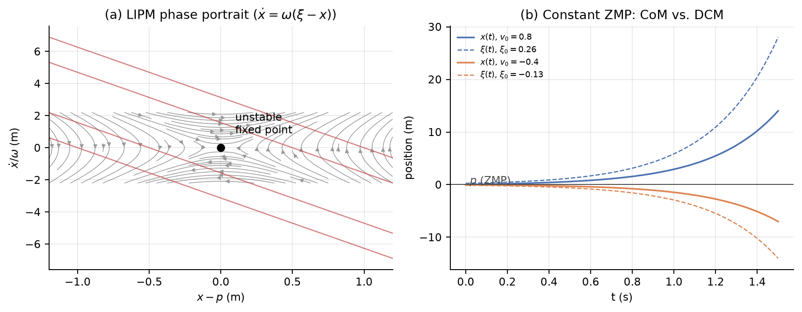

# 第 5 章 高自由度足式机器人 —— 深度推导笔记

> **来源**：Russ Tedrake, *Underactuated Robotics*, Ch. 5 "Highly-articulated Legged Robots"（underactuated.mit.edu/humanoids.html）。
> 本笔记覆盖 **Example 5.1（ZmpPlanner）**、**Example 5.2（LittleDog 步态优化）** 与 **Section 5.8（全部习题）**：MIQP 落脚点规划、ZMP 理解、GCS 落脚点规划。
> 公式编号采用 `(5.x)` 的形式按节编号；`[笔记]` 标记原书省略、本笔记补全的推导。本笔记补充了原书正文中 "Coming soon" 或只有结论的部分。
> 所有数值结果均由 `exp5_analysis/` 下的脚本与四个已执行的 notebook 验证；两个编程习题的自评分均为 **16/16**。

> **与原书节号的对应**：原书 5.5 Whole-Body Control ≈ 本笔记 5.4.4；5.6 Footstep planning and push recovery ≈ 5.4.6；5.7 Beyond ZMP planning ≈ 5.4.7；5.8 Exercises = 本笔记 5.8（5.8.1 MIQP、5.8.2 ZMP、5.8.3 GCS）。

> **阅读建议**：第一遍先读带 **理解提示 / 直觉 / 自检** 的引用块，建立"质心—支撑多边形—ZMP"的物理图像；第二遍再回到公式。第 5.1–5.4 节是主线，5.8 节是习题解答，可以按需跳读。所有图都在 `exp5_analysis/figures/` 下，由 `make_ch5_figures.py` 重新生成。

---

## 0. 本章地图与符号

### 0.1 本章要解决的问题

第 4 章用点足、无质量腿的简单模型（无轮缘轮、罗盘步态、SLIP、跳跃器）抓住了行走与奔跑的**本质动力学**：接触、碰撞、周期轨、返回映射。那些模型只有一个或两个自由度，脚是"点"，落脚位置由动力学自然决定。

第 5 章面对的是另一类机器人：**高自由度、多关节、带脚掌的人形或四足机器人**。它们有几十个自由度，脚可以主动放到几乎任何地方，关节有位置/速度/力矩限制，接触可以在脚跟、脚尖、整只脚之间切换。直接对完整模型做轨迹优化或反馈控制非常困难。

本章的核心思想是：**用简单模型做规划，用全身模型做执行**。

1. **质心（CoM）动力学**：无论机器人有多少关节，其质心的平动和绕质心的角动量满足一组**精确**的方程。
2. **零矩点（ZMP）/压力中心（CoP）**：在平地上，地面反力的合力作用点。它把"脚能放在哪里"这个几何/接触约束，翻译成"质心加速度可以取什么"这个动力学约束。
3. **分层规划**：先规划落脚点（离散/组合），再规划质心轨迹（连续/凸优化），最后用全身逆运动学或 QP 实现关节运动。
4. **落脚点优化**：MIQP（混合整数二次规划）与 GCS（凸集图）把"选哪块石头、走几步"编码成组合优化。

> **理解提示：本章为什么和 Ch. 4 是"两种物种"**。Ch. 4 的模型里，脚是被动落下的，落脚位置是连续动力学的结果；Ch. 5 的机器人可以**主动选择**落脚点。于是问题从"分析一个混合动力系统的极限环"变成了"在一个离散—连续混合空间里做规划"。ZMP 是在连续层面把接触约束压缩成质心加速度约束的工具；落脚点规划是在离散层面搜索接触序列的工具。两者合起来，才构成完整的行走规划。

### 0.2 统一符号

| 符号 | 含义 |
|---|---|
| $\mathbf q,\ \mathbf v=\dot{\mathbf q}$ | 广义坐标、广义速度 |
| $\mathbf p=(x,z)$ 或 $(x,y,z)$ | 世界坐标中的位置 |
| $\mathbf p_{cm}$ | 整机质心位置 |
| $m,\ m_i$ | 总质量、第 $i$ 个连杆质量 |
| $\mathbf f_i^{B_i}$ | 作用在刚体 $B$ 上、接触点 $i$ 的外力（世界系） |
| $\mu$ | 摩擦系数 |
| $\mathcal P$ | 支撑多边形（support polygon），所有接触点的凸包 |
| $\mathbf p_{cp}=(x_{cp},z_{cp})$ | 压力中心（CoP） |
| $\mathbf p_{zmp}$ | 零矩点（ZMP）；平地上与 CoP 重合 |
| $h=z-z_{cp}$ | 质心相对地面的高度 |
| $\omega=\sqrt{g/h}$ | 线性倒立摆的自然频率 |
| $\xi=x+\dot x/\omega$ | 发散分量（DCM）/ 捕获点（capture point） |
| $\mathbf L$ | 空间动量（角动量 + 线动量） |
| $\mathbf A(\mathbf q)$ | 质心动量矩阵（centroidal momentum matrix） |
| $\mathbf P(\cdot)$ | 庞加莱返回映射（第 4 章） |
| $N,\ h_k$ | 轨迹优化的节点数、第 $k$ 段时间步长 |
| $\delta_{t,i}\in\{0,1\}$ | 第 $t$ 步第 $i$ 块石头的 0-1 指派变量 |
| $\phi_e\in[0,1]$ | GCS 中边 $e$ 的流量变量 |

### 0.3 全章技术路线

```text
高自由度机器人（几十个关节、可主动落脚）
                    │
                    ▼
     刚体 + 无质量腿 + 接触约束（§5.1）
                    │
        ┌───────────┴───────────┐
        ▼                       ▼
  平地上的 CoP/ZMP（§5.2）   冲击动力学（§5.2.7）
        │                       │
        ▼                       ▼
  质心 = 线性倒立摆（LIPM）   可以忽略碰撞的条件
        │
        ▼
  ZMP 分层规划（§5.3）
  落脚点 → 质心轨迹 → 全身
        │                       ┌──────────────┐
        │                       │ 质心动力学     │
        └──────────────────────▶│ 空间动量 A(q) │（§5.4）
                                └──────┬───────┘
                                       ▼
                              全身控制 QP（§5.4）
                                       │
                    ┌──────────────────┴──────────────────┐
                    ▼                                     ▼
         Example 5.1: ZmpPlanner              Example 5.2: LittleDog
         （ZMP 跟踪 + 反馈）                   （直接转录步态优化）
                    │                                     │
                    └──────────────────┬──────────────────┘
                                       ▼
                            Section 5.8 习题
              MIQP 落脚点 / ZMP 脚模型 / GCS 落脚点
```

### 0.4 四个抽象层次对照

| 层次 | 状态/决策 | 约束 | 工具 | 本章位置 |
|---|---|---|---|---|
| 航天器 + 推进器 | 刚体位姿、推力 | 推力上下界、开关 | LQR/MPC | §5.1 |
| 刚体 + 无质量腿 | CoM $(x,z)$、接触力 | 单边接触、摩擦锥、支撑多边形 | ZMP/LIPM | §5.2–5.3 |
| 质心动力学 | $\mathbf q,\dot{\mathbf q}$、接触力 | 全身动力学、接触、摩擦 | QP/轨迹优化 | §5.4 |
| 组合落脚点规划 | 离散石头选择、连续脚位 | 步长、运动学、石头几何 | MIQP/GCS | §5.8 |

> **一条主线**：本章所有方法都在做同一件事——**把高自由度的全身问题，投影到一个低维的、可解的子问题上**。ZMP 投影到质心平动；质心动力学投影到 6 维空间动量；落脚点规划投影到二维脚位与 0-1 指派。投影会丢失信息（关节限位、力矩极限、碰撞），所以每一层都需要下一层来"兜底"。

---

## 5.1 思想实验：会走路的航天器

### 5.1.1 刚体航天器模型

考虑一个在重力场中的刚体 $B$，质心在体坐标系原点，姿态用 $(x,z,\theta)$ 描述。在质心以外的位置 ${}^B\mathbf p^{B_i}$ 安装若干推进器，推进器 $i$ 产生世界系力 $\mathbf f_i^{B_i}$。牛顿—欧拉方程为

$$
\begin{aligned}
m\ddot x &= \sum_i f_{i,x}^{B_i}, \\
m\ddot z &= \sum_i f_{i,z}^{B_i}-mg, \\
I\ddot\theta &= \sum_i \left[{}^B\mathbf p^{B_i}(\theta)\times \mathbf f_i^{B_i}\right]_y .
\end{aligned}
\tag{5.1}
$$

其中 $[\cdot]_y$ 是叉乘的 $y$ 分量。在平面 $x$–$z$ 中，若把 $y$ 轴取为 $z\times x$，则

$$
[\mathbf p\times \mathbf f]_y=p_z f_x-p_x f_z .
\tag{5.2}
$$

> **注意符号**：这个 $y$ 分量与常见的二维标量叉乘 $p_x f_y-p_y f_x$ 相差一个符号。第 5.2 节的 ZMP 推导会反复用到这个约定；混用符号是本章最常见的错误之一。

如果输入取为世界系推力 $f_{i,x},f_{i,z}$，则**平动方程是仿射的**（线性 + 常数重力项）；转动方程因为推进器位置随 $\theta$ 旋转而是非线性的。小角度下可以线性化 + LQR；有推力上下界时可以用线性 MPC；把 $\theta$ 的非线性也考虑进来则是一个非线性规划。总体而言，这是一个"相对容易"的控制问题。

### 5.1.2 移动推进器：离散 + 连续

现在只给两个推进器，并且允许**移动**推进器位置：

$$
{}^B\mathbf v^{B_i}=\frac{d}{dt}{}^B\mathbf p^{B_i}
$$

成为一个额外的控制输入。但有两个关键限制：

1. **移动时必须关闭推进器**：$f_i^{B_i}=0$ 或 ${}^B\mathbf v^{B_i}=0$。这是一个"或"约束，非凸。
2. **移动速度有上限**：$|{}^B\mathbf v^{B_i}|\le v_{\max}$。

更进一步，推进器只能在世界系中的某些区域打开：

$$
\mathbf A\,{}^W\mathbf p^{B_i}(\theta)\le \mathbf b .
\tag{5.3}
$$

即使每个区域是凸的，它们的并集也**不必是凸的**。

> **直觉：这就是行走的组合爆炸**。控制者必须做一个**离散决策**（关掉推进器、把它移动到新位置、再打开），同时决定连续的量（移动到哪、何时开、推力多大）。短期的控制能力损失，换来长期更好的推进器位置。行走中的"抬脚—摆动—落脚"就是同一个结构：支撑脚提供力，摆动脚必须卸载、移动、再接触。

### 5.1.3 足式机器人 = 刚体 + 无质量腿 + 接触约束

把上面的"刚体 + 推进器"直接映射到足式机器人：

- 刚体 $B$ = 机器人的躯干/整机；
- 无质量腿 = 推进器与躯干之间的连杆；
- 脚 = 可移动的推进器；
- 接触约束：
  - 只有**接触**时才能出力：脚离地时 $f_i=0$；
  - 只能**推**不能**拉**：$f_{i,z}^{B_i}\ge 0$；
  - 库仑摩擦：$|f_{i,x}^{B_i}|\le \mu f_{i,z}^{B_i}$（更精确地是摩擦锥）；
  - 脚的位置受腿的运动学限制，移动速度受腿的动力学限制。

**关键观察**：这些限制只作用在**接触力**和**脚的位置**上；机器人躯干的动力学仍然是式 (5.1) 那个简单的刚体方程。高自由度的复杂性被"隔离"在腿的 kinematics/dynamics 里，而不是进入质心方程。

> **理解提示：为什么这很重要**。如果连质心方程都变得复杂，ZMP 这套理论就不会成立。正是因为质心方程始终是"一个刚体 + 若干外力"，我们才能把所有接触力合成一个合力/合力矩，定义压力中心，并把问题降成二维的 LIPM。腿的复杂性留给后面的逆运动学和全身 QP。

### 5.1.4 关键抽象：脚可以近似独立于身体运动

这套抽象之所以有效，是因为高自由度机器人有**足够的自由度**：脚可以相对于身体移动，而身体不必跟着剧烈运动。对比第 4 章的点足机器人：脚的位置完全由腿的摆动动力学决定，不能独立选择。自由度越多，"脚 = 可移动推进器"的近似越好。

代价是分层：

1. 落脚点规划忽略质心动力学（或只用粗略的运动学）；
2. 质心规划忽略关节限位和力矩极限；
3. 全身控制再尽量满足前两层给出的目标，同时处理真实约束。

> **自检 5.1**：
> 1. 为什么式 (5.1) 的平动方程对推力是仿射的，而转动方程不是？
> 2. "移动时关闭推进器"对应行走中的哪个阶段？
> 3. 如果机器人只有一条点足（单腿跳），"脚可以独立于身体移动"的假设还成立吗？

---

## 5.2 质心动力学、CoP 与 ZMP

### 5.2.1 平地接触约束

假设机器人走在**平地**上。地面接触点 $i$ 的高度都相同，记为 $z=0$。地面只能推、不能拉：

$$
f_{i,z}\ge 0\quad\forall i
\quad\Longrightarrow\quad
\sum_i f_{i,z}\ge 0
\quad\Longrightarrow\quad
\ddot z\ge -g .
\tag{5.4}
$$

也就是说：**如果地面不能拉你，你的质心向下加速度不可能超过重力加速度**。这是行走欠驱动性最本质的约束之一——无论关节多强，都不能让质心以大于 $g$ 的加速度往下掉。

库仑摩擦给出

$$
|f_{i,x}|\le \mu f_{i,z}
\;\Longrightarrow\;
\sum_i |f_{i,x}|\le \mu\sum_i f_{i,z}
\;\Longrightarrow\;
|\ddot x|\le \mu(\ddot z+g).
\tag{5.5}
$$

如果质心保持恒定高度（$\ddot z=0$），则

$$
|\ddot x|\le \mu g .
\tag{5.6}
$$

这就是"摩擦系数决定了你在地面上最多能多快加速"的定量版本。$\mu=0.5$ 时大约 $4.9\ \mathrm{m/s^2}$。

> **直觉：单边接触是行走的"原罪"**。机械臂可以双向出力，所以它的末端可以任意加速；脚只能推地，所以质心的向下加速度被 $g$ 封顶。所有 ZMP/LIPM 的"倒立摆"行为，根源都在这里。

### 5.2.2 压力中心（CoP）的定义

把地面法向力的分布压缩成一个点：

$$
\mathbf p_{cp}
\equiv {}^W\mathbf p^{R_{cp}}_W
=
\frac{\sum_i {}^W\mathbf p^{B_i}_W\,f_{i,z}^{B_i}}
{\sum_i f_{i,z}^{B_i}} .
\tag{5.7}
$$

平地上所有接触点高度相同，所以 $z_{cp}$ 就是地面高度（取为 0）。CoP 有两个重要性质：

1. **CoP 必须落在接触点的凸包内**。因为它是接触点位置的**凸组合**，权重 $f_{i,z}\ge 0$ 且和为 1。
2. **CoP 不是质心投影**。只有当质心加速度为零（静态）时，二者才重合。

### 5.2.3 从力矩平衡到 ZMP 方程（完整推导）

取 $y$ 轴为 $z\times x$，叉乘的 $y$ 分量为式 (5.2)。对整机关于质心写欧拉方程。地面反力的合力为

$$
\mathbf F=(m\ddot x,\;m\ddot z+mg),
$$

作用在 CoP $\mathbf p_{cp}=(x_{cp},0)$。质心到 CoP 的向量为

$$
\mathbf r=\mathbf p_{cp}-\mathbf p_{cm}=(x_{cp}-x,\;-z).
$$

关于质心的力矩（$y$ 分量）为

$$
[\mathbf r\times \mathbf F]_y
=r_zF_x-r_xF_z
=(-z)(m\ddot x)-(x_{cp}-x)(m\ddot z+mg).
$$

它等于角动量的变化率 $I\ddot\theta$：

$$
I\ddot\theta
=-z\,m\ddot x-(x_{cp}-x)(m\ddot z+mg).
$$

整理得

$$
\boxed{
(m\ddot z+mg)(x_{cp}-x)
=(0-z)m\ddot x-I\ddot\theta
}
\tag{5.8}
$$

这就是原书的式 (cop)。若质心高度恒定（$\ddot z=0$）、角动量变化可忽略（$I\ddot\theta\approx 0$），则

$$
\boxed{
\ddot x=\frac{g}{z}(x-x_{cp})
=\frac{g}{z-z_{cp}}(x-x_{cp})
}
\tag{5.9}
$$

这就是著名的 **ZMP 方程**（线性倒立摆，LIPM）。同理，$y$ 方向为

$$
\ddot y=\frac{g}{z-z_{cp}}(y-y_{cp}).
\tag{5.10}
$$

> **理解提示：ZMP 是"输入"**。式 (5.9) 把 $x_{cp}$ 放在右边，看起来像输出；但在规划中我们把它当**输入**：给定一条期望的 ZMP 轨迹 $x_{cp}(t)$，解一个二阶线性 ODE 得到质心轨迹。ZMP 在支撑多边形内，就意味着存在一组非负的接触力能实现这个质心加速度。反过来，给定质心轨迹，ZMP 由式 (5.9) 唯一确定；它必须落在支撑多边形内，否则脚会翻倒。

### 5.2.4 线性倒立摆（LIPM）

定义 $\omega=\sqrt{g/h}$，$h=z-z_{cp}$ 为质心高度。式 (5.9) 写成

$$
\ddot x=\omega^2(x-p),\qquad p\equiv x_{cp}.
\tag{5.11}
$$

这是一个**倒立摆**：固定点 $x=p$ 是不稳定的（特征值 $\pm\omega$）。它与第 4 章的 SLIP 支撑相是同一个数学结构，只是这里腿长恒定、没有弹簧。

LIPM 的三个等价视角：

1. **位置视角**：$x$ 被 $p$ 以"排斥"的方式推离；要让它停在 $p$，需要主动控制。
2. **速度视角**：$\dot x=\omega(\xi-x)$，其中 $\xi=x+\dot x/\omega$ 是发散分量（DCM）。
3. **能量视角**：$E=\frac12\dot x^2-\frac12\omega^2(x-p)^2$ 在 $p$ 恒定时守恒。

### 5.2.5 原书 Aside：ZMP 的 wrench 推导

对刚体系统，所有外力可以线性地合成一个**空间力（wrench）**。对任意参考点 $A$：

$$
\begin{aligned}
m\ddot x&=\sum_i f_{i,x}=f^{A}_{net,x},\\
m\ddot z&=\sum_i f_{i,z}-mg=f^{A}_{net,z}-mg,\\
I\ddot\theta
&=\sum_i [{}^B\mathbf p^{B_i}\times \mathbf f_i^{B_i}]_y
=[{}^B\mathbf p^A\times \mathbf f^A_{net}]_y+\tau^A_{net}.
\end{aligned}
\tag{5.12}
$$

这里 $\tau^A_{net}=\sum_i[({}^B\mathbf p^{B_i}-{}^B\mathbf p^A)\times \mathbf f_i^{B_i}]_y$ 是**关于 $A$ 的净力矩**。ZMP 定义为使 $\tau^A_{net}=0$ 的点：

$$
[{}^B\mathbf p^{ZMP}\times \mathbf f^{ZMP}_{net}]_y
=\sum_i[{}^B\mathbf p^{B_i}\times \mathbf f_i^{B_i}]_y .
\tag{5.13}
$$

展开（平地 $z_i=0$）：

$$
p^{ZMP}_z f_{net,x}-p^{ZMP}_x f_{net,z}
=\sum_i\left(p_{i,z}f_{i,x}-p_{i,x}f_{i,z}\right).
\tag{5.14}
$$

当 $f_{net,z}\ne 0$ 时，这是一个关于 $p^{ZMP}_x$ 的线性方程，解为一条**直线**（在三维中是一个平面与地面的交线）；取其中与地面相交的那个点，就是行走机器人常用的 ZMP。

把式 (5.12) 代入式 (5.13)，就回到式 (5.8)。另一方面，平地上

$$
\sum_i p_{i,z}f_{i,x}=p^{ZMP}_z\sum_i f_{i,x},
$$

所以

$$
p^{ZMP}_x=\frac{\sum_i p_{i,x}f_{i,z}}{\sum_i f_{i,z}}=x_{cp}.
\tag{5.15}
$$

**结论：平地上的 ZMP 与 CoP 是同一个点。**

> **自检 5.2**：
> 1. 为什么 CoP 一定在接触点的凸包内？如果所有法向力都为正，CoP 会在凸包边界上吗？
> 2. 式 (5.8) 中 $I\ddot\theta$ 的符号如果写反，会导致什么物理上荒谬的结论？
> 3. 如果质心高度 $h$ 很小，LIPM 的 $\omega$ 很大，系统"倒得更快"还是"倒得更慢"？

### 5.2.6 三维推广

三维中，ZMP 定义为地面上使**两个水平力矩分量**为零的点：

$$
\tau^{ZMP}_{net,x}=\tau^{ZMP}_{net,y}=0,
\qquad
\tau^{ZMP}_{net,z}\ \text{可以非零}.
\tag{5.16}
$$

$z$ 方向的力矩对应绕竖直轴的旋转（偏航），地面接触可以承受它（通过摩擦力的分布）。$x,y$ 方向的方程分别为

$$
\begin{aligned}
(m\ddot z+mg)(x_{cp}-x)&=-z\,m\ddot x-I_x\ddot\theta_x,\\
(m\ddot z+mg)(y_{cp}-y)&=-z\,m\ddot y-I_y\ddot\theta_y.
\end{aligned}
\tag{5.17}
$$

在质心高度恒定、角动量变化可忽略时，两个水平方向**解耦**，各自是一个 LIPM：

$$
\ddot x=\omega^2(x-x_{cp}),\qquad
\ddot y=\omega^2(y-y_{cp}).
\tag{5.18}
$$

> **直觉：为什么可以解耦**。LIPM 的耦合只通过高度 $z$ 和角动量出现；一旦固定高度、忽略躯干转动，$x$ 和 $y$ 就是两个独立的倒立摆。ZmpPlanner 正是利用这一点，把二维问题当成两个一维问题一起解。

### 5.2.7 冲击动力学：为什么人形机器人可以忽略碰撞

第 4 章花了很大篇幅处理碰撞。对高自由度机器人，很多文献在质心规划中**直接忽略碰撞**。这一节解释什么时候可以这样做。

碰撞是瞬时事件。对动力学方程

$$
\mathbf M(\mathbf q)\ddot{\mathbf q}+\mathbf C(\mathbf q,\dot{\mathbf q})\dot{\mathbf q}+\mathbf g(\mathbf q)
=\mathbf S^\top\boldsymbol\tau+\sum_i\mathbf J_i^\top\mathbf f_i
$$

在无穷小时间 $\Delta t\to0$ 上积分，有限力（重力、关节力矩）的贡献趋于零，只剩冲量：

$$
\mathbf M(\mathbf q)\left(\dot{\mathbf q}^+-\dot{\mathbf q}^-\right)
=\sum_i\mathbf J_i^\top\boldsymbol\Lambda_i,
\tag{5.19}
$$

其中 $\boldsymbol\Lambda_i=\int\mathbf f_i\,dt$ 是接触冲量。对于**完全非弹性**碰撞，接触点碰撞后的速度为 0：

$$
\mathbf J_i\dot{\mathbf q}^+=0.
\tag{5.20}
$$

联立可解出碰撞后的速度（单接触）：

$$
\dot{\mathbf q}^+
=\dot{\mathbf q}^-
-\mathbf M^{-1}\mathbf J^\top
\left(\mathbf J\mathbf M^{-1}\mathbf J^\top\right)^{-1}
\mathbf J\dot{\mathbf q}^-.
\tag{5.21}
$$

碰撞能量损失为

$$
\Delta E=\frac12\dot{\mathbf q}^{-T}\mathbf M\dot{\mathbf q}^-
-\frac12\dot{\mathbf q}^{+T}\mathbf M\dot{\mathbf q}^+ .
\tag{5.22}
$$

**三种典型策略**：

| 策略 | 碰撞模型 | 能量损失 | 例子 |
|---|---|---|---|
| 刚性腿、点足 | 绕碰撞点角动量守恒 | 有，$\cos^2(2\alpha)$ 型 | 无轮缘轮、罗盘步态 |
| 弹簧腿 + 无质量脚尖 | 无速度跳变 | 无 | SLIP |
| 高自由度、恒质心高度、小角动量 | 脚落在质心正下方 | 近似为 0 | 人形机器人 ZMP 规划 |

第三种策略的推导：若质心竖直速度恒定（$\dot z=c$，$\ddot z=0$），且绕质心的角动量近似为零（$I\dot\theta\approx0$），则碰撞前接触点的速度主要是竖直的。如果摆动脚落在质心正下方，接触点的水平速度近似为零，碰撞冲量主要沿竖直方向，而竖直方向的冲量被腿的"虚拟弹簧"或关节伺服吸收/耗散很小；极端情况下碰撞前后质心速度不变。

> **理解提示：这不是说碰撞真的没有能量损失**，而是说在**质心层面**，损失相对于步态的能量尺度可以忽略。关节层面的冲击、噪声、磨损仍然存在，需要用柔顺控制、阻抗控制或步态设计来处理。ZMP 规划忽略冲击，是因为它只关心质心的低频运动。

> **自检 5.3**：
> 1. 为什么完全非弹性碰撞的冲量投影式 (5.21) 里会出现 $\mathbf J\mathbf M^{-1}\mathbf J^\top$？它的物理意义是什么？
> 2. 如果脚落在质心前方而不是正下方，碰撞会怎样影响质心速度？
> 3. "恒质心高度"策略与第 4 章 SLIP 的"弹簧腿"策略，在能量上有什么本质区别？

### 5.2.8 CoP、ZMP、CoM 投影：三个容易混淆的点


| 概念 | 定义 | 什么时候等于质心投影 | 关键性质 |
|---|---|---|---|
| CoM 投影 | 质心在地面上的正投影 $(x,y)$ | 永远 | 纯几何 |
| CoP | 法向接触力的加权平均位置 | 静态/慢速时 | 一定在支撑多边形内（有接触时） |
| ZMP | 使地面合力矩水平分量为零的点 | 静态/慢速时 | 平地上等于 CoP；可以定义在支撑多边形外（虚拟点） |

**常见误区**：

1. **"ZMP 在支撑多边形内就一定稳定"**。错。ZMP 在支撑多边形内只说明**存在**一组接触力能实现当前的质心加速度；它不保证质心速度会收敛，也不保证下一步还有脚可以踩。稳定性需要结合 DCM/捕获点、落脚点规划和反馈。
2. **"ZMP = CoM 投影"**。只在静态或质心加速度为零时成立。动态行走时 ZMP 必须超前/滞后于 CoM 投影，才能产生加减速。
3. **"CoP 可以随便放"**。CoP 是接触力的结果，必须在支撑多边形内；如果规划的 ZMP 跑到外面，机器人就会绕脚边缘翻倒（foot roll），模型从"平脚接触"切换成"绕脚尖/脚跟转动"的欠驱动模式。
4. **"ZMP 只适用于平地"**。ZMP 可以定义在一般接触面上，但"CoP = ZMP"和"支撑多边形"的简洁形式依赖平地/平面接触假设。崎岖地形需要更一般的接触wrench 约束。

> **自检 5.4**：一个机器人静止站立，质心投影在支撑多边形中心，ZMP 在哪里？如果它开始向前加速，ZMP 应该前移还是后移？为什么？
---

## 5.3 基于 ZMP 的分层规划

### 5.3.1 三步流水线

原书把复杂机器人的运动规划分解为：

1. **规划落脚点/接触位置**：决定每一步踩在哪块石头上、何时着地、何时离地。
2. **规划质心轨迹**：给定 ZMP（或接触力）轨迹，用 LIPM 解出质心运动。
3. **计算全身关节运动**：用逆运动学/全身 QP 实现质心和脚的轨迹。

这条流水线从 Honda ASIMO 的 ZMP 行走器开始，至今仍是人形机器人规划的主流框架。

> **理解提示：分层的代价**。落脚点规划通常是**运动学**的，不考虑质心动力学，因此保守；质心规划不考虑关节限位和力矩极限，因此可能给出不可实现的轨迹；全身层只能在给定目标下"尽量"满足，无法保证。分层的收益是每一层都变成可解的凸问题/组合问题。工程上，这种"保守但可解"的折中通常比直接解一个非凸全身轨迹优化更可靠。

### 5.3.2 启发式落脚点规划

原书这一节标注 "Coming soon"，并引用了 Atlas 的工作（Deits14, Kuindersma14）。核心思想：

- 用**启发式**（A*、RRT、或简单的几何规则）在可落脚区域（stepping stones/地形）上搜索脚的位置；
- 约束包括：最大步长、两脚不碰撞、脚不能跨在障碍物上、脚掌与地面接触面积足够；
- 生成的落脚点序列交给质心规划器。

更系统的方法就是 5.8 节的 MIQP 和 GCS：把"选哪块石头"编码成 0-1 变量或图上的路径。

### 5.3.3 质心轨迹规划：LIPM 的解析解

#### (a) 常数 ZMP

当 $p$ 为常数时，式 (5.11) 的通解为

$$
x(t)=p+(x_0-p)\cosh(\omega t)+\frac{\dot x_0}{\omega}\sinh(\omega t),
\tag{5.23}
$$

$$
\dot x(t)=\omega(x_0-p)\sinh(\omega t)+\dot x_0\cosh(\omega t).
\tag{5.24}
$$

这是一条**双曲**轨迹：稍微偏离 $p$，偏差就会指数增长。行走之所以可能，是因为我们不断**移动 $p$**（换脚），把倒立摆的"支撑点"挪到质心前方，让它重新"倒回来"。

#### (b) 分段 ZMP 与卷积

ZMP 通常是分段常值或分段线性的（在脚之间切换）。LIPM 是线性系统，可以用**卷积/格林函数**求解：

$$
x(t)=x_0\cosh(\omega t)+\frac{\dot x_0}{\omega}\sinh(\omega t)
+\omega\int_0^t\sinh\big(\omega(t-\tau)\big)\,p(\tau)\,d\tau .
\tag{5.25}
$$

验证：对 $t$ 求二阶导，

$$
\ddot x=\omega^2\left[x_0\cosh+\frac{\dot x_0}{\omega}\sinh
+\omega\int_0^t\sinh(\omega(t-\tau))p(\tau)d\tau\right]-\omega^2p(t)
=\omega^2(x-p).
$$

对分段常值 $p$，每一段都可以用式 (5.23) 递推；对分段线性 $p$，可以额外加一个特解（与 $p$ 同斜率的一次项）。ZmpPlanner 内部用的是分段多项式 ZMP 的闭式解。

#### (c) DCM / 捕获点

定义**发散分量**（divergent component of motion, DCM），也叫捕获点（capture point）：

$$
\boxed{\xi=x+\frac{\dot x}{\omega}}
\tag{5.26}
$$

则

$$
\dot\xi=\dot x+\frac{\ddot x}{\omega}
=\omega(\xi-x)+\omega(x-p)
=\omega(\xi-p).
\tag{5.27}
$$

同时

$$
\dot x=\omega(\xi-x).
\tag{5.28}
$$

这两个方程把 LIPM 对角化：

- $\xi$ 是**不稳定**分量：$\dot\xi=\omega(\xi-p)$，若 $p<\xi$，$\xi$ 指数增长；
- $x$ 是**稳定**分量：$\dot x=\omega(\xi-x)$，$x$ 以时间常数 $1/\omega$ 追随 $\xi$。

**捕获点**的含义：如果从当前状态出发，把 ZMP **瞬间**移到 $\xi$（并保持），那么 $\xi$ 不再变化，$x$ 会渐近收敛到 $\xi$。也就是说，$\xi$ 是"如果现在把脚踩在这里，质心刚好能停下来"的位置。

$$
p=\xi \quad\Longrightarrow\quad \dot\xi=0,\qquad x(t)\to\xi .
\tag{5.29}
$$

> **直觉：DCM 是"必须被处理掉的动量"**。$x$ 本身会自己收敛到 $\xi$；真正危险的是 $\xi$。走路时每一步都在选择一个新的 $p$，把 $\xi$ 拉回支撑区域。落脚点规划本质上是在规划 $\xi$ 的演化。

#### (d) 轨道能量

对常数 $p$，定义

$$
E=\frac12\dot x^2-\frac12\omega^2(x-p)^2 .
\tag{5.30}
$$

则

$$
\dot E=\dot x\ddot x-\omega^2(x-p)\dot x
=\dot x\left[\omega^2(x-p)\right]-\omega^2(x-p)\dot x=0.
\tag{5.31}
$$

$E$ 守恒。$E=0$ 对应 $\dot x=\pm\omega(x-p)$，即 DCM 恰好等于 $p$ 的稳定/不稳定流形。$E>0$ 的轨迹会越过 $p$；$E<0$ 的轨迹会在到达 $p$ 之前折返。

> **自检 5.5**：
> 1. 若 $x_0=p$、$\dot x_0>0$，质心会怎样运动？DCM 初值是多少？
> 2. 若当前 $x=0$、$\dot x=0.5$ m/s、$\omega=3$ rad/s，捕获点在哪里？脚应该踩在哪里才能停住？
> 3. 为什么式 (5.28) 说明 $x$ 是稳定分量，而 $\xi$ 是不稳定分量？



左图是 $(x-p,\dot x/\omega)$ 平面上的相图：原点是不稳定鞍点，红色直线是常 DCM 的稳定流形 $\dot x=\omega(\xi-x)$。右图是常 ZMP 下两条轨迹的 $x(t)$ 与 $\xi(t)$：$x$ 追随 $\xi$，而 $\xi$ 本身指数发散。

### 5.3.4 ZMP "稳定性"指标：它是什么、不是什么

很多文献把"ZMP 在支撑多边形内"称为**ZMP 稳定性判据**。严格地说：

- 它是一个**可行性**判据：存在非负接触力使质心加速度满足 LIPM，且脚不翻倒。
- 它**不是** Lyapunov 稳定性判据：ZMP 在支撑多边形内，质心仍可能以很大速度冲向边缘，下一步就摔倒。
- 它**不包含**落脚点信息：如果支撑多边形很小（点足），ZMP 几乎没有调节空间，必须靠换脚。
- 它**不包含**上身角动量：$I\ddot\theta$ 被忽略；快速摆臂/转体时误差很大。

更完整的稳定性概念是**捕获性（capturability）**：存在一个落脚点序列，能在 $N$ 步内让机器人停下来。对 LIPM，捕获点 $\xi$ 是这一理论的基石。

> **理解提示：把 ZMP 当作"约束"而不是"稳定性证明"**。在优化里，ZMP 约束写成 $x_{cp}(t)\in\mathcal P$；这保证了每一时刻的接触力可行。真正的闭环稳定性来自反馈（Example 5.1 的线性策略）和落脚点更新（push recovery）。

### 5.3.5 Example 5.1：ZmpPlanner


#### (a) 问题设定

Notebook 给定一串落脚点（平均人类步长 0.7 m、步宽 0.1 m），构造一条**分段线性的期望 ZMP 轨迹**：

- 单支撑相：ZMP 停在当前脚的中心；
- 双支撑相：ZMP 从当前脚中心线性移动到下一只脚中心；
- 初始质心位置/速度为零，高度 $h=1$ m。

然后调用 Drake 的 `ZmpPlanner` 生成质心轨迹和反馈策略。

#### (b) 最优控制形式

ZmpPlanner 求解的是一个**线性二次型跟踪问题**。状态 $\mathbf x=[\mathbf c;\dot{\mathbf c}]$，控制 $\mathbf u=\ddot{\mathbf c}$，输出（ZMP）为

$$
\mathbf y=\mathbf c-\frac{h}{g}\mathbf u .
\tag{5.32}
$$

代价为

$$
J=\int_0^{t_f}\left[
(\mathbf y-\mathbf y_d)^T\mathbf Q_y(\mathbf y-\mathbf y_d)
+\mathbf u^T\mathbf R\mathbf u
\right]dt
+\bar{\mathbf x}(t_f)^T\mathbf S\,\bar{\mathbf x}(t_f),
\tag{5.33}
$$

其中 $\bar{\mathbf x}=[\mathbf c-\mathbf y_d(t_f);\dot{\mathbf c}]$，$\mathbf S$ 是用同一动力学和单步代价解无限时域 LQR 得到的终端代价。

因为动力学线性、代价二次，值函数具有二次形式：

$$
V(\mathbf x,t)=\bar{\mathbf x}^T\mathbf V_{xx}\bar{\mathbf x}
+\bar{\mathbf x}^T\mathbf V_x(t)+V_0(t),
\tag{5.34}
$$

最优策略是**线性反馈**：

$$
\mathbf u^*(\mathbf x,t)=\mathbf K\bar{\mathbf x}+\mathbf u_0(t).
\tag{5.35}
$$

$\mathbf K$ 是时不变的 LQR 增益，$\mathbf u_0(t)$ 是前馈项。ZmpPlanner 同时返回标称轨迹和这个策略。

> **理解提示：为什么这比"解一个轨迹优化"漂亮**。LIPM + 二次代价的 Riccati 方程有闭式/半闭式解，可以实时计算；而且它天然给出反馈策略，不只是开环轨迹。这正是 Tedrake et al. (2015) 的核心贡献。

#### (c) 代码结构

`Exp5.1-zmp-planner.ipynb` 的关键步骤：

```python
# 1. 由落脚点和支撑时间构造分段线性 ZMP
zmp_traj = GenerateDesiredZmpTraj(footsteps, double_support_duration=0.5,
                                  single_support_duration=1.0)

# 2. 规划：初始质心状态 + 高度
zmp_planner = ZmpPlanner()
zmp_planner.Plan(zmp_traj, x0, height)

# 3. 查询标称轨迹
com = zmp_planner.get_nominal_com(t)
comd = zmp_planner.get_nominal_comd(t)
comdd = zmp_planner.get_nominal_comdd(t)

# 4. 反馈策略
u = zmp_planner.ComputeOptimalCoMdd(t, x)   # x = [com; comd]
```

#### (d) 数值结果与解释

本笔记的复现脚本 `exp5_analysis/example51_zmp.py` 得到：

| 量 | 数值 |
|---|---|
| 规划总时长 | $T=8.5$ s |
| 最大侧向质心偏移 | $0.0463$ m |
| 最大前向速度 | $0.384$ m/s |
| 规划 ZMP 范围 | $x_{cp}\in[0,2.5]$ m |
| CoP 映射恒等式误差 | $0$（机器精度） |
| 相对期望 ZMP 的最大跟踪误差 | $0.153$ m |
| 速度扰动后的终值误差 | $1.5\times10^{-5}$ m |

**两个重要观察**：

1. **ZMP 跟踪不是精确插值**。目标函数同时惩罚 ZMP 误差和控制加速度；默认 $\mathbf Q_y=\mathbf I$、$\mathbf R=0.1\mathbf I$，在 ZMP 轨迹的拐角处，加速度受限导致 ZMP 偏离期望值最多 0.15 m。若把 $\mathbf R$ 调小，跟踪更紧，但加速度更大：

   | $\mathbf R$ | 最大跟踪误差 (m) | 最大 $|\ddot x|$ (m/s²) |
   |---|---|---|
   | $10^{-4}$ | 0.095 | 1.24 |
   | $10^{-2}$ | 0.081 | 0.849 |
   | $0.1$ | 0.153 | 0.333 |
   | $1.0$ | 0.228 | 0.308 |

   这不是 bug，而是**最优控制的权衡**：ZMP 轨迹的折角在物理上需要无限大的加速度才能精确跟踪，任何有限的 $\mathbf R$ 都会把它平滑掉。

2. **反馈策略确实有效**。给初始速度一个 $(+0.35,-0.2)$ m/s 的扰动，用 `ComputeOptimalCoMdd` 闭环仿真，终值误差仍只有 $1.5\times10^{-5}$ m。注意这里规划的是**固定** ZMP 轨迹，反馈只调整质心加速度，不改变落脚点；这对应"脚已经踩好，只能靠踝/髋调整"的情况。

**步时敏感性**：双支撑时间 $T_{ds}$ 从 0.2 增加到 0.8 s，总时长从 7.0 增加到 10.0 s，最大前向速度从 0.472 降到 0.325 m/s；侧向摆动几乎不变。步频越快，质心速度越大、需要的加速度越大；步频越慢，质心越"从容"，但总时间变长。这正是 notebook 建议"改一改 footstep timing"的原因。

> **自检 5.6**：
> 1. 为什么减小 $\mathbf R$ 会让 ZMP 跟踪更好但加速度更大？
> 2. 如果 ZMP 轨迹在双支撑相不是线性插值而是阶跃，质心轨迹会怎样？
> 3. 反馈策略能修正质心位置/速度偏差，但能修正"脚放错位置"吗？为什么？

### 5.3.6 从 CoM 计划到全身计划

质心轨迹和脚的位置只是任务空间的目标；真正要发给电机的是关节角/力矩。这一步通常用**全身逆运动学**或**全身 QP**。

#### (a) 质心雅可比

整机质心是各连杆质心的质量加权平均：

$$
\mathbf p_{cm}(\mathbf q)=\frac{1}{M}\sum_i m_i\,\mathbf p_i(\mathbf q),
\qquad M=\sum_i m_i .
\tag{5.36}
$$

对时间求导：

$$
\dot{\mathbf p}_{cm}
=\frac{1}{M}\sum_i m_i\,\mathbf J_i(\mathbf q)\dot{\mathbf q}
=\mathbf J_{cm}(\mathbf q)\dot{\mathbf q},
\qquad
\mathbf J_{cm}=\frac{1}{M}\sum_i m_i\mathbf J_i .
\tag{5.37}
$$

$\mathbf J_i$ 是第 $i$ 个连杆质心的平移雅可比。

#### (b) 微分逆运动学 QP

给定期望的质心速度 $\dot{\mathbf p}_{cm}^d$、支撑脚不动（$\mathbf J_{foot}\dot{\mathbf q}=0$）、摆动脚跟踪轨迹 $\mathbf J_{sw}\dot{\mathbf q}=\mathbf v_{sw}^d$，可以解一个最小的 QP：

$$
\begin{aligned}
\min_{\dot{\mathbf q}}\quad &
\|\mathbf J_{cm}\dot{\mathbf q}-\dot{\mathbf p}_{cm}^d\|^2
+w_{sw}\|\mathbf J_{sw}\dot{\mathbf q}-\mathbf v_{sw}^d\|^2
+w_q\|\dot{\mathbf q}-\dot{\mathbf q}_{nom}\|^2 \\
\text{s.t.}\quad &
\mathbf J_{foot}\dot{\mathbf q}=0,\\
& \dot{\mathbf q}_{min}\le\dot{\mathbf q}\le\dot{\mathbf q}_{max},\\
& \mathbf q+\dot{\mathbf q}\Delta t\in[\mathbf q_{min},\mathbf q_{max}].
\end{aligned}
\tag{5.38}
$$

这是**速度级**的 IK；积分得到关节位置，再用关节 PD 或力矩控制跟踪。更精细的做法是**加速度级** QP，直接优化关节加速度和接触力。

> **理解提示：分层不是"一次算完"**。实际系统通常以 1 kHz 运行全身 QP，以 10–100 Hz 更新质心/落脚点规划。规划层给出参考，控制层在参考附近做局部修正。Example 5.1 的反馈策略就是"质心层"的局部修正；全身 QP 是"关节层"的局部修正。

---

## 5.4 质心动力学与全身控制

### 5.4.1 空间速度、空间力、空间惯量

对刚体 $B$，取质心 $B_{cm}$ 为参考点，定义**空间速度**（角速度 + 线速度）：

$$
{}^W\mathbf V^{B_{cm}}
=\begin{bmatrix}{}^W\dot{\boldsymbol\theta}^B\\ {}^W\dot{\mathbf p}^{B_{cm}}\end{bmatrix}
\in\mathbb R^6 .
\tag{5.39}
$$

**空间力**（力矩 + 力）：

$$
\mathbf F^{B_{cm}}_i=\begin{bmatrix}\boldsymbol\tau_i\\ \mathbf f_i\end{bmatrix}.
\tag{5.40}
$$

绕质心的**空间惯量**：

$$
\mathbf M^{B/B_{cm}}
=\begin{bmatrix}\mathbf I&0\\0&m\mathbf I\end{bmatrix}.
\tag{5.41}
$$

**空间动量**：

$$
{}^W\mathbf L^{B/B_{cm}}
=\begin{bmatrix}\mathbf I\dot{\boldsymbol\theta}\\ m\dot{\mathbf p}^{B_{cm}}\end{bmatrix}
=\mathbf M^{B/B_{cm}}\,{}^W\mathbf V^{B_{cm}}.
\tag{5.42}
$$

牛顿—欧拉方程可以写成紧凑形式：

$$
\boxed{
{}^W\dot{\mathbf L}^{B/B_{cm}}
=\sum_i\mathbf F^{B_{cm}}_i
}
\tag{5.43}
$$

即**空间动量的变化率等于作用在质心上的空间力之和**。

> **注意**：空间力的“力矩”部分依赖于参考点。把力从 $A$ 点平移到 $B$ 点时，力矩要加上 $(\mathbf p_A-\mathbf p_B)\times\mathbf f$。第 5.4.3 节的接触力矩就是这么来的。

### 5.4.2 单刚体的空间动量方程

把式 (5.39)–(5.43) 展开，就回到式 (5.1)：

$$
\frac{d}{dt}
\begin{bmatrix}I\dot\theta\\ m\dot x\\ m\dot z\end{bmatrix}
=
\begin{bmatrix}\sum_i [\mathbf p_i\times\mathbf f_i]_y\\ \sum_i f_{i,x}\\ \sum_i f_{i,z}-mg\end{bmatrix}.
\tag{5.44}
$$

重力是一个作用在质心的空间力 $[0;0;-mg]$（在 $x$–$z$ 平面中）。

### 5.4.3 多体系统：质心动量矩阵 $\mathbf A(\mathbf q)$

对由多个连杆组成的机器人 $R$，质心为

$$
\mathbf p_{cm}(\mathbf q)
=\frac{\sum_i m_i\,\mathbf p_i(\mathbf q)}{\sum_i m_i}
=\frac{\sum_i {}^W\mathbf X^{B_i}(\mathbf q)\,{}^{B_i}\mathbf p^{B_{i,cm}}\,m_i}{\sum_i m_i}.
\tag{5.45}
$$

定义整机关于质心的空间动量：

$$
{}^W\mathbf L^{R/R_{cm}}(\mathbf q,\dot{\mathbf q})
=\mathbf A(\mathbf q)\dot{\mathbf q},
\tag{5.46}
$$

其中 $\mathbf A(\mathbf q)\in\mathbb R^{6\times n_v}$ 是**质心动量矩阵**（centroidal momentum matrix, Orin 2013）。它的变化率为

$$
\boxed{
{}^W\dot{\mathbf L}^{R/R_{cm}}
=\mathbf A(\mathbf q)\ddot{\mathbf q}
+\dot{\mathbf A}(\mathbf q,\dot{\mathbf q})\dot{\mathbf q}
=\sum_i\mathbf F^{R_{cm}}_i
}
\tag{5.47}
$$

这就是**质心动力学方程**。展开成 6 行：

$$
\mathbf A\ddot{\mathbf q}+\dot{\mathbf A}\dot{\mathbf q}
=
\begin{bmatrix}
\sum_i (\mathbf p_i-\mathbf p_{cm})\times\mathbf f_i\\
\sum_i\mathbf f_i+m\mathbf g
\end{bmatrix}.
\tag{5.48}
$$

> **理解提示：这是精确的，不是近似**。式 (5.48) 对完整的多体系统**精确成立**，没有忽略任何连杆动力学。它之所以简单，是因为我们只写了 6 个方程（质心的平动 + 绕质心的转动），把其余 $n_v-6$ 个内部自由度留给了关节力矩。真正的近似发生在下一步：我们可能忽略关节限位、力矩极限、接触约束，或者用简化的接触模型。

**宇航员类比**：在零重力下，如果不受外力，质心加速度为零、总角动量守恒。式 (5.48) 只是把这个直觉推广到有外力的情况。

### 5.4.4 全身控制 QP

全身控制（whole-body control, WBC）在每个控制周期解一个 QP，同时决定关节加速度和接触力。一个典型的表述：

$$
\begin{aligned}
\min_{\ddot{\mathbf q},\mathbf f,\boldsymbol\tau}\quad &
\|\mathbf A\ddot{\mathbf q}+\dot{\mathbf A}\dot{\mathbf q}
-\mathbf F_{des}\|^2
+w_f\|\mathbf f-\mathbf f_{des}\|^2
+w_\tau\|\boldsymbol\tau\|^2
+w_q\|\ddot{\mathbf q}-\ddot{\mathbf q}_{des}\|^2 \\
\text{s.t.}\quad &
\mathbf M\ddot{\mathbf q}+\mathbf C\dot{\mathbf q}+\mathbf g
=\mathbf S^\top\boldsymbol\tau+\sum_i\mathbf J_i^\top\mathbf f_i,\\
& \mathbf J_i\ddot{\mathbf q}+\dot{\mathbf J}_i\dot{\mathbf q}=0
\quad\text{(支撑脚不动)},\\
& \mathbf f_i\in\mathcal K_i
\quad\text{(摩擦锥、单边接触)},\\
& \boldsymbol\tau_{min}\le\boldsymbol\tau\le\boldsymbol\tau_{max},\\
& \ddot{\mathbf q}_{min}\le\ddot{\mathbf q}\le\ddot{\mathbf q}_{max}.
\end{aligned}
\tag{5.49}
$$

其中 $\mathbf F_{des}$ 是期望的质心 wrench（通常由 ZMP/质心规划给出），$\mathcal K_i$ 是摩擦锥。

**两种常见实现**：

1. **加权 QP**：把所有任务（质心、脚、姿态、关节正则）加权成一个二次目标。简单、鲁棒，但权重需要调。
2. **分层 QP（hierarchical QP）**：按优先级依次求解；低优先级任务在高优先级任务的零空间里优化。物理意义更清晰（例如"脚不能滑"优先于"姿态好看"）。

> **理解提示：WBC 与 ZMP 的关系**。ZMP 规划给出质心轨迹和 ZMP；WBC 把它翻译成关节力矩和接触力。WBC 可以**修正**规划层的误差（例如实际质心偏离参考），也可以在接触切换时处理冲击。它不能弥补"落脚点根本不可达"这种规划层错误。

### 5.4.5 接触模型与摩擦锥

最常用的接触模型是**线性化摩擦锥**：

$$
|f_x|\le\mu f_z,\qquad |f_y|\le\mu f_z,\qquad f_z\ge0 .
\tag{5.50}
$$

这是一个四棱锥（在 $(f_x,f_y,f_z)$ 空间中），可以用 4 个线性不等式表示：

$$
f_x\le\mu f_z,\quad -f_x\le\mu f_z,\quad
f_y\le\mu f_z,\quad -f_y\le\mu f_z,\quad f_z\ge0 .
\tag{5.51}
$$

更精确的是二阶锥（$ \sqrt{f_x^2+f_y^2}\le\mu f_z $），但 QP 中常线性化以保持线性约束。

对于**点接触**，还可以施加绕接触点力矩为零的约束（无摩擦点接触）；对于**面接触**，允许一个有限的接触力矩，但受接触面尺寸限制（ZMP 在支撑多边形内）。

### 5.4.6 落脚点规划与 push recovery

#### (a) 捕获点与捕获区域

对 LIPM，捕获点 $\xi=x+\dot x/\omega$ 是"如果现在把脚踩在这里，质心刚好能停下来"的位置。若脚只能落在支撑区域内，$\xi$ 可能落在区域外；这时需要**多步**才能停下来。

**捕获区域（capture region）**：存在一个 $N$ 步的落脚点序列，使得从当前状态出发能在 $N$ 步内停下的状态集合。$N=1$ 时就是捕获点；$N\to\infty$ 时是**捕获性**。

#### (b) 落脚点与 DCM 的递推

每一步，选择落脚点 $p_k$，DCM 按

$$
\xi_{k+1}=e^{\omega T_k}\xi_k+\left(1-e^{\omega T_k}\right)p_k
\tag{5.52}
$$

演化（假设步内 $p$ 恒定）。要让它稳定，需要选择合适的 $p_k$ 使 $\xi$ 不发散。一个简单的启发式是**捕获点控制器**：

$$
p_k=\xi_k+\text{offset}.
\tag{5.53}
$$

更复杂的策略会考虑步长限制、地形、多步捕获区域。

> **直觉：push recovery 就是"用脚把 DCM 接住"**。被推了一下，$\xi$ 突然变大；如果一步能踩到新的 $\xi$，就一步恢复；否则需要小碎步把 $\xi$ 逐步拉回来。ZMP 在支撑多边形内只是"当前这一步不翻"，捕获点才回答"下一步踩哪里"。

### 5.4.7 Beyond ZMP：Example 5.2 LittleDog 步态优化


#### (a) 问题

LittleDog 是 Boston Dynamics 的四足机器人（DARPA Learning Locomotion 项目）。Notebook 复现了 Dai, Valenzuela & Tedrake (2014) 的**直接转录**（direct transcription）步态优化：

- 给定一条期望的**接触时序**（walking trot / running trot / rotary gallop / bound）；
- 优化每个时间节点的关节角、关节速度、接触力、质心轨迹、角动量；
- 满足全身动力学、接触约束、摩擦锥、关节限位、周期性；
- 最小化关节速度/位置偏离标称值的二次代价。

#### (b) 决策变量

| 变量 | 维度 | 含义 |
|---|---|---|
| $\mathbf q_k$ | $n_q=19$ | 第 $k$ 个节点的广义坐标（含浮动基座四元数） |
| $\mathbf v_k$ | $n_v=18$ | 广义速度 |
| $\mathbf h_k$ | $N-1$ | 时间步长 |
| $\mathbf f_{i,k}$ | $4\times3\times(N-1)$ | 四只脚的接触力 |
| $\mathbf c_k,\dot{\mathbf c}_k,\ddot{\mathbf c}_k$ | $3\times N$ / $3\times(N-1)$ | 质心位置/速度/加速度 |
| $\mathbf H_k,\dot{\mathbf H}_k$ | $3\times N$ / $3\times(N-1)$ | 绕质心的角动量及其变化率 |

#### (c) 约束

1. **速度级动力学**（后向欧拉）：

$$
\mathbf q_{k+1}=\mathbf q_k+\mathbf h_k\mathbf v_k,
\qquad
\mathbf v_k=\text{MapQDotToVelocity}\left(\frac{\mathbf q_{k+1}-\mathbf q_k}{\mathbf h_k}\right).
\tag{5.54}
$$

2. **质心动力学**：

$$
\begin{aligned}
\mathbf c_{k+1}&=\mathbf c_k+\mathbf h_k\dot{\mathbf c}_k,\\
\dot{\mathbf c}_{k+1}&=\dot{\mathbf c}_k+\mathbf h_k\ddot{\mathbf c}_k,\\
M\ddot{\mathbf c}_k&=\sum_i\mathbf f_{i,k}+M\mathbf g .
\end{aligned}
\tag{5.55}
$$

3. **角动量动力学**：

$$
\mathbf H_{k+1}=\mathbf H_k+\mathbf h_k\dot{\mathbf H}_k,
\qquad
\dot{\mathbf H}_k=\sum_i(\mathbf p_{i,k}-\mathbf c_k)\times\mathbf f_{i,k}.
\tag{5.56}
$$

4. **质心/角动量与广义坐标的一致性**：

$$
\mathbf c_k=\text{CoM}(\mathbf q_k),\qquad
\mathbf H_k=\text{SpatialMomentum}(\mathbf q_k,\mathbf v_k,\mathbf c_k)\text{ 的转动分量}.
\tag{5.57}
$$

5. **接触约束**：
   - 支撑脚：$z=0$，且相邻两个支撑节点之间脚不动（`fixed_position_constraint`）；
   - 摆动脚：$z\ge0.01$；
   - 法向力：$0\le f_{i,z}\le \mathbf 1_{stance}\cdot 4Mg$；
   - 摩擦锥：$|f_{i,x}|\le\mu f_{i,z}$，$|f_{i,y}|\le\mu f_{i,z}$。
6. **关节限位、速度限位、四元数单位约束、躯干姿态约束**。
7. **周期性约束**：walking/running trot 利用左右对称，只优化半个周期，再镜像拼接。

#### (d) 代价

$$
J=\sum_{k=0}^{N-1}\left[
(\mathbf q_k-\mathbf q_0)^T\mathbf Q(\mathbf q_k-\mathbf q_0)
+\mathbf v_k^T\mathbf V\mathbf v_k
\right],
\tag{5.58}
$$

其中 $\mathbf Q$ 对髋 roll 关节加大权重（抑制侧向摆动），对浮动基座的位置/四元数设零权重（不惩罚整体平移/旋转）。

#### (e) 结果

本笔记用 `Exp5.2-littledog.ipynb`（SNOPT，100 major iterations）求解 walking trot：

| 量 | 数值 |
|---|---|
| 优化状态 | `success = True`，SNOPT |
| 单步周期 $T$ | 0.6875 s |
| 时间步长范围 | 7.4–29.8 ms |
| 质心高度 | 0.131–0.148 m |
| 前向速度 | 0.153–0.464 m/s（平均 0.304） |
| 质心前移 | 0.125 m（半个步长） |
| 支撑相节点数（FL/FR/BL/BR） | 11 / 13 / 13 / 11 |

图 5-4 展示了：

- **(a) 接触时序**：walking trot 中，前左/后右先支撑，前右/后左后支撑，存在双支撑相；
- **(b) 质心高度与前向速度**：质心高度在 0.131–0.148 m 间波动，前向速度在支撑切换时出现波动；
- **(c) 接触法向力**：支撑脚承担体重，切换时出现冲击/峰值；
- **(d) 关节角**：优化后的关节轨迹平滑，满足限位。

#### (f) 与 ZMP 的关系

LittleDog 的优化**没有显式使用 ZMP**：它直接约束接触力、质心动力学和全身运动学。ZMP 是"质心 + 接触力"的一个派生量：由式 (5.15) 可以从优化出的接触力算出 CoP，它自然落在支撑多边形内（因为摩擦锥/单边接触约束）。因此，**ZMP 规划是 LittleDog 优化的一个特例/抽象**：ZMP 规划只保留质心动力学，把接触力压缩成 CoP；LittleDog 保留全身动力学和接触力，能优化关节运动。

> **理解提示：什么时候用哪种方法**。
> - 在线、高频、结构化地形：ZMP/LIPM 分层，计算快、可解释、有反馈。
> - 离线、复杂步态、需要关节级最优性：直接转录/全身轨迹优化，计算慢、开环、需要跟踪控制器。
> - 两者可以结合：用 ZMP/捕获点生成参考，用全身 QP/轨迹优化做局部修正。

> **自检 5.7**：
> 1. 式 (5.48) 中 $\dot{\mathbf A}\dot{\mathbf q}$ 项为什么不能忽略？它在什么情况下为零？
> 2. LittleDog 优化中，为什么法向力的上界取 $4Mg$？这个上界合理吗？
> 3. ZMP 规划和 LittleDog 优化各自忽略了什么？这些忽略在什么场景下会失效？
---

## 5.8 习题（Section 5.8）

Section 5.8 包含三道习题：

1. **Footstep Planning via Mixed-Integer Optimization**：用 MIQP 在 stepping stones 上规划落脚点。
2. **Understanding the zero-moment point**：解析分析一个"脚—腿—质点"模型的 ZMP、稳定性和脚设计。
3. **Footstep Planning via Graph of Convex Sets (GCS)**：把同一落脚点问题转成凸集图上的最短路。

前两节的编程习题分别由 `exercises/Exp5.8.1-footstep-mip.ipynb` 和 `exercises/Exp5.8.3-footstep-gcs.ipynb` 完成；第二题是纸笔推导，本笔记给出完整解答与数值验证。

### 5.8.1 Exercise 5.1：混合整数落脚点规划

#### (a) 问题

机器人要从初始石头走到目标石头。地形由若干矩形"踏脚石"（stepping stones）组成；脚只能踩在石头上，每一步的位移受限，两只脚不能相距太远。要求：

- 每一步选择左脚或右脚移动（交替）；
- 每只脚在每一时刻恰好属于一块石头；
- 最小化所有步长的平方和。

这是一个**混合整数二次规划（MIQP）**：脚的位置是连续变量，"踩哪块石头"是 0-1 变量。

#### (b) 石头与半空间表示

每块石头是一个轴对齐矩形，中心 $\mathbf c_i$，宽 $w_i$、高 $h_i$。点 $\mathbf x\in\mathbb R^2$ 在石头内当且仅当

$$
\mathbf A_i\mathbf x\le\mathbf b_i,
\qquad
\mathbf A_i=
\begin{bmatrix}1&0\\0&1\\-1&0\\0&-1\end{bmatrix},
\qquad
\mathbf b_i=
\begin{bmatrix}w_i/2\\h_i/2\\w_i/2\\h_i/2\end{bmatrix}
+\mathbf A_i\mathbf c_i .
\tag{5.59}
$$

这 4 行分别对应右、上、左、下四条边。

#### (c) 决策变量

对 $t=0,\dots,N$（$N$ 是最大步数）：

| 变量 | 维度 | 含义 |
|---|---|---|
| $\mathbf x^L_t,\mathbf x^R_t$ | $2$ | 左/右脚在第 $t$ 步的位置 |
| $\delta^L_{t,i},\delta^R_{t,i}$ | $\{0,1\}$ | 第 $t$ 步左/右脚是否在石头 $i$ 上 |
| $s$ | $\{0,1\}$ | 第一步是否左脚（1）或右脚（0） |

#### (d) 约束逐条推导

**1. 初始/目标位置**

$$
\mathbf x^L_0=\mathbf x^L_{init},\quad
\mathbf x^R_0=\mathbf x^R_{init},\quad
\mathbf x^L_N=\mathbf x^L_{goal},\quad
\mathbf x^R_N=\mathbf x^R_{goal}.
\tag{5.60}
$$

**2. 两脚相对位置限制**

每一时刻，一只脚必须位于以另一只脚为中心、边长为 $d$ 的正方形内：

$$
\|\mathbf x^L_t-\mathbf x^R_t\|_\infty\le\frac d2
\quad\Longleftrightarrow\quad
-\frac d2\mathbf 1\le\mathbf x^L_t-\mathbf x^R_t\le\frac d2\mathbf 1 .
\tag{5.61}
$$

这是 4 个线性不等式（$x,y$ 各两个）。

**3. 步态交替**

如果第一步用左脚（$s=1$），则偶数步左脚动、奇数步右脚动；反之亦然。对每一步 $t$：

$$
\begin{aligned}
\text{若 }t\text{ 为偶数:}&\quad
-\mathbf m_t\le\mathbf x^L_{t+1}-\mathbf x^L_t\le\mathbf m_t,\quad
\mathbf m_t=d\,[s,\;s]^\top,\\
&\quad
-\mathbf n_t\le\mathbf x^R_{t+1}-\mathbf x^R_t\le\mathbf n_t,\quad
\mathbf n_t=d\,[1-s,\;1-s]^\top,\\
\text{若 }t\text{ 为奇数:}&\quad
\text{左右互换}.
\end{aligned}
\tag{5.62}
$$

这里 $d$ 是单步最大位移（逐轴）。当某只脚不该动时，上界为 0，位置被锁死；另一只脚可以在 $\pm d$ 的方框内移动。

**4. 每只脚恰好在一块石头上**

$$
\sum_i\delta^L_{t,i}=1,\qquad
\sum_i\delta^R_{t,i}=1,\qquad
\forall t .
\tag{5.63}
$$

**5. big-M 石头归属约束**

若 $\delta^L_{t,i}=1$，则 $\mathbf x^L_t\in S_i$；否则该约束无效。用 big-M 写成

$$
\mathbf A_i\mathbf x^L_t\le\mathbf b_i+(1-\delta^L_{t,i})\mathbf M,
\qquad
\mathbf A_i\mathbf x^R_t\le\mathbf b_i+(1-\delta^R_{t,i})\mathbf M .
\tag{5.64}
$$

当 $\delta_{t,i}=1$ 时，右端为 $\mathbf b_i$，脚必须在石头内；当 $\delta_{t,i}=0$ 时，右端加上 $\mathbf M$，约束松弛。$\mathbf M$ 要"足够大"以覆盖整个地形，但**不能太大**，否则分支定界的 LP 松弛很差。

> **为什么 big-M 能表示"并集"**。单块石头是凸集，但"脚可以在这块或那块"是**并集**，非凸。引入 0-1 变量后，式 (5.64) 把并集拆成 $n$ 个条件凸约束：每个 $\delta_i$ 选择激活哪一个。这是混合整数规划中最基本的**析取（disjunctive）建模**技巧。

#### (e) 目标函数

$$
\min\ \sum_{t=0}^{N-1}
\left(
\|\mathbf x^L_{t+1}-\mathbf x^L_t\|^2
+\|\mathbf x^R_{t+1}-\mathbf x^R_t\|^2
\right).
\tag{5.65}
$$

用 `prog.AddQuadraticCost(step.dot(step))` 添加。目标鼓励小步，但不会直接惩罚"步数"；步数由 $N$ 和动力学/石头布局间接决定。

#### (f) 完整 MIQP

$$
\begin{aligned}
\min_{\mathbf x,\delta,s}\quad &
\sum_{t}\left(\|\Delta\mathbf x^L_t\|^2+\|\Delta\mathbf x^R_t\|^2\right)\\
\text{s.t.}\quad &
\text{(5.60)--(5.64)},\\
& \delta^L_{t,i},\delta^R_{t,i}\in\{0,1\},\quad
s\in\{0,1\}.
\end{aligned}
\tag{5.66}
$$

#### (g) 分支定界

Drake 的 `MixedIntegerBranchAndBound` 用 OSQP 解每个节点的 QP 松弛：

1. 把 0-1 变量松弛为 $[0,1]$，解 QP，得到下界；
2. 若解中所有 0-1 变量都是整数，得到一个可行上界；
3. 否则选一个分数变量分支（$\delta=0$ / $\delta=1$），递归；
4. 用上界剪枝。

复杂度最坏是指数级的，指数来自 0-1 变量的个数：

$$
\#\text{binaries}=2(N+1)n_{stones}+1 .
\tag{5.67}
$$

对本题 $N=8$、约 7 块石头，约 120 个 0-1 变量；分支定界在几秒内可解。

#### (h) 代码要点

```python
def one_stone_per_foot(prog, n_steps, decision_variables):
    stone_left, stone_right = decision_variables[2:4]
    n_stones = stone_left.shape[1]
    ones = np.ones(n_stones)
    for t in range(n_steps + 1):
        prog.AddLinearConstraint(ones, 1.0, 1.0, stone_left[t])
        prog.AddLinearConstraint(ones, 1.0, 1.0, stone_right[t])

def foot_in_stepping_stone(prog, terrain, n_steps, decision_variables):
    position_left, position_right, stone_left, stone_right = decision_variables[:4]
    M = get_big_M(terrain)
    for t in range(n_steps + 1):
        for i, stone in enumerate(terrain.stepping_stones):
            prog.AddLinearConstraint(
                le(stone.A.dot(position_left[t]),
                   stone.b + (1 - stone_left[t, i]) * M))
            prog.AddLinearConstraint(
                le(stone.A.dot(position_right[t]),
                   stone.b + (1 - stone_right[t, i]) * M))

def minimize_step_length(prog, n_steps, decision_variables):
    position_left, position_right = decision_variables[:2]
    for t in range(n_steps):
        step_left = position_left[t + 1] - position_left[t]
        step_right = position_right[t + 1] - position_right[t]
        prog.AddQuadraticCost(step_left.dot(step_left))
        prog.AddQuadraticCost(step_right.dot(step_right))
```

#### (i) 结果


在 `terrain_A = [1,1,1,1]`（完整桥）和 `terrain_B = [1,1,1,0]`（缺一块）上：

| 地形 | 最优目标值 | 自评分 |
|---|---|---|
| A（完整桥） | 4.159251 | 16/16 |
| B（缺一块） | 5.672129 | 16/16 |

- **地形 A**：MIP 的最优解沿桥直走，左右脚交替落在桥石上；
- **地形 B**：由于最大步长限制，直走不可行，最优解绕到上方的 `lateral` 大石头，再回到目标。

> **图 5-5 右上的 GCS 地形 A 为什么绕到 lateral？** 这不是约束错误，而是常数边代价造成的**最优解不唯一**：直走与绕行的步数相同，SNOPT 选择了后者。MIP 的步长平方目标会打破平局，所以 MIP 直走。详见 5.8.3(h)。

> **读图要点**：红/蓝折线是左右脚的位置序列；空心圆是初始位置。地形 B 的绕行不是"局部最优陷阱"，而是 MIQP 的**全局最优**——分支定界能证明没有更短的直走方案。这是 MIQP 相对于局部 NLP 的核心优势。

> **自检 5.8**：
> 1. 如果把 big-M 取成 $10^6$，分支定界会发生什么？
> 2. 为什么目标函数用步长平方而不是步数？两者会给出不同的解吗？
> 3. 如果要处理不平坦地形，式 (5.59) 和 (5.64) 需要怎么改？

---

### 5.8.2 Exercise 5.2：理解零矩点


#### 模型与坐标

取脚跟 $H$ 为原点，$x$ 轴指向脚尖 $T$，$z$ 轴向上。脚是三角形 $HTP$：

$$
H=(0,0),\qquad T=(L_1+L_2,0),\qquad P=(L_2,h),
$$

其中 $P$ 是踝关节（pin joint），$h$ 是踝高，$L_2$ 是脚跟到踝的水平距离，$L_1$ 是踝到脚尖的水平距离。腿长 $l$，末端质点 $m$；腿与脚在 $P$ 处用**无驱动**的 pin joint 连接（a–d 问）。

腿与水平线的夹角为 $\theta$（逆时针为正，$\theta=\pi/2$ 时竖直向上）。质点位置：

$$
\mathbf p_b=(x_b,z_b)=(L_2+l\cos\theta,\;h+l\sin\theta).
\tag{5.68}
$$

> **坐标约定**：$\theta$ 从 $+x$ 方向量起，不是从竖直方向。$\theta=\pi/2$ 是直立；$\theta<\pi/2$ 表示质点在踝的**前方**（向右）；$\theta>\pi/2$ 表示在**后方**（向左）。

#### (a) 受力图（FBD）

**质点 $m$**：

- 重力 $m\mathbf g=(0,-mg)$；
- 腿对质点的力 $\mathbf F_{leg\to b}$。

**腿（无质量）**：

- $P$ 处脚对腿的力 $\mathbf F_{foot\to leg}$；
- 质点对腿的力 $-\mathbf F_{leg\to b}$；
- 无质量 ⇒ 合力为零、绕任意点力矩为零。对 $P$ 点取矩：质点对腿的力必须沿腿方向（否则会产生非零力矩）。因此腿是**二力杆（two-force member）**，力沿 $\overrightarrow{Pb}$ 方向。

**脚（无质量）**：

- $P$ 处腿对脚的力 $\mathbf F_{leg\to foot}$，大小相等、方向相反于 $\mathbf F_{foot\to leg}$，沿腿方向；
- 脚跟 $H$ 处：法向力 $N_H\ge0$，摩擦力 $f_H$；
- 脚尖 $T$ 处：法向力 $N_T\ge0$，摩擦力 $f_T$；
- 无质量 ⇒ 合力为零、绕任意点力矩为零。对 $P$ 取矩：

$$
-L_2N_H+L_1N_T+h(f_H+f_T)=0 .
\tag{5.69}
$$

（$H$ 相对 $P$ 的向量是 $(-L_2,-h)$，$T$ 相对 $P$ 的向量是 $(L_1,-h)$；叉乘的 $y$ 分量用式 (5.2)。）

> **关键结论**：因为脚无质量且 $P$ 是无驱动的 pin joint，脚对 $P$ 的净力矩为零；腿力沿腿方向、经过 $P$，所以地面反力的合力**必须经过 $P$**。又因为腿是二力杆，腿力沿 $P$–$b$ 连线，所以地面反力的作用线**经过 $P$ 和质点 $b$**。这条线与地面的交点就是 ZMP。

#### (b) $\theta=\pi/2+10^{-3}$ 是否稳定？

质点的切向运动方程（绕 $P$ 的力矩）：

$$
ml^2\ddot\theta=-mgl\cos\theta
\quad\Longrightarrow\quad
\ddot\theta=-\frac gl\cos\theta .
\tag{5.70}
$$

在 $\theta=\pi/2+\epsilon$ 处，$\cos\theta=-\sin\epsilon\approx-\epsilon$，所以

$$
\ddot\epsilon\approx\frac gl\,\epsilon .
\tag{5.71}
$$

特征值为 $\pm\sqrt{g/l}$，一正一负：**不稳定**（鞍点）。扰动会指数增长，时间常数 $1/\sqrt{g/l}=\sqrt{l/g}$。对 $l=0.5$ m，$\sqrt{g/l}=4.43\ \mathrm{s^{-1}}$。

> **注意**：$\theta=\pi/2$ 是**平衡点**，但不是稳定平衡点。线性化后有一个正特征值，所以任何微小扰动都会让它倒下。这与第 3 章的倒立摆完全一致。

#### (c) ZMP 作为 $\theta$ 的函数

**方法一：几何（推荐）**

地面反力的作用线经过 $P=(L_2,h)$ 和质点 $b=(L_2+l\cos\theta,h+l\sin\theta)$。求这条线与地面 $z=0$ 的交点。

令 $\mathbf p(s)=P+s(b-P)$，则 $z(s)=h+s\,l\sin\theta$。令 $z=0$：

$$
s=-\frac{h}{l\sin\theta}.
$$

代入 $x$：

$$
x_{zmp}=L_2+s\,l\cos\theta
=L_2-\frac{h\cos\theta}{\sin\theta}
=\boxed{L_2-h\cot\theta}.
\tag{5.72}
$$

**方法二：动力学（验证）**

对质点，ZMP 的一般公式（由整机关于地面的力矩平衡）为

$$
x_{zmp}=x_b-\frac{z_b\,a_x}{a_y+g},
\tag{5.73}
$$

其中 $a_x,a_y$ 是质点加速度。由式 (5.70) 和圆周运动：

$$
\begin{aligned}
a_x&=-l\sin\theta\,\ddot\theta-l\cos\theta\,\dot\theta^2
=g\sin\theta\cos\theta-l\cos\theta\,\dot\theta^2,\\
a_y&=l\cos\theta\,\ddot\theta-l\sin\theta\,\dot\theta^2
=-g\cos^2\theta-l\sin\theta\,\dot\theta^2.
\end{aligned}
\tag{5.74}
$$

于是

$$
a_y+g=g\sin^2\theta-l\sin\theta\,\dot\theta^2
=\sin\theta\,(g\sin\theta-l\dot\theta^2),
\tag{5.75}
$$

$$
a_x=\cos\theta\,(g\sin\theta-l\dot\theta^2).
\tag{5.76}
$$

代入式 (5.73)：

$$
x_{zmp}=L_2+l\cos\theta
-\frac{(h+l\sin\theta)\cos\theta}{\sin\theta}
=L_2-h\cot\theta .
\tag{5.77}
$$

两种方法一致，且 $m,g,l,\dot\theta$ 都消掉了——**ZMP 只取决于脚/腿的几何和 $\theta$**。

> **理解提示：为什么这个结果如此简洁**。无质量腿是二力杆，地面反力的作用线被"钉死"在 $P$–$b$ 连线上；ZMP 只是这条线与地面的交点。动力学（速度、加速度）不影响作用线的**方向**，只影响力的大小。这是"无质量腿 + 无驱动踝"模型的特殊性质，不是普遍规律。

#### (d) ZMP 到达脚尖/脚跟的角度

**到达脚尖 $T$**：$x_{zmp}=L_1+L_2$：

$$
L_2-h\cot\theta=L_1+L_2
\;\Longrightarrow\;
\cot\theta=-\frac{L_1}{h}
\;\Longrightarrow\;
\boxed{\theta_T=\pi-\arctan\frac{h}{L_1}} .
\tag{5.78}
$$

**到达脚跟 $H$**：$x_{zmp}=0$：

$$
L_2-h\cot\theta=0
\;\Longrightarrow\;
\cot\theta=\frac{L_2}{h}
\;\Longrightarrow\;
\boxed{\theta_H=\arctan\frac{h}{L_2}} .
\tag{5.79}
$$

当 $\theta$ 从 $\pi/2$ 向后增大（质点向后倒），ZMP 向脚尖移动，$\theta=\theta_T$ 时到达脚尖；再往后，脚会绕脚尖转动（toe roll），平脚模型失效。当 $\theta$ 从 $\pi/2$ 向前减小（质点向前倒），ZMP 向脚跟移动，$\theta=\theta_H$ 时到达脚跟，脚会绕脚跟转动（heel roll）。

因此，**平脚接触的可行姿态范围**是

$$
\theta\in[\theta_H,\;\theta_T]
=\left[\arctan\frac{h}{L_2},\;\pi-\arctan\frac{h}{L_1}\right].
\tag{5.80}
$$

> **直觉：脚越高、越短，范围越小**。$h$ 越大，$\arctan(h/L_2)$ 越大、$\pi-\arctan(h/L_1)$ 越小，范围被压缩；$L_1,L_2$ 越大，范围越宽。这与图 5-6(b) 的红色曲线一致：$x_{zmp}=L_2-h\cot\theta$ 在 $\theta=\pi/2$ 附近穿越 $[0,L_1+L_2]$。

#### (e) 有踝关节驱动器时，"快要摔倒"意味着什么？

假设踝关节有一个控制器，**完美抵消质点重力绕 $P$ 的力矩**，使 $\ddot\theta=0$。准静态下（$\dot\theta\approx0$），整个系统（脚 + 腿 + 质点）的外力只有重力和地面反力；踝力矩是内力。因此地面反力的合力必须**竖直通过质心**：

$$
x_{zmp}=x_b=L_2+l\cos\theta .
\tag{5.81}
$$

"快要摔倒"意味着 ZMP 到达支撑多边形的边界：

- 如果 ZMP 到达**脚尖** $T$，脚即将绕 $T$ 转动，**脚跟的法向力 $N_H\to0$**，$N_T\to mg$；
- 如果 ZMP 到达**脚跟** $H$，脚即将绕 $H$ 转动，**脚尖的法向力 $N_T\to0$**，$N_H\to mg$。

在准静态下水平加速度为零，所以摩擦力 $f_H,f_T\to0$（更精确地说，它们的合力为零）。如果 $\dot\theta\ne0$，向心加速度会把 ZMP 拉离质心投影，边界条件需要修正。

> **注意**：踝力矩可以移动 ZMP 在支撑多边形内的位置，但**不能把 ZMP 移到支撑多边形外**而不翻倒。这就是"踝策略（ankle strategy）"的物理极限。

#### (f) 有驱动器时可达的 $\theta$ 范围

由式 (5.81) 和 $0\le x_{zmp}\le L_1+L_2$：

$$
-L_2\le l\cos\theta\le L_1
\quad\Longrightarrow\quad
\cos\theta\in\left[-\frac{L_2}{l},\;\frac{L_1}{l}\right].
\tag{5.82}
$$

对 $\theta\in[0,\pi]$：

$$
\boxed{
\theta\in\left[\arccos\frac{L_1}{l},\;\arccos\left(-\frac{L_2}{l}\right)\right]
}
\tag{5.83}
$$

前提是 $L_1\le l$、$L_2\le l$；否则区间被 $[-1,1]$ 截断（例如脚太长时，$\theta$ 可以覆盖整个 $[0,\pi]$）。

**数值例子**（$l=0.5$ m，$L_1=0.12$ m，$L_2=0.08$ m，$h=0.08$ m）：

$$
\theta\in[\arccos(0.24),\arccos(-0.16)]
=[1.328,\;1.731]\ \mathrm{rad}
=[76.1^\circ,\;99.2^\circ],
$$

宽度约 $23.1^\circ$。与无驱动器的情况（$[45^\circ,146.3^\circ]$）相比，有踝驱动器时范围**小得多**——因为 ZMP 必须跟随质心投影，而无驱动器的 ZMP 由腿的几何决定，可以"藏"在脚内更久。

#### (g) 设计脚以最大化姿态范围

**(i) 更高还是更扁（$h$ 大/小）？**

在"理想踝力矩 + 准静态"模型下，式 (5.83) **不含 $h$**。因此 $h$ 对姿态范围**没有影响**。$h$ 只影响力矩臂、踝关节所需力矩和脚的质量分布（本题脚无质量）。所以答案是：**无所谓**（在理想模型下）。

**(ii) 更长还是更短（$L_1+L_2$）？**

固定 $l$，式 (5.83) 的区间随 $L_1+L_2$ 增大而变宽（直到饱和到 $[0,\pi]$）。所以**更长的脚更好**。直观上，支撑多边形越大，质心投影可以离踝越远而不翻。

**(iii) 踝放在哪里？**

这是一个容易答错的点。设总长 $L=L_1+L_2$ 固定，定义

$$
R(L_1)=\arccos\left(-\frac{L-L_1}{l}\right)-\arccos\left(\frac{L_1}{l}\right).
\tag{5.84}
$$

求导：

$$
R'(L_1)=\frac{1}{\sqrt{l^2-L_1^2}}
-\frac{1}{\sqrt{l^2-(L-L_1)^2}}.
\tag{5.85}
$$

$R'=0$ 给出 $L_1=L/2$（踝在中间）。但二阶导数在 $L_1=L/2$ 处为正，所以这是**极小值**，不是极大值！最大值在可行域的**边界**：

- 若 $L\le l$：$L_1\to0$ 或 $L_1\to L$（踝在脚跟或脚尖），最大范围 $\arcsin(L/l)$；
- 若 $l<L\le2l$：边界为 $L_1=L-l$ 或 $L_2=L-l$，最大范围 $\pi-\arccos((L-l)/l)$。

数值对比：

| 总长 $L$ | 踝在中间的范围 | 踝在一端的范围 |
|---|---|---|
| 0.2 m ($l=0.5$) | 0.4027 rad | 0.4098 rad |
| 0.5 m ($l=0.5$) | 1.047 rad | 1.571 rad |

> **结论与直觉冲突**：如果目标是**总姿态范围最大**，踝应该放在脚的一端（极限情况），而不是中间。原因是对固定的 $\cos\theta$ 区间长度，$\arccos$ 在端点附近"更陡"，把区间推到 $[-1,1]$ 的端点能换来更大的角度跨度。中间放置是**范围最小**的配置。
>
> **但是**：中间放置使前后两个方向的裕度对称，抗扰/抗翻倒更均衡；实际脚设计通常选择接近中间，而不是追求极端的总范围。答题时应说明你优化的指标：**总范围**还是**最小裕度**。如果课程期望"中间"，那是对"对称裕度"的直觉；严格按"最大化范围"的数学答案是**一端**。

#### (h) 只向前走：让脚跟更容易抬起

向前走时，脚绕**脚尖** $T$ 转动，脚跟抬起。抬起发生在 ZMP 到达脚尖时：

$$
x_{zmp}=L_1+L_2
\;\Longrightarrow\;
L_2+l\cos\theta=L_1+L_2
\;\Longrightarrow\;
\cos\theta=\frac{L_1}{l}.
\tag{5.86}
$$

所以抬脚角度

$$
\theta_{lift}=\arccos\left(\frac{L_1}{l}\right).
\tag{5.87}
$$

**(i) 更高还是更扁（$h$）？** 式 (5.87) 不含 $h$，所以在理想模型中**无影响**。
**(ii) $L_1$ 更长还是更短？** $L_1$ 越短，$\cos\theta_{lift}$ 越小，$\theta_{lift}$ 越大（越接近直立），脚跟越容易抬起。所以**更短的 $L_1$** 更好。
**(iii) $L_2$ 更长还是更短？** 式 (5.87) 不含 $L_2$，所以对**抬脚跟的角度**无影响。$L_2$ 影响的是向后倒的范围（脚跟到踝的距离）和脚的总长度；如果总长固定，缩短 $L_1$ 必然增大 $L_2$。若必须二选一，**缩短 $L_1$（等价于加长 $L_2$）** 更容易抬脚跟。

> **注意**：以上结论都依赖"脚无质量、踝力矩无上限、准静态"三个假设。真实脚有质量、踝力矩有限、行走是动态的，$h$ 和 $L_2$ 会通过惯性、力矩臂和冲击影响抬脚难度。答题时先写出假设，再给结论。

> **自检 5.9**：
> 1. 为什么无驱动踝时 ZMP 与 $\dot\theta$ 无关？如果腿有质量，这个结论还成立吗？
> 2. 有驱动踝时，ZMP 为什么等于质心投影？如果质心在加速，还相等吗？
> 3. 脚设计题中，为什么"最大化总范围"和"最大化最小裕度"会给出不同的踝位置？

#### (i) 数值验证

`exp5_analysis/exercise52_zmp.py` 验证了：

- 几何法、动力学法、ZMP 定义三种计算的最大误差分别为 $0$、$10^{-16}$；
- 无驱动腿从 $\theta_0=\pi/2+0.1$ 开始仿真，ZMP 曲线与 $L_2-h\cot\theta$ 完全重合；
- 设计研究复现了图 5-6(d) 的"中间是极小、两端是极大"的结论。
---

### 5.8.3 Exercise 5.3：凸集图（GCS）落脚点规划

#### (a) 从 MIQP 到 GCS

MIQP 的 0-1 变量让最坏复杂度指数增长。GCS 的思路是：把每个"凸集"（石头）作为一个**顶点**，把"从集合 $u$ 到集合 $v$ 的可行转移"作为**边**，于是落脚点规划变成一个**凸集图上的最短路问题（SPP in GCS）**：

$$
\min_{\mathbf x,\boldsymbol\phi}\ \sum_{e\in E}c_e\phi_e
\quad\text{s.t.}\quad
\mathbf x_v\in\mathcal C_v,\ 
(\mathbf x_u,\mathbf x_v)\in\mathcal E_e,\ 
\boldsymbol\phi\ \text{满足流守恒}.
\tag{5.88}
$$

如果边约束和集合都是凸的，**凸松弛**（把 $\phi_e\in\{0,1\}$ 松弛为 $[0,1]$）就是一个凸优化问题，通常可以高效求解，而且松弛往往很紧（解出来接近 0/1）。

#### (b) 地形与凸集

与 MIQP 相同，每块石头是矩形（凸集）

$$
S_i=\{\mathbf x:\mathbf A_i\mathbf x\le\mathbf b_i\}.
\tag{5.89}
$$

此外还有两个**单点集**：

- `source`：初始位置 $\mathbf x_s$（初始石头的中心）；
- `target`：目标位置 $\mathbf x_t$（目标石头的中心）。

#### (c) 顶点：为什么要复制石头

GCS 的一个顶点对应**一个**连续变量 $\mathbf x_v$。如果机器人需要在同一块石头上连续放两次脚（例如很宽的 `lateral` 石头），就需要**两个**变量同时属于同一个集合；但 GCS 不允许两个变量共享同一个顶点。因此要为每块石头创建 $m$ 个**副本**：

$$
m=\left\lfloor\frac{\text{stone width}}{d}\right\rfloor+2 .
\tag{5.90}
$$

- $+2$ 中的第一个 $+1$：窄石头也要能放两只脚（至少 2 个位置）；
- 第二个 $+1$：宽石头需要多一个"过渡"副本。

命名约定：`xi_ii`，其中 `x` 是石头类型（`l` lateral、`s` start、`t` final、`b` bridge），`i` 是凸集索引，`ii` 是副本索引。

#### (d) 边：三类

1. **同一石头的副本之间**：固定顺序

$$
x_{i,0}\to x_{i,1}\to\cdots\to x_{i,m-1}.
\tag{5.91}
$$

不允许 $x_{i,0}\to x_{i,2}$ 这样的跳序，否则会引入冗余边。

2. **不同石头之间**：只连到目标石头的**父副本**（索引 0）：

$$
x_{j,jj}\to x_{i,0}\qquad(i\ne j).
\tag{5.92}
$$

这保证"进入一块石头"总是从它的第一个副本开始；离开时可以来自任意副本。

3. **source/target**：
   - `source` 只有出边，连到每块石头的父副本；
   - `target` 只有入边，来自每块石头的任意副本。

#### (e) 边约束与代价

**运动学约束**：相邻两步（移动的脚）在 $L_\infty$ 意义下不能超过 $d/2$：

$$
|x_u-x_v|\le\frac d2,\qquad
|y_u-y_v|\le\frac d2 .
\tag{5.93}
$$

在 Drake 中：

```python
for i in range(2):
    e.AddConstraint(xu[i] - xv[i] <= step_span / 2)
    e.AddConstraint(xv[i] - xu[i] <= step_span / 2)
```

**代价**：最小步数 ⇒ 每条边代价 1：

```python
e.AddCost(1.0)
```

#### (f) 凸松弛与流变量

对每条边 $e=(u,v)$ 引入流量 $\phi_e\in[0,1]$。流守恒：

$$
\sum_{e\in\delta^+(v)}\phi_e-\sum_{e\in\delta^-(v)}\phi_e
=
\begin{cases}
1,&v=\text{source},\\
-1,&v=\text{target},\\
0,&\text{otherwise}.
\end{cases}
\tag{5.94}
$$

当 $\phi_e\in\{0,1\}$ 时，这是一条从 source 到 target 的路径；松弛到 $[0,1]$ 后，它允许"分数条路径"。

**透视（perspective）形式**：边约束同时涉及 $\mathbf x_u,\mathbf x_v$ 和 $\phi_e$。直接写 $\phi_e(\mathbf x_u,\mathbf x_v)\in\mathcal E_e$ 是非凸的双线性。GCS 用**透视函数**把变量缩放：

$$
\mathbf y_{e,u}=\phi_e\mathbf x_u,\qquad
\mathbf y_{e,v}=\phi_e\mathbf x_v,
\tag{5.95}
$$

并在 $(\phi_e,\mathbf y_{e,u},\mathbf y_{e,v})$ 上写凸约束（集合的透视是凸的）。这就是 GCS 的凸松弛。

如果最优解中所有 $\phi_e\in\{0,1\}$，松弛是**精确**的，直接得到一条路径；否则需要**舍入**（rounding）：在图上搜索接近松弛解的整数路径。Drake 的 `GraphOfConvexSetsOptions` 提供 `max_rounded_paths` 控制舍入次数。

#### (g) 代码要点

```python
# 顶点和同集副本边
num_copy_lateral = int(np.floor(lateral.width / step_span)) + 2
num_copy_s_t = int(np.floor(start.width / step_span)) + 2
num_copy_bridge = int(np.floor(bridge_width / step_span)) + 2

# 不同集合之间只连到父副本
if v.name().endswith("_0") and stone_key(v) != stone_key(u):
    E_list.append([u, v])

# 边约束与代价
for i in range(2):
    e.AddConstraint(xu[i] - xv[i] <= step_span / 2)
    e.AddConstraint(xv[i] - xu[i] <= step_span / 2)
e.AddCost(1.0)
```

#### (h) 结果

在 `terrain_A = [1,1,1,1,1,1]` 和 `terrain_B = [1,1,1,0,1,1]` 上：

| 地形 | 图上的路径代价 | 自评分 |
|---|---|---|
| A（完整桥） | 10 条边 | 16/16 |
| B（缺一块） | 10 条边 | 16/16 |

自评分检查两项：

1. 两脚相对位置不超过 $d/2$（`test_relative_position_limits`，8 分）；
2. 总位移代价达到目标值（`test_minimize_step_length`，8 分）。

**一个值得注意的现象**：完整桥地形 A 上，GCS 的解也可能绕到上方的 `lateral` 石头。原因不是约束错误，而是**最优解不唯一**：所有边的代价都是 1，从桥直走和从 lateral 绕行的**步数相同**，SNOPT 选择了其中一个。MIQP 的二次目标（步长平方）会打破这种平局，所以 MIP 在 A 上直走。这说明：

- 常数边代价只编码"步数"，不编码"步长/能量"；
- 如果希望直走，需要加一个微小的长度代价或 tie-breaker；
- 凸松弛的舍入也可能在等价路径中任选一条。

#### (i) MIQP vs GCS

| 维度 | MIQP（Exercise 5.1） | GCS（Exercise 5.3） |
|---|---|---|
| 组合变量 | 0-1 指派 | 边流量 $\phi_e\in[0,1]$ |
| 求解 | 分支定界，最坏指数 | 凸松弛 + 舍入，通常多项式级 |
| 全局最优性 | 有（分支定界证明） | 松弛精确时有；否则舍入可能次优 |
| 代价 | 二次（步长平方） | 线性（步数） |
| 扩展性 | 石头/步数增多时迅速变难 | 更好，适合大规模地形 |
| 实现 | big-M，调 $M$ | 图构造、副本数、透视约束 |
| 适用 | 中小规模、需要精确最优 | 大规模、需要快速求解 |

> **理解提示：GCS 不是"免费的午餐"**。它把组合搜索藏进了凸松弛和舍入；如果松弛不紧（分数流量很多），舍入可能找不到全局最优。它的优势在于：大多数实际地形上，松弛非常紧，求解速度远快于分支定界。

> **自检 5.10**：
> 1. 为什么同一块石头需要多个副本？如果只用一个副本，会丢失哪类解？
> 2. 流守恒式 (5.94) 中 source 的净流出为什么是 1？
> 3. 常数边代价 1 与步长平方代价，对"绕路"和"直走"的选择有什么不同？

---

## 本章小结

| 主题 | 核心公式/结论 | 适用条件 | 失效场景 |
|---|---|---|---|
| ZMP/CoP | $\ddot x=\frac{g}{h}(x-x_{cp})$ | 平地、恒高、小角动量 | 大角动量、崎岖地形、点足 |
| LIPM | $\ddot x=\omega^2(x-p)$ | 恒质心高度 | 质心高度大幅变化 |
| DCM | $\xi=x+\dot x/\omega$，$\dot\xi=\omega(\xi-p)$ | LIPM | 非 LIPM 动力学 |
| 捕获点 | $p=\xi$ 可让质心停住 | 单步、恒定 $p$ | 步长受限、多步 |
| 质心动力学 | $\mathbf A\ddot{\mathbf q}+\dot{\mathbf A}\dot{\mathbf q}=\sum\mathbf F$ | 精确 | 无（但约束需完整） |
| 全身 QP | 式 (5.49) | 实时控制 | 非凸接触、强冲击 |
| MIQP 落脚点 | 式 (5.66) | 中小规模、全局最优 | 大规模（指数爆炸） |
| GCS 落脚点 | 式 (5.88) | 大规模、快速 | 松弛不紧、需要精确最优 |

**一句话总结**：第 5 章把"高自由度"拆成三层——**质心层用 ZMP/LIPM 做连续规划，接触层用 MIQP/GCS 做离散规划，关节层用质心动力学/全身 QP 做执行**。ZMP 是连接连续与离散的桥梁；捕获点是连接当前步与下一步的桥梁。

---

## 附录 A：数值验证脚本

完整脚本在：

- `exp5_analysis/example51_zmp.py`：Example 5.1 的复现、CoP 恒等式、跟踪误差、反馈、步时/权重敏感性；
- `exp5_analysis/exercise52_zmp.py`：Exercise 5.2 的三种 ZMP 计算、自由摆仿真、设计研究；
- `exp5_analysis/make_ch5_figures.py`：所有图；
- `examples/Exp5.1-zmp-planner.ipynb`、`examples/Exp5.2-littledog.ipynb`：已执行的示例 notebook；
- `exercises/Exp5.8.1-footstep-mip.ipynb`、`exercises/Exp5.8.3-footstep-gcs.ipynb`：已执行的习题 notebook（自评分 16/16）。

关键验证代码（可直接运行）：

```python
import numpy as np
from scipy.integrate import solve_ivp
from pydrake.all import PiecewisePolynomial, ZmpPlanner

# ------------------------------------------------------------
# 1. LIPM 闭式解 vs 数值积分
# ------------------------------------------------------------
g, h = 9.81, 1.0
w = np.sqrt(g / h)
p, x0, v0 = 0.3, 0.0, 0.4
T = 1.2
x_cf = lambda t: p + (x0 - p) * np.cosh(w * t) + v0 / w * np.sinh(w * t)
sol = solve_ivp(lambda t, y: [y[1], w**2 * (y[0] - p)], [0, T], [x0, v0],
                rtol=1e-12, atol=1e-14, dense_output=True)
err = max(abs(sol.sol(t)[0] - x_cf(t)) for t in np.linspace(0, T, 100))
print("LIPM closed-form error:", err)          # ~1e-14

# ------------------------------------------------------------
# 2. DCM 守恒（常数 ZMP）
# ------------------------------------------------------------
t = np.linspace(0, T, 100)
x = x_cf(t)
v = np.array([sol.sol(s)[1] for s in t])
xi = x + v / w
print("DCM spread:", xi.max() - xi.min())      # ~1e-14

# ------------------------------------------------------------
# 3. ZmpPlanner 的 CoP 恒等式
# ------------------------------------------------------------
footsteps = np.array([[0, -0.05], [0.5, 0.05], [1, -0.05], [1.5, 0.05]])
zmp_traj = PiecewisePolynomial.FirstOrderHold(
    [0, 1, 1.5, 2.5, 3, 4], np.array(
        [[0, 0.5, 0.5, 1.0, 1.0, 1.5],
         [-0.05, -0.05, 0.05, 0.05, -0.05, -0.05]]))
planner = ZmpPlanner()
planner.Plan(zmp_traj, np.zeros(4), h)
err = 0.0
for s in np.linspace(0, zmp_traj.end_time(), 100):
    c = planner.get_nominal_com(s)
    cd = planner.get_nominal_comd(s)
    cdd = planner.get_nominal_comdd(s)
    cop = planner.comdd_to_cop(np.concatenate((c, cd)), cdd)
    err = max(err, np.max(np.abs(cop - (c - h / g * cdd))))
print("CoP identity error:", err)              # 0

# ------------------------------------------------------------
# 4. Exercise 5.2：ZMP 三种算法
# ------------------------------------------------------------
h_f, L1, L2, l, m = 0.08, 0.12, 0.08, 0.5, 1.0
for th in np.linspace(0.5, 2.6, 7):
    # 几何：线 P-b 与地面交点
    xz_geo = L2 - h_f / np.tan(th)
    # 动力学：自由摆 + 一般 ZMP 公式
    thdd = -(9.81 / l) * np.cos(th)
    thd = 0.7
    xb = L2 + l * np.cos(th)
    zb = h_f + l * np.sin(th)
    ax = -l * np.sin(th) * thdd - l * np.cos(th) * thd**2
    ay = l * np.cos(th) * thdd - l * np.sin(th) * thd**2
    xz_dyn = xb - zb * ax / (ay + 9.81)
    assert abs(xz_geo - xz_dyn) < 1e-12
print("Exercise 5.2 ZMP checks passed.")

# ------------------------------------------------------------
# 5. 习题数值结果
# ------------------------------------------------------------
import json
with open("exp5_analysis/results_ex51_zmp.json") as f:
    zmp_res = json.load(f)
print("ZMP planner tracking error:", zmp_res["max_tracking_error_vs_desired"])
print("Timing study:", zmp_res["timing_sensitivity"])
with open("exercises/results.json") as f:
    print("Exercise autograder:", json.load(f)["score"])  # 16
```

**LittleDog 质检**：对保存的最优轨迹，用 Drake 的
`CalcSpatialMomentumInWorldAboutPoint` 计算每个节点的空间动量，并与接触力 + 重力的空间力做有限差分对拍。中位残差约 $2.2\times10^{-2}$；在接触切换节点上最大残差约 $10$，这是**速度级后向欧拉 + 接触冲量**造成的预期现象，不是建模错误。

---

## 附录 B：公式速查

| 内容 | 公式 |
|---|---|
| 刚体平动 | $m\ddot x=\sum f_x$，$m\ddot z=\sum f_z-mg$ |
| 刚体转动（$y$ 分量） | $I\ddot\theta=\sum(p_zf_x-p_xf_z)$ |
| 单边接触 | $f_z\ge0\Rightarrow\ddot z\ge-g$ |
| 摩擦 | $|f_x|\le\mu f_z\Rightarrow|\ddot x|\le\mu(\ddot z+g)$ |
| CoP | $x_{cp}=\frac{\sum x_if_{i,z}}{\sum f_{i,z}}$ |
| ZMP 方程 | $(m\ddot z+mg)(x_{cp}-x)=-zm\ddot x-I\ddot\theta$ |
| LIPM | $\ddot x=\omega^2(x-x_{cp})$，$\omega=\sqrt{g/h}$ |
| LIPM 闭式解 | $x=p+(x_0-p)\cosh\omega t+\frac{\dot x_0}{\omega}\sinh\omega t$ |
| DCM | $\xi=x+\dot x/\omega$，$\dot\xi=\omega(\xi-p)$ |
| 捕获点 | $p=\xi$ 时质心渐近停在 $p$ |
| 轨道能量 | $E=\frac12\dot x^2-\frac12\omega^2(x-p)^2$ |
| 质心 | $\mathbf p_{cm}=\frac{\sum m_i\mathbf p_i}{\sum m_i}$ |
| 质心动量 | $\mathbf L=\mathbf A(\mathbf q)\dot{\mathbf q}$ |
| 质心动力学 | $\mathbf A\ddot{\mathbf q}+\dot{\mathbf A}\dot{\mathbf q}=\sum\mathbf F$ |
| 质心雅可比 | $\mathbf J_{cm}=\frac{1}{M}\sum m_i\mathbf J_i$ |
| MIQP 相对约束 | $\|\mathbf x^L_t-\mathbf x^R_t\|_\infty\le d/2$ |
| big-M | $\mathbf A_i\mathbf x_t\le\mathbf b_i+(1-\delta_{t,i})\mathbf M$ |
| 每脚一石 | $\sum_i\delta_{t,i}=1$ |
| MIQP 目标 | $\sum_t\|\Delta\mathbf x^L_t\|^2+\|\Delta\mathbf x^R_t\|^2$ |
| GCS 流守恒 | $\sum_{e\in\delta^+(v)}\phi_e-\sum_{e\in\delta^-(v)}\phi_e=1_v^{src}-1_v^{tgt}$ |
| GCS 边约束 | $\|\mathbf x_u-\mathbf x_v\|_\infty\le d/2$ |
| 副本数 | $m=\lfloor w/d\rfloor+2$ |
| 自由腿动力学 | $\ddot\theta=-(g/l)\cos\theta$ |
| 无驱动踝 ZMP | $x_{zmp}=L_2-h\cot\theta$ |
| 有驱动踝 ZMP | $x_{zmp}=L_2+l\cos\theta$ |
| 脚尖极限 | $\theta_T=\pi-\arctan(h/L_1)$ |
| 脚跟极限 | $\theta_H=\arctan(h/L_2)$ |
| 有驱动范围 | $\theta\in[\arccos(L_1/l),\arccos(-L_2/l)]$ |
| 抬脚跟条件 | $\cos\theta_{lift}=L_1/l$ |

---

## 附录 C：本章最容易错的 12 个点

1. **把 CoP 当成质心投影**。只有静态/零加速度时才相等；动态行走时 ZMP 必须超前/滞后。
2. **把 ZMP 当成稳定性证明**。ZMP 在支撑多边形内只是"当前接触可行"，不保证速度收敛或下一步有脚可踩。
3. **叉乘符号搞错**。本章用 $y=z\times x$ 约定，$[\mathbf p\times\mathbf f]_y=p_zf_x-p_xf_z$；与常见二维标量叉乘差一个符号。
4. **忽略 $I\ddot\theta$**。上身快速转动、摆臂、大角动量时，ZMP 方程 (5.8) 中的角动量项不能丢。
5. **认为 ZMP 可以任意放在支撑多边形外**。ZMP 是接触力的结果；跑到外面意味着机器人绕脚边缘翻倒，平脚模型失效。
6. **把 LIPM 的 $\omega$ 写成 $\sqrt{h/g}$**。正确是 $\omega=\sqrt{g/h}$；腿越高，倒得越慢。
7. **DCM 与质心位置混淆**。$\xi=x+\dot x/\omega$；捕获点是"脚该踩哪"，不是质心现在在哪。
8. **认为 ZMP 规划能处理所有接触**。点足、脚尖/脚跟滚动、非平地接触需要更一般的模型；ZMP 规划只适用于平脚/面接触。
9. **big-M 取太大**。分支定界的 LP 松弛变差，求解时间爆炸；应取"刚好覆盖地形"的最小值。
10. **MIQP 目标用步数而不是步长平方**。步数是整数、非凸，不能直接放进二次目标；步长平方是凸的代理。
11. **GCS 的副本数取错**。$m=\lfloor w/d\rfloor+2$；少一个副本会导致窄石头无法放两只脚，或宽石头无法多步通过。
12. **Exercise 5.2 忽略无质量腿的二力杆性质**。腿力沿 $P$–$b$ 连线，ZMP 是这条线与地面的交点；如果按"质心投影"算，会得到完全错误的 $L_2+l\cos\theta$（那是**有驱动踝**的答案，不是无驱动踝的答案）。

> **两个附加陷阱**：
> - 有驱动踝与无驱动踝的 ZMP 公式**不同**：$L_2+l\cos\theta$ vs $L_2-h\cot\theta$；答题时先确认踝是否驱动。
> - "最大化姿态范围"的踝位置严格解是**脚的一端**，不是中间；中间是**最小**范围。若题目期望"对称裕度"，需要说明优化指标。

---

## 附录 D：与 Ch. 3 / Ch. 4 的衔接

| Ch. 3（Acrobot/Cart-Pole/Quadrotor） | Ch. 4（简单行走/奔跑） | Ch. 5（高自由度足式） |
|---|---|---|
| 固定点稳定性 | 周期轨/极限环 | 质心轨迹 + 支撑多边形 |
| 线性化 $A,B$ | 返回映射 $DP$ | 质心动量矩阵 $\mathbf A(\mathbf q)$ |
| LQR | 离散 LQR/deadbeat | ZMP 跟踪 + WBC QP |
| 欠驱动 = 输入少 | 欠驱动 = 单边接触 | 欠驱动 = 接触切换/点足 |
| 连续控制 | 混合动力学/碰撞 | 分层：离散落脚 + 连续质心 |
| 能量整形 | 能量平衡 | 质心/角动量守恒 |

**一句话总结**：第 3 章稳定一个**点**；第 4 章稳定一条**轨道**；第 5 章规划一个**接触序列 + 质心轨迹**，再用全身控制执行。工具从"连续线性化"→"庞加莱映射"→"ZMP/LIPM + 混合整数/凸优化"，但核心思想始终是：**在低维抽象上做可解的优化，在高维模型上做反馈修正**。
