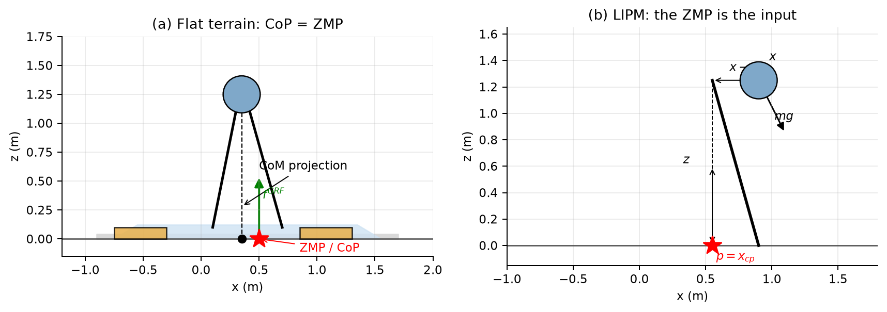

# 第 5 章 高自由度足式机器人 —— 深度推导笔记

> **来源**：Russ Tedrake, *Underactuated Robotics*, Ch. 5 "Highly-articulated Legged Robots"（underactuated.mit.edu/humanoids.html）。
> 本笔记覆盖 **Example 5.1（ZmpPlanner）**、**Example 5.2（LittleDog 步态优化）** 与 **Section 5.8（全部习题）**：MIQP 落脚点规划、ZMP 理解、GCS 落脚点规划。
> 公式编号采用 `(5.x)` 的形式按节编号；`[笔记]` 标记原书省略、本笔记补全的推导。本笔记补充了原书正文中 "Coming soon" 或只有结论的部分。
> 所有数值结果均由 `exp5_analysis/` 下的脚本与三个已执行的 notebook 验证；两个编程习题的自评分均为 **16/16**。

> **阅读建议**：第一遍先读带 **理解提示 / 直觉 / 自检** 的引用块，建立"质心—支撑多边形—ZMP"的物理图像；第二遍再回到公式。第 5.1–5.4 节是主线，5.8 节是习题解答，可以按需跳读。所有图都在 `exp5_analysis/figures/` 下，由 `make_ch5_figures.py` 重新生成。

---

## 0. 本章地图与符号

### 0.1 本章要解决的问题

第 4 章用点足、无质量腿的简单模型（无轮缘轮、罗盘步态、SLIP、跳跃器）抓住了行走与奔跑的**本质动力学**：接触、碰撞、周期轨、返回映射。那些模型只有一个或两个自由度，脚是"点"，落脚位置由动力学自然决定。

第 5 章面对的是另一类机器人：**高自由度、多关节、带脚掌的人形或四足机器人**。它们有几十个自由度，脚可以主动放到几乎任何地方，关节有位置/速度/力矩限制，接触可以在脚跟、脚尖、整只脚之间切换。直接对完整模型做轨迹优化或反馈控制非常困难。

本章的核心思想是：**用简单模型做规划，用全身模型做执行**。

1. **质心（CoM）动力学**：无论机器人有多少关节，其质心的平动和绕质心的角动量满足一组**精确**的方程。
2. **零矩点（ZMP）/压力中心（CoP）**：在平地上，地面反力的合力作用点。它把"脚能放在哪里"这个几何/接触约束，翻译成"质心加速度可以取什么"这个动力学约束。
3. **分层规划**：先规划落脚点（离散/组合），再规划质心轨迹（连续/凸优化），最后用全身逆运动学或 QP 实现关节运动。
4. **落脚点优化**：MIQP（混合整数二次规划）与 GCS（凸集图）把"选哪块石头、走几步"编码成组合优化。

> **理解提示：本章为什么和 Ch. 4 是"两种物种"**。Ch. 4 的模型里，脚是被动落下的，落脚位置是连续动力学的结果；Ch. 5 的机器人可以**主动选择**落脚点。于是问题从"分析一个混合动力系统的极限环"变成了"在一个离散—连续混合空间里做规划"。ZMP 是在连续层面把接触约束压缩成质心加速度约束的工具；落脚点规划是在离散层面搜索接触序列的工具。两者合起来，才构成完整的行走规划。

### 0.2 统一符号

| 符号 | 含义 |
|---|---|
| $\mathbf q,\ \mathbf v=\dot{\mathbf q}$ | 广义坐标、广义速度 |
| $\mathbf p=(x,z)$ 或 $(x,y,z)$ | 世界坐标中的位置 |
| $\mathbf p_{cm}$ | 整机质心位置 |
| $m,\ m_i$ | 总质量、第 $i$ 个连杆质量 |
| $\mathbf f_i^{B_i}$ | 作用在刚体 $B$ 上、接触点 $i$ 的外力（世界系） |
| $\mu$ | 摩擦系数 |
| $\mathcal P$ | 支撑多边形（support polygon），所有接触点的凸包 |
| $\mathbf p_{cp}=(x_{cp},z_{cp})$ | 压力中心（CoP） |
| $\mathbf p_{zmp}$ | 零矩点（ZMP）；平地上与 CoP 重合 |
| $h=z-z_{cp}$ | 质心相对地面的高度 |
| $\omega=\sqrt{g/h}$ | 线性倒立摆的自然频率 |
| $\xi=x+\dot x/\omega$ | 发散分量（DCM）/ 捕获点（capture point） |
| $\mathbf L$ | 空间动量（角动量 + 线动量） |
| $\mathbf A(\mathbf q)$ | 质心动量矩阵（centroidal momentum matrix） |
| $\mathbf P(\cdot)$ | 庞加莱返回映射（第 4 章） |
| $N,\ h_k$ | 轨迹优化的节点数、第 $k$ 段时间步长 |
| $\delta_{t,i}\in\{0,1\}$ | 第 $t$ 步第 $i$ 块石头的 0-1 指派变量 |
| $\phi_e\in[0,1]$ | GCS 中边 $e$ 的流量变量 |

### 0.3 全章技术路线

```text
高自由度机器人（几十个关节、可主动落脚）
                    │
                    ▼
     刚体 + 无质量腿 + 接触约束（§5.1）
                    │
        ┌───────────┴───────────┐
        ▼                       ▼
  平地上的 CoP/ZMP（§5.2）   冲击动力学（§5.2.7）
        │                       │
        ▼                       ▼
  质心 = 线性倒立摆（LIPM）   可以忽略碰撞的条件
        │
        ▼
  ZMP 分层规划（§5.3）
  落脚点 → 质心轨迹 → 全身
        │                       ┌──────────────┐
        │                       │ 质心动力学     │
        └──────────────────────▶│ 空间动量 A(q) │（§5.4）
                                └──────┬───────┘
                                       ▼
                              全身控制 QP（§5.4）
                                       │
                    ┌──────────────────┴──────────────────┐
                    ▼                                     ▼
         Example 5.1: ZmpPlanner              Example 5.2: LittleDog
         （ZMP 跟踪 + 反馈）                   （直接转录步态优化）
                    │                                     │
                    └──────────────────┬──────────────────┘
                                       ▼
                            Section 5.8 习题
              MIQP 落脚点 / ZMP 脚模型 / GCS 落脚点
```

### 0.4 四个抽象层次对照

| 层次 | 状态/决策 | 约束 | 工具 | 本章位置 |
|---|---|---|---|---|
| 航天器 + 推进器 | 刚体位姿、推力 | 推力上下界、开关 | LQR/MPC | §5.1 |
| 刚体 + 无质量腿 | CoM $(x,z)$、接触力 | 单边接触、摩擦锥、支撑多边形 | ZMP/LIPM | §5.2–5.3 |
| 质心动力学 | $\mathbf q,\dot{\mathbf q}$、接触力 | 全身动力学、接触、摩擦 | QP/轨迹优化 | §5.4 |
| 组合落脚点规划 | 离散石头选择、连续脚位 | 步长、运动学、石头几何 | MIQP/GCS | §5.8 |

> **一条主线**：本章所有方法都在做同一件事——**把高自由度的全身问题，投影到一个低维的、可解的子问题上**。ZMP 投影到质心平动；质心动力学投影到 6 维空间动量；落脚点规划投影到二维脚位与 0-1 指派。投影会丢失信息（关节限位、力矩极限、碰撞），所以每一层都需要下一层来"兜底"。

---

## 5.1 思想实验：会走路的航天器

### 5.1.1 刚体航天器模型

考虑一个在重力场中的刚体 $B$，质心在体坐标系原点，姿态用 $(x,z,\theta)$ 描述。在质心以外的位置 ${}^B\mathbf p^{B_i}$ 安装若干推进器，推进器 $i$ 产生世界系力 $\mathbf f_i^{B_i}$。牛顿—欧拉方程为

$$
\begin{aligned}
m\ddot x &= \sum_i f_{i,x}^{B_i}, \\
m\ddot z &= \sum_i f_{i,z}^{B_i}-mg, \\
I\ddot\theta &= \sum_i \left[{}^B\mathbf p^{B_i}(\theta)\times \mathbf f_i^{B_i}\right]_y .
\end{aligned}
\tag{5.1}
$$

其中 $[\cdot]_y$ 是叉乘的 $y$ 分量。在平面 $x$–$z$ 中，若把 $y$ 轴取为 $z\times x$，则

$$
[\mathbf p\times \mathbf f]_y=p_z f_x-p_x f_z .
\tag{5.2}
$$

> **注意符号**：这个 $y$ 分量与常见的二维标量叉乘 $p_x f_y-p_y f_x$ 相差一个符号。第 5.2 节的 ZMP 推导会反复用到这个约定；混用符号是本章最常见的错误之一。

如果输入取为世界系推力 $f_{i,x},f_{i,z}$，则**平动方程是仿射的**（线性 + 常数重力项）；转动方程因为推进器位置随 $\theta$ 旋转而是非线性的。小角度下可以线性化 + LQR；有推力上下界时可以用线性 MPC；把 $\theta$ 的非线性也考虑进来则是一个非线性规划。总体而言，这是一个"相对容易"的控制问题。

### 5.1.2 移动推进器：离散 + 连续

现在只给两个推进器，并且允许**移动**推进器位置：

$$
{}^B\mathbf v^{B_i}=\frac{d}{dt}{}^B\mathbf p^{B_i}
$$

成为一个额外的控制输入。但有两个关键限制：

1. **移动时必须关闭推进器**：$f_i^{B_i}=0$ 或 ${}^B\mathbf v^{B_i}=0$。这是一个"或"约束，非凸。
2. **移动速度有上限**：$|{}^B\mathbf v^{B_i}|\le v_{\max}$。

更进一步，推进器只能在世界系中的某些区域打开：

$$
\mathbf A\,{}^W\mathbf p^{B_i}(\theta)\le \mathbf b .
\tag{5.3}
$$

即使每个区域是凸的，它们的并集也**不必是凸的**。

> **直觉：这就是行走的组合爆炸**。控制者必须做一个**离散决策**（关掉推进器、把它移动到新位置、再打开），同时决定连续的量（移动到哪、何时开、推力多大）。短期的控制能力损失，换来长期更好的推进器位置。行走中的"抬脚—摆动—落脚"就是同一个结构：支撑脚提供力，摆动脚必须卸载、移动、再接触。

### 5.1.3 足式机器人 = 刚体 + 无质量腿 + 接触约束

把上面的"刚体 + 推进器"直接映射到足式机器人：

- 刚体 $B$ = 机器人的躯干/整机；
- 无质量腿 = 推进器与躯干之间的连杆；
- 脚 = 可移动的推进器；
- 接触约束：
  - 只有**接触**时才能出力：脚离地时 $f_i=0$；
  - 只能**推**不能**拉**：$f_{i,z}^{B_i}\ge 0$；
  - 库仑摩擦：$|f_{i,x}^{B_i}|\le \mu f_{i,z}^{B_i}$（更精确地是摩擦锥）；
  - 脚的位置受腿的运动学限制，移动速度受腿的动力学限制。

**关键观察**：这些限制只作用在**接触力**和**脚的位置**上；机器人躯干的动力学仍然是式 (5.1) 那个简单的刚体方程。高自由度的复杂性被"隔离"在腿的 kinematics/dynamics 里，而不是进入质心方程。

> **理解提示：为什么这很重要**。如果连质心方程都变得复杂，ZMP 这套理论就不会成立。正是因为质心方程始终是"一个刚体 + 若干外力"，我们才能把所有接触力合成一个合力/合力矩，定义压力中心，并把问题降成二维的 LIPM。腿的复杂性留给后面的逆运动学和全身 QP。

### 5.1.4 关键抽象：脚可以近似独立于身体运动

这套抽象之所以有效，是因为高自由度机器人有**足够的自由度**：脚可以相对于身体移动，而身体不必跟着剧烈运动。对比第 4 章的点足机器人：脚的位置完全由腿的摆动动力学决定，不能独立选择。自由度越多，"脚 = 可移动推进器"的近似越好。

代价是分层：

1. 落脚点规划忽略质心动力学（或只用粗略的运动学）；
2. 质心规划忽略关节限位和力矩极限；
3. 全身控制再尽量满足前两层给出的目标，同时处理真实约束。

> **自检 5.1**：
> 1. 为什么式 (5.1) 的平动方程对推力是仿射的，而转动方程不是？
> 2. "移动时关闭推进器"对应行走中的哪个阶段？
> 3. 如果机器人只有一条点足（单腿跳），"脚可以独立于身体移动"的假设还成立吗？

---

## 5.2 质心动力学、CoP 与 ZMP

### 5.2.1 平地接触约束

假设机器人走在**平地**上。地面接触点 $i$ 的高度都相同，记为 $z=0$。地面只能推、不能拉：

$$
f_{i,z}\ge 0\quad\forall i
\quad\Longrightarrow\quad
\sum_i f_{i,z}\ge 0
\quad\Longrightarrow\quad
\ddot z\ge -g .
\tag{5.4}
$$

也就是说：**如果地面不能拉你，你的质心向下加速度不可能超过重力加速度**。这是行走欠驱动性最本质的约束之一——无论关节多强，都不能让质心以大于 $g$ 的加速度往下掉。

库仑摩擦给出

$$
|f_{i,x}|\le \mu f_{i,z}
\;\Longrightarrow\;
\sum_i |f_{i,x}|\le \mu\sum_i f_{i,z}
\;\Longrightarrow\;
|\ddot x|\le \mu(\ddot z+g).
\tag{5.5}
$$

如果质心保持恒定高度（$\ddot z=0$），则

$$
|\ddot x|\le \mu g .
\tag{5.6}
$$

这就是"摩擦系数决定了你在地面上最多能多快加速"的定量版本。$\mu=0.5$ 时大约 $4.9\ \mathrm{m/s^2}$。

> **直觉：单边接触是行走的"原罪"**。机械臂可以双向出力，所以它的末端可以任意加速；脚只能推地，所以质心的向下加速度被 $g$ 封顶。所有 ZMP/LIPM 的"倒立摆"行为，根源都在这里。

### 5.2.2 压力中心（CoP）的定义

把地面法向力的分布压缩成一个点：

$$
\mathbf p_{cp}
\equiv {}^W\mathbf p^{R_{cp}}_W
=
\frac{\sum_i {}^W\mathbf p^{B_i}_W\,f_{i,z}^{B_i}}
{\sum_i f_{i,z}^{B_i}} .
\tag{5.7}
$$

平地上所有接触点高度相同，所以 $z_{cp}$ 就是地面高度（取为 0）。CoP 有两个重要性质：

1. **CoP 必须落在接触点的凸包内**。因为它是接触点位置的**凸组合**，权重 $f_{i,z}\ge 0$ 且和为 1。
2. **CoP 不是质心投影**。只有当质心加速度为零（静态）时，二者才重合。

### 5.2.3 从力矩平衡到 ZMP 方程（完整推导）

取 $y$ 轴为 $z\times x$，叉乘的 $y$ 分量为式 (5.2)。对整机关于质心写欧拉方程。地面反力的合力为

$$
\mathbf F=(m\ddot x,\;m\ddot z+mg),
$$

作用在 CoP $\mathbf p_{cp}=(x_{cp},0)$。质心到 CoP 的向量为

$$
\mathbf r=\mathbf p_{cp}-\mathbf p_{cm}=(x_{cp}-x,\;-z).
$$

关于质心的力矩（$y$ 分量）为

$$
[\mathbf r\times \mathbf F]_y
=r_zF_x-r_xF_z
=(-z)(m\ddot x)-(x_{cp}-x)(m\ddot z+mg).
$$

它等于角动量的变化率 $I\ddot\theta$：

$$
I\ddot\theta
=-z\,m\ddot x-(x_{cp}-x)(m\ddot z+mg).
$$

整理得

$$
\boxed{
(m\ddot z+mg)(x_{cp}-x)
=(0-z)m\ddot x-I\ddot\theta
}
\tag{5.8}
$$

这就是原书的式 (cop)。若质心高度恒定（$\ddot z=0$）、角动量变化可忽略（$I\ddot\theta\approx 0$），则

$$
\boxed{
\ddot x=\frac{g}{z}(x-x_{cp})
=\frac{g}{z-z_{cp}}(x-x_{cp})
}
\tag{5.9}
$$

这就是著名的 **ZMP 方程**（线性倒立摆，LIPM）。同理，$y$ 方向为

$$
\ddot y=\frac{g}{z-z_{cp}}(y-y_{cp}).
\tag{5.10}
$$

> **理解提示：ZMP 是"输入"**。式 (5.9) 把 $x_{cp}$ 放在右边，看起来像输出；但在规划中我们把它当**输入**：给定一条期望的 ZMP 轨迹 $x_{cp}(t)$，解一个二阶线性 ODE 得到质心轨迹。ZMP 在支撑多边形内，就意味着存在一组非负的接触力能实现这个质心加速度。反过来，给定质心轨迹，ZMP 由式 (5.9) 唯一确定；它必须落在支撑多边形内，否则脚会翻倒。

### 5.2.4 线性倒立摆（LIPM）

定义 $\omega=\sqrt{g/h}$，$h=z-z_{cp}$ 为质心高度。式 (5.9) 写成

$$
\ddot x=\omega^2(x-p),\qquad p\equiv x_{cp}.
\tag{5.11}
$$

这是一个**倒立摆**：固定点 $x=p$ 是不稳定的（特征值 $\pm\omega$）。它与第 4 章的 SLIP 支撑相是同一个数学结构，只是这里腿长恒定、没有弹簧。

LIPM 的三个等价视角：

1. **位置视角**：$x$ 被 $p$ 以"排斥"的方式推离；要让它停在 $p$，需要主动控制。
2. **速度视角**：$\dot x=\omega(\xi-x)$，其中 $\xi=x+\dot x/\omega$ 是发散分量（DCM）。
3. **能量视角**：$E=\frac12\dot x^2-\frac12\omega^2(x-p)^2$ 在 $p$ 恒定时守恒。

### 5.2.5 原书 Aside：ZMP 的 wrench 推导

对刚体系统，所有外力可以线性地合成一个**空间力（wrench）**。对任意参考点 $A$：

$$
\begin{aligned}
m\ddot x&=\sum_i f_{i,x}=f^{A}_{net,x},\\
m\ddot z&=\sum_i f_{i,z}-mg=f^{A}_{net,z}-mg,\\
I\ddot\theta
&=\sum_i [{}^B\mathbf p^{B_i}\times \mathbf f_i^{B_i}]_y
=[{}^B\mathbf p^A\times \mathbf f^A_{net}]_y+\tau^A_{net}.
\end{aligned}
\tag{5.12}
$$

这里 $\tau^A_{net}=\sum_i[({}^B\mathbf p^{B_i}-{}^B\mathbf p^A)\times \mathbf f_i^{B_i}]_y$ 是**关于 $A$ 的净力矩**。ZMP 定义为使 $\tau^A_{net}=0$ 的点：

$$
[{}^B\mathbf p^{ZMP}\times \mathbf f^{ZMP}_{net}]_y
=\sum_i[{}^B\mathbf p^{B_i}\times \mathbf f_i^{B_i}]_y .
\tag{5.13}
$$

展开（平地 $z_i=0$）：

$$
p^{ZMP}_z f_{net,x}-p^{ZMP}_x f_{net,z}
=\sum_i\left(p_{i,z}f_{i,x}-p_{i,x}f_{i,z}\right).
\tag{5.14}
$$

当 $f_{net,z}\ne 0$ 时，这是一个关于 $p^{ZMP}_x$ 的线性方程，解为一条**直线**（在三维中是一个平面与地面的交线）；取其中与地面相交的那个点，就是行走机器人常用的 ZMP。

把式 (5.12) 代入式 (5.13)，就回到式 (5.8)。另一方面，平地上

$$
\sum_i p_{i,z}f_{i,x}=p^{ZMP}_z\sum_i f_{i,x},
$$

所以

$$
p^{ZMP}_x=\frac{\sum_i p_{i,x}f_{i,z}}{\sum_i f_{i,z}}=x_{cp}.
\tag{5.15}
$$

**结论：平地上的 ZMP 与 CoP 是同一个点。**

> **自检 5.2**：
> 1. 为什么 CoP 一定在接触点的凸包内？如果所有法向力都为正，CoP 会在凸包边界上吗？
> 2. 式 (5.8) 中 $I\ddot\theta$ 的符号如果写反，会导致什么物理上荒谬的结论？
> 3. 如果质心高度 $h$ 很小，LIPM 的 $\omega$ 很大，系统"倒得更快"还是"倒得更慢"？

### 5.2.6 三维推广

三维中，ZMP 定义为地面上使**两个水平力矩分量**为零的点：

$$
\tau^{ZMP}_{net,x}=\tau^{ZMP}_{net,y}=0,
\qquad
\tau^{ZMP}_{net,z}\ \text{可以非零}.
\tag{5.16}
$$

$z$ 方向的力矩对应绕竖直轴的旋转（偏航），地面接触可以承受它（通过摩擦力的分布）。$x,y$ 方向的方程分别为

$$
\begin{aligned}
(m\ddot z+mg)(x_{cp}-x)&=-z\,m\ddot x-I_x\ddot\theta_x,\\
(m\ddot z+mg)(y_{cp}-y)&=-z\,m\ddot y-I_y\ddot\theta_y.
\end{aligned}
\tag{5.17}
$$

在质心高度恒定、角动量变化可忽略时，两个水平方向**解耦**，各自是一个 LIPM：

$$
\ddot x=\omega^2(x-x_{cp}),\qquad
\ddot y=\omega^2(y-y_{cp}).
\tag{5.18}
$$

> **直觉：为什么可以解耦**。LIPM 的耦合只通过高度 $z$ 和角动量出现；一旦固定高度、忽略躯干转动，$x$ 和 $y$ 就是两个独立的倒立摆。ZmpPlanner 正是利用这一点，把二维问题当成两个一维问题一起解。

### 5.2.7 冲击动力学：为什么人形机器人可以忽略碰撞

第 4 章花了很大篇幅处理碰撞。对高自由度机器人，很多文献在质心规划中**直接忽略碰撞**。这一节解释什么时候可以这样做。

碰撞是瞬时事件。对动力学方程

$$
\mathbf M(\mathbf q)\ddot{\mathbf q}+\mathbf C(\mathbf q,\dot{\mathbf q})\dot{\mathbf q}+\mathbf g(\mathbf q)
=\mathbf S^\top\boldsymbol\tau+\sum_i\mathbf J_i^\top\mathbf f_i
$$

在无穷小时间 $\Delta t\to0$ 上积分，有限力（重力、关节力矩）的贡献趋于零，只剩冲量：

$$
\mathbf M(\mathbf q)\left(\dot{\mathbf q}^+-\dot{\mathbf q}^-\right)
=\sum_i\mathbf J_i^\top\boldsymbol\Lambda_i,
\tag{5.19}
$$

其中 $\boldsymbol\Lambda_i=\int\mathbf f_i\,dt$ 是接触冲量。对于**完全非弹性**碰撞，接触点碰撞后的速度为 0：

$$
\mathbf J_i\dot{\mathbf q}^+=0.
\tag{5.20}
$$

联立可解出碰撞后的速度（单接触）：

$$
\dot{\mathbf q}^+
=\dot{\mathbf q}^-
-\mathbf M^{-1}\mathbf J^\top
\left(\mathbf J\mathbf M^{-1}\mathbf J^\top\right)^{-1}
\mathbf J\dot{\mathbf q}^-.
\tag{5.21}
$$

碰撞能量损失为

$$
\Delta E=\frac12\dot{\mathbf q}^{-T}\mathbf M\dot{\mathbf q}^-
-\frac12\dot{\mathbf q}^{+T}\mathbf M\dot{\mathbf q}^+ .
\tag{5.22}
$$

**三种典型策略**：

| 策略 | 碰撞模型 | 能量损失 | 例子 |
|---|---|---|---|
| 刚性腿、点足 | 绕碰撞点角动量守恒 | 有，$\cos^2(2\alpha)$ 型 | 无轮缘轮、罗盘步态 |
| 弹簧腿 + 无质量脚尖 | 无速度跳变 | 无 | SLIP |
| 高自由度、恒质心高度、小角动量 | 脚落在质心正下方 | 近似为 0 | 人形机器人 ZMP 规划 |

第三种策略的推导：若质心竖直速度恒定（$\dot z=c$，$\ddot z=0$），且绕质心的角动量近似为零（$I\dot\theta\approx0$），则碰撞前接触点的速度主要是竖直的。如果摆动脚落在质心正下方，接触点的水平速度近似为零，碰撞冲量主要沿竖直方向，而竖直方向的冲量被腿的"虚拟弹簧"或关节伺服吸收/耗散很小；极端情况下碰撞前后质心速度不变。

> **理解提示：这不是说碰撞真的没有能量损失**，而是说在**质心层面**，损失相对于步态的能量尺度可以忽略。关节层面的冲击、噪声、磨损仍然存在，需要用柔顺控制、阻抗控制或步态设计来处理。ZMP 规划忽略冲击，是因为它只关心质心的低频运动。

> **自检 5.3**：
> 1. 为什么完全非弹性碰撞的冲量投影式 (5.21) 里会出现 $\mathbf J\mathbf M^{-1}\mathbf J^\top$？它的物理意义是什么？
> 2. 如果脚落在质心前方而不是正下方，碰撞会怎样影响质心速度？
> 3. "恒质心高度"策略与第 4 章 SLIP 的"弹簧腿"策略，在能量上有什么本质区别？

### 5.2.8 CoP、ZMP、CoM 投影：三个容易混淆的点



| 概念 | 定义 | 什么时候等于质心投影 | 关键性质 |
|---|---|---|---|
| CoM 投影 | 质心在地面上的正投影 $(x,y)$ | 永远 | 纯几何 |
| CoP | 法向接触力的加权平均位置 | 静态/慢速时 | 一定在支撑多边形内（有接触时） |
| ZMP | 使地面合力矩水平分量为零的点 | 静态/慢速时 | 平地上等于 CoP；可以定义在支撑多边形外（虚拟点） |

**常见误区**：

1. **"ZMP 在支撑多边形内就一定稳定"**。错。ZMP 在支撑多边形内只说明**存在**一组接触力能实现当前的质心加速度；它不保证质心速度会收敛，也不保证下一步还有脚可以踩。稳定性需要结合 DCM/捕获点、落脚点规划和反馈。
2. **"ZMP = CoM 投影"**。只在静态或质心加速度为零时成立。动态行走时 ZMP 必须超前/滞后于 CoM 投影，才能产生加减速。
3. **"CoP 可以随便放"**。CoP 是接触力的结果，必须在支撑多边形内；如果规划的 ZMP 跑到外面，机器人就会绕脚边缘翻倒（foot roll），模型从"平脚接触"切换成"绕脚尖/脚跟转动"的欠驱动模式。
4. **"ZMP 只适用于平地"**。ZMP 可以定义在一般接触面上，但"CoP = ZMP"和"支撑多边形"的简洁形式依赖平地/平面接触假设。崎岖地形需要更一般的接触wrench 约束。

> **自检 5.4**：一个机器人静止站立，质心投影在支撑多边形中心，ZMP 在哪里？如果它开始向前加速，ZMP 应该前移还是后移？为什么？
