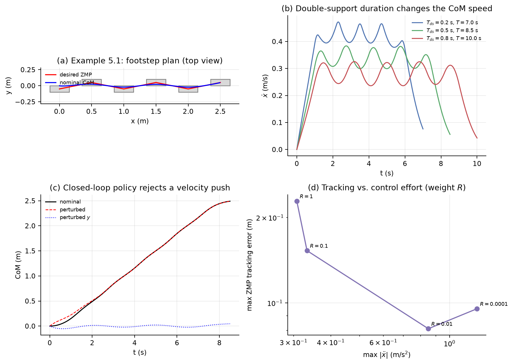
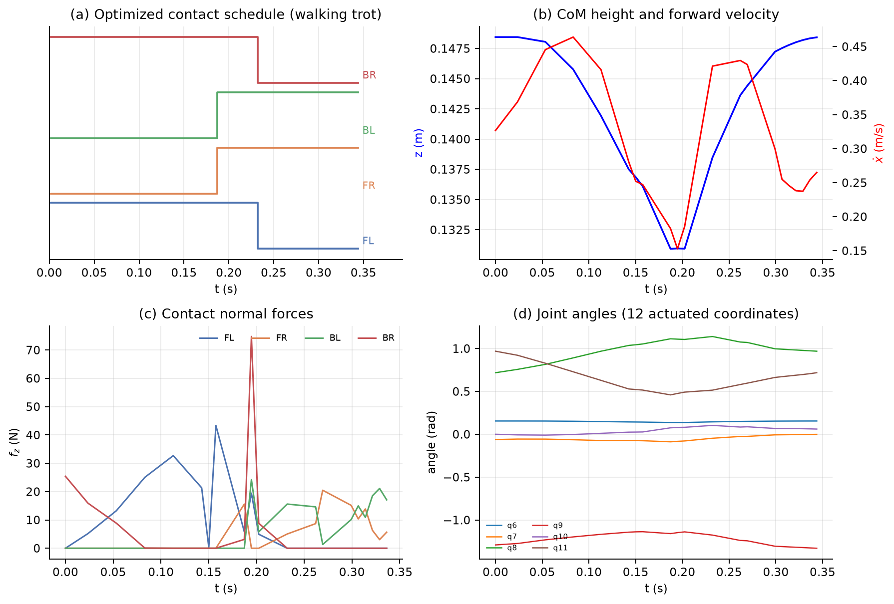

---

## 5.3 基于 ZMP 的分层规划

### 5.3.1 三步流水线

原书把复杂机器人的运动规划分解为：

1. **规划落脚点/接触位置**：决定每一步踩在哪块石头上、何时着地、何时离地。
2. **规划质心轨迹**：给定 ZMP（或接触力）轨迹，用 LIPM 解出质心运动。
3. **计算全身关节运动**：用逆运动学/全身 QP 实现质心和脚的轨迹。

这条流水线从 Honda ASIMO 的 ZMP 行走器开始，至今仍是人形机器人规划的主流框架。

> **理解提示：分层的代价**。落脚点规划通常是**运动学**的，不考虑质心动力学，因此保守；质心规划不考虑关节限位和力矩极限，因此可能给出不可实现的轨迹；全身层只能在给定目标下"尽量"满足，无法保证。分层的收益是每一层都变成可解的凸问题/组合问题。工程上，这种"保守但可解"的折中通常比直接解一个非凸全身轨迹优化更可靠。

### 5.3.2 启发式落脚点规划

原书这一节标注 "Coming soon"，并引用了 Atlas 的工作（Deits14, Kuindersma14）。核心思想：

- 用**启发式**（A*、RRT、或简单的几何规则）在可落脚区域（stepping stones/地形）上搜索脚的位置；
- 约束包括：最大步长、两脚不碰撞、脚不能跨在障碍物上、脚掌与地面接触面积足够；
- 生成的落脚点序列交给质心规划器。

更系统的方法就是 5.8 节的 MIQP 和 GCS：把"选哪块石头"编码成 0-1 变量或图上的路径。

### 5.3.3 质心轨迹规划：LIPM 的解析解

#### (a) 常数 ZMP

当 $p$ 为常数时，式 (5.11) 的通解为

$$
x(t)=p+(x_0-p)\cosh(\omega t)+\frac{\dot x_0}{\omega}\sinh(\omega t),
\tag{5.23}
$$

$$
\dot x(t)=\omega(x_0-p)\sinh(\omega t)+\dot x_0\cosh(\omega t).
\tag{5.24}
$$

这是一条**双曲**轨迹：稍微偏离 $p$，偏差就会指数增长。行走之所以可能，是因为我们不断**移动 $p$**（换脚），把倒立摆的"支撑点"挪到质心前方，让它重新"倒回来"。

#### (b) 分段 ZMP 与卷积

ZMP 通常是分段常值或分段线性的（在脚之间切换）。LIPM 是线性系统，可以用**卷积/格林函数**求解：

$$
x(t)=x_0\cosh(\omega t)+\frac{\dot x_0}{\omega}\sinh(\omega t)
+\omega\int_0^t\sinh\big(\omega(t-\tau)\big)\,p(\tau)\,d\tau .
\tag{5.25}
$$

验证：对 $t$ 求二阶导，

$$
\ddot x=\omega^2\left[x_0\cosh+\frac{\dot x_0}{\omega}\sinh
+\omega\int_0^t\sinh(\omega(t-\tau))p(\tau)d\tau\right]-\omega^2p(t)
=\omega^2(x-p).
$$

对分段常值 $p$，每一段都可以用式 (5.23) 递推；对分段线性 $p$，可以额外加一个特解（与 $p$ 同斜率的一次项）。ZmpPlanner 内部用的是分段多项式 ZMP 的闭式解。

#### (c) DCM / 捕获点

定义**发散分量**（divergent component of motion, DCM），也叫捕获点（capture point）：

$$
\boxed{\xi=x+\frac{\dot x}{\omega}}
\tag{5.26}
$$

则

$$
\dot\xi=\dot x+\frac{\ddot x}{\omega}
=\omega(\xi-x)+\omega(x-p)
=\omega(\xi-p).
\tag{5.27}
$$

同时

$$
\dot x=\omega(\xi-x).
\tag{5.28}
$$

这两个方程把 LIPM 对角化：

- $\xi$ 是**不稳定**分量：$\dot\xi=\omega(\xi-p)$，若 $p<\xi$，$\xi$ 指数增长；
- $x$ 是**稳定**分量：$\dot x=\omega(\xi-x)$，$x$ 以时间常数 $1/\omega$ 追随 $\xi$。

**捕获点**的含义：如果从当前状态出发，把 ZMP **瞬间**移到 $\xi$（并保持），那么 $\xi$ 不再变化，$x$ 会渐近收敛到 $\xi$。也就是说，$\xi$ 是"如果现在把脚踩在这里，质心刚好能停下来"的位置。

$$
p=\xi \quad\Longrightarrow\quad \dot\xi=0,\qquad x(t)\to\xi .
\tag{5.29}
$$

> **直觉：DCM 是"必须被处理掉的动量"**。$x$ 本身会自己收敛到 $\xi$；真正危险的是 $\xi$。走路时每一步都在选择一个新的 $p$，把 $\xi$ 拉回支撑区域。落脚点规划本质上是在规划 $\xi$ 的演化。

#### (d) 轨道能量

对常数 $p$，定义

$$
E=\frac12\dot x^2-\frac12\omega^2(x-p)^2 .
\tag{5.30}
$$

则

$$
\dot E=\dot x\ddot x-\omega^2(x-p)\dot x
=\dot x\left[\omega^2(x-p)\right]-\omega^2(x-p)\dot x=0.
\tag{5.31}
$$

$E$ 守恒。$E=0$ 对应 $\dot x=\pm\omega(x-p)$，即 DCM 恰好等于 $p$ 的稳定/不稳定流形。$E>0$ 的轨迹会越过 $p$；$E<0$ 的轨迹会在到达 $p$ 之前折返。

> **自检 5.5**：
> 1. 若 $x_0=p$、$\dot x_0>0$，质心会怎样运动？DCM 初值是多少？
> 2. 若当前 $x=0$、$\dot x=0.5$ m/s、$\omega=3$ rad/s，捕获点在哪里？脚应该踩在哪里才能停住？
> 3. 为什么式 (5.28) 说明 $x$ 是稳定分量，而 $\xi$ 是不稳定分量？

### 5.3.4 ZMP "稳定性"指标：它是什么、不是什么

很多文献把"ZMP 在支撑多边形内"称为**ZMP 稳定性判据**。严格地说：

- 它是一个**可行性**判据：存在非负接触力使质心加速度满足 LIPM，且脚不翻倒。
- 它**不是** Lyapunov 稳定性判据：ZMP 在支撑多边形内，质心仍可能以很大速度冲向边缘，下一步就摔倒。
- 它**不包含**落脚点信息：如果支撑多边形很小（点足），ZMP 几乎没有调节空间，必须靠换脚。
- 它**不包含**上身角动量：$I\ddot\theta$ 被忽略；快速摆臂/转体时误差很大。

更完整的稳定性概念是**捕获性（capturability）**：存在一个落脚点序列，能在 $N$ 步内让机器人停下来。对 LIPM，捕获点 $\xi$ 是这一理论的基石。

> **理解提示：把 ZMP 当作"约束"而不是"稳定性证明"**。在优化里，ZMP 约束写成 $x_{cp}(t)\in\mathcal P$；这保证了每一时刻的接触力可行。真正的闭环稳定性来自反馈（Example 5.1 的线性策略）和落脚点更新（push recovery）。

### 5.3.5 Example 5.1：ZmpPlanner



#### (a) 问题设定

Notebook 给定一串落脚点（平均人类步长 0.7 m、步宽 0.1 m），构造一条**分段线性的期望 ZMP 轨迹**：

- 单支撑相：ZMP 停在当前脚的中心；
- 双支撑相：ZMP 从当前脚中心线性移动到下一只脚中心；
- 初始质心位置/速度为零，高度 $h=1$ m。

然后调用 Drake 的 `ZmpPlanner` 生成质心轨迹和反馈策略。

#### (b) 最优控制形式

ZmpPlanner 求解的是一个**线性二次型跟踪问题**。状态 $\mathbf x=[\mathbf c;\dot{\mathbf c}]$，控制 $\mathbf u=\ddot{\mathbf c}$，输出（ZMP）为

$$
\mathbf y=\mathbf c-\frac{h}{g}\mathbf u .
\tag{5.32}
$$

代价为

$$
J=\int_0^{t_f}\left[
(\mathbf y-\mathbf y_d)^T\mathbf Q_y(\mathbf y-\mathbf y_d)
+\mathbf u^T\mathbf R\mathbf u
\right]dt
+\bar{\mathbf x}(t_f)^T\mathbf S\,\bar{\mathbf x}(t_f),
\tag{5.33}
$$

其中 $\bar{\mathbf x}=[\mathbf c-\mathbf y_d(t_f);\dot{\mathbf c}]$，$\mathbf S$ 是用同一动力学和单步代价解无限时域 LQR 得到的终端代价。

因为动力学线性、代价二次，值函数具有二次形式：

$$
V(\mathbf x,t)=\bar{\mathbf x}^T\mathbf V_{xx}\bar{\mathbf x}
+\bar{\mathbf x}^T\mathbf V_x(t)+V_0(t),
\tag{5.34}
$$

最优策略是**线性反馈**：

$$
\mathbf u^*(\mathbf x,t)=\mathbf K\bar{\mathbf x}+\mathbf u_0(t).
\tag{5.35}
$$

$\mathbf K$ 是时不变的 LQR 增益，$\mathbf u_0(t)$ 是前馈项。ZmpPlanner 同时返回标称轨迹和这个策略。

> **理解提示：为什么这比"解一个轨迹优化"漂亮**。LIPM + 二次代价的 Riccati 方程有闭式/半闭式解，可以实时计算；而且它天然给出反馈策略，不只是开环轨迹。这正是 Tedrake et al. (2015) 的核心贡献。

#### (c) 代码结构

`Exp5.1-zmp-planner.ipynb` 的关键步骤：

```python
# 1. 由落脚点和支撑时间构造分段线性 ZMP
zmp_traj = GenerateDesiredZmpTraj(footsteps, double_support_duration=0.5,
                                  single_support_duration=1.0)

# 2. 规划：初始质心状态 + 高度
zmp_planner = ZmpPlanner()
zmp_planner.Plan(zmp_traj, x0, height)

# 3. 查询标称轨迹
com = zmp_planner.get_nominal_com(t)
comd = zmp_planner.get_nominal_comd(t)
comdd = zmp_planner.get_nominal_comdd(t)

# 4. 反馈策略
u = zmp_planner.ComputeOptimalCoMdd(t, x)   # x = [com; comd]
```

#### (d) 数值结果与解释

本笔记的复现脚本 `exp5_analysis/example51_zmp.py` 得到：

| 量 | 数值 |
|---|---|
| 规划总时长 | $T=8.5$ s |
| 最大侧向质心偏移 | $0.0463$ m |
| 最大前向速度 | $0.384$ m/s |
| 规划 ZMP 范围 | $x_{cp}\in[0,2.5]$ m |
| CoP 映射恒等式误差 | $0$（机器精度） |
| 相对期望 ZMP 的最大跟踪误差 | $0.153$ m |
| 速度扰动后的终值误差 | $1.5\times10^{-5}$ m |

**两个重要观察**：

1. **ZMP 跟踪不是精确插值**。目标函数同时惩罚 ZMP 误差和控制加速度；默认 $\mathbf Q_y=\mathbf I$、$\mathbf R=0.1\mathbf I$，在 ZMP 轨迹的拐角处，加速度受限导致 ZMP 偏离期望值最多 0.15 m。若把 $\mathbf R$ 调小，跟踪更紧，但加速度更大：

   | $\mathbf R$ | 最大跟踪误差 (m) | 最大 $|\ddot x|$ (m/s²) |
   |---|---|---|
   | $10^{-4}$ | 0.095 | 1.24 |
   | $10^{-2}$ | 0.081 | 0.849 |
   | $0.1$ | 0.153 | 0.333 |
   | $1.0$ | 0.228 | 0.308 |

   这不是 bug，而是**最优控制的权衡**：ZMP 轨迹的折角在物理上需要无限大的加速度才能精确跟踪，任何有限的 $\mathbf R$ 都会把它平滑掉。

2. **反馈策略确实有效**。给初始速度一个 $(+0.35,-0.2)$ m/s 的扰动，用 `ComputeOptimalCoMdd` 闭环仿真，终值误差仍只有 $1.5\times10^{-5}$ m。注意这里规划的是**固定** ZMP 轨迹，反馈只调整质心加速度，不改变落脚点；这对应"脚已经踩好，只能靠踝/髋调整"的情况。

**步时敏感性**：双支撑时间 $T_{ds}$ 从 0.2 增加到 0.8 s，总时长从 7.0 增加到 10.0 s，最大前向速度从 0.472 降到 0.325 m/s；侧向摆动几乎不变。步频越快，质心速度越大、需要的加速度越大；步频越慢，质心越"从容"，但总时间变长。这正是 notebook 建议"改一改 footstep timing"的原因。

> **自检 5.6**：
> 1. 为什么减小 $\mathbf R$ 会让 ZMP 跟踪更好但加速度更大？
> 2. 如果 ZMP 轨迹在双支撑相不是线性插值而是阶跃，质心轨迹会怎样？
> 3. 反馈策略能修正质心位置/速度偏差，但能修正"脚放错位置"吗？为什么？

### 5.3.6 从 CoM 计划到全身计划

质心轨迹和脚的位置只是任务空间的目标；真正要发给电机的是关节角/力矩。这一步通常用**全身逆运动学**或**全身 QP**。

#### (a) 质心雅可比

整机质心是各连杆质心的质量加权平均：

$$
\mathbf p_{cm}(\mathbf q)=\frac{1}{M}\sum_i m_i\,\mathbf p_i(\mathbf q),
\qquad M=\sum_i m_i .
\tag{5.36}
$$

对时间求导：

$$
\dot{\mathbf p}_{cm}
=\frac{1}{M}\sum_i m_i\,\mathbf J_i(\mathbf q)\dot{\mathbf q}
=\mathbf J_{cm}(\mathbf q)\dot{\mathbf q},
\qquad
\mathbf J_{cm}=\frac{1}{M}\sum_i m_i\mathbf J_i .
\tag{5.37}
$$

$\mathbf J_i$ 是第 $i$ 个连杆质心的平移雅可比。

#### (b) 微分逆运动学 QP

给定期望的质心速度 $\dot{\mathbf p}_{cm}^d$、支撑脚不动（$\mathbf J_{foot}\dot{\mathbf q}=0$）、摆动脚跟踪轨迹 $\mathbf J_{sw}\dot{\mathbf q}=\mathbf v_{sw}^d$，可以解一个最小的 QP：

$$
\begin{aligned}
\min_{\dot{\mathbf q}}\quad &
\|\mathbf J_{cm}\dot{\mathbf q}-\dot{\mathbf p}_{cm}^d\|^2
+w_{sw}\|\mathbf J_{sw}\dot{\mathbf q}-\mathbf v_{sw}^d\|^2
+w_q\|\dot{\mathbf q}-\dot{\mathbf q}_{nom}\|^2 \\
\text{s.t.}\quad &
\mathbf J_{foot}\dot{\mathbf q}=0,\\
& \dot{\mathbf q}_{min}\le\dot{\mathbf q}\le\dot{\mathbf q}_{max},\\
& \mathbf q+\dot{\mathbf q}\Delta t\in[\mathbf q_{min},\mathbf q_{max}].
\end{aligned}
\tag{5.38}
$$

这是**速度级**的 IK；积分得到关节位置，再用关节 PD 或力矩控制跟踪。更精细的做法是**加速度级** QP，直接优化关节加速度和接触力。

> **理解提示：分层不是"一次算完"**。实际系统通常以 1 kHz 运行全身 QP，以 10–100 Hz 更新质心/落脚点规划。规划层给出参考，控制层在参考附近做局部修正。Example 5.1 的反馈策略就是"质心层"的局部修正；全身 QP 是"关节层"的局部修正。

---

## 5.4 质心动力学与全身控制

### 5.4.1 空间速度、空间力、空间惯量

对刚体 $B$，取质心 $B_{cm}$ 为参考点，定义**空间速度**（角速度 + 线速度）：

$$
{}^W\mathbf V^{B_{cm}}
=\begin{bmatrix}{}^W\dot{\boldsymbol\theta}^B\\ {}^W\dot{\mathbf p}^{B_{cm}}\end{bmatrix}
\in\mathbb R^6 .
\tag{5.39}
$$

**空间力**（力矩 + 力）：

$$
\mathbf F^{B_{cm}}_i=\begin{bmatrix}\boldsymbol\tau_i\\ \mathbf f_i\end{bmatrix}.
\tag{5.40}
$$

绕质心的**空间惯量**：

$$
\mathbf M^{B/B_{cm}}
=\begin{bmatrix}\mathbf I&0\\0&m\mathbf I\end{bmatrix}.
\tag{5.41}
$$

**空间动量**：

$$
{}^W\mathbf L^{B/B_{cm}}
=\begin{bmatrix}\mathbf I\dot{\boldsymbol\theta}\\ m\dot{\mathbf p}^{B_{cm}}\end{bmatrix}
=\mathbf M^{B/B_{cm}}\,{}^W\mathbf V^{B_{cm}}.
\tag{5.42}
$$

牛顿—欧拉方程可以写成紧凑形式：

$$
\boxed{
{}^W\dot{\mathbf L}^{B/B_{cm}}
=\sum_i\mathbf F^{B_{cm}}_i
}
\tag{5.43}
$$

即**空间动量的变化率等于作用在质心上的空间力之和**。

> **注意**：空间力的“力矩”部分依赖于参考点。把力从 $A$ 点平移到 $B$ 点时，力矩要加上 $(\mathbf p_A-\mathbf p_B)\times\mathbf f$。第 5.4.3 节的接触力矩就是这么来的。

### 5.4.2 单刚体的空间动量方程

把式 (5.39)–(5.43) 展开，就回到式 (5.1)：

$$
\frac{d}{dt}
\begin{bmatrix}I\dot\theta\\ m\dot x\\ m\dot z\end{bmatrix}
=
\begin{bmatrix}\sum_i [\mathbf p_i\times\mathbf f_i]_y\\ \sum_i f_{i,x}\\ \sum_i f_{i,z}-mg\end{bmatrix}.
\tag{5.44}
$$

重力是一个作用在质心的空间力 $[0;0;-mg]$（在 $x$–$z$ 平面中）。

### 5.4.3 多体系统：质心动量矩阵 $\mathbf A(\mathbf q)$

对由多个连杆组成的机器人 $R$，质心为

$$
\mathbf p_{cm}(\mathbf q)
=\frac{\sum_i m_i\,\mathbf p_i(\mathbf q)}{\sum_i m_i}
=\frac{\sum_i {}^W\mathbf X^{B_i}(\mathbf q)\,{}^{B_i}\mathbf p^{B_{i,cm}}\,m_i}{\sum_i m_i}.
\tag{5.45}
$$

定义整机关于质心的空间动量：

$$
{}^W\mathbf L^{R/R_{cm}}(\mathbf q,\dot{\mathbf q})
=\mathbf A(\mathbf q)\dot{\mathbf q},
\tag{5.46}
$$

其中 $\mathbf A(\mathbf q)\in\mathbb R^{6\times n_v}$ 是**质心动量矩阵**（centroidal momentum matrix, Orin 2013）。它的变化率为

$$
\boxed{
{}^W\dot{\mathbf L}^{R/R_{cm}}
=\mathbf A(\mathbf q)\ddot{\mathbf q}
+\dot{\mathbf A}(\mathbf q,\dot{\mathbf q})\dot{\mathbf q}
=\sum_i\mathbf F^{R_{cm}}_i
}
\tag{5.47}
$$

这就是**质心动力学方程**。展开成 6 行：

$$
\mathbf A\ddot{\mathbf q}+\dot{\mathbf A}\dot{\mathbf q}
=
\begin{bmatrix}
\sum_i (\mathbf p_i-\mathbf p_{cm})\times\mathbf f_i\\
\sum_i\mathbf f_i+m\mathbf g
\end{bmatrix}.
\tag{5.48}
$$

> **理解提示：这是精确的，不是近似**。式 (5.48) 对完整的多体系统**精确成立**，没有忽略任何连杆动力学。它之所以简单，是因为我们只写了 6 个方程（质心的平动 + 绕质心的转动），把其余 $n_v-6$ 个内部自由度留给了关节力矩。真正的近似发生在下一步：我们可能忽略关节限位、力矩极限、接触约束，或者用简化的接触模型。

**宇航员类比**：在零重力下，如果不受外力，质心加速度为零、总角动量守恒。式 (5.48) 只是把这个直觉推广到有外力的情况。

### 5.4.4 全身控制 QP

全身控制（whole-body control, WBC）在每个控制周期解一个 QP，同时决定关节加速度和接触力。一个典型的表述：

$$
\begin{aligned}
\min_{\ddot{\mathbf q},\mathbf f,\boldsymbol\tau}\quad &
\|\mathbf A\ddot{\mathbf q}+\dot{\mathbf A}\dot{\mathbf q}
-\mathbf F_{des}\|^2
+w_f\|\mathbf f-\mathbf f_{des}\|^2
+w_\tau\|\boldsymbol\tau\|^2
+w_q\|\ddot{\mathbf q}-\ddot{\mathbf q}_{des}\|^2 \\
\text{s.t.}\quad &
\mathbf M\ddot{\mathbf q}+\mathbf C\dot{\mathbf q}+\mathbf g
=\mathbf S^\top\boldsymbol\tau+\sum_i\mathbf J_i^\top\mathbf f_i,\\
& \mathbf J_i\ddot{\mathbf q}+\dot{\mathbf J}_i\dot{\mathbf q}=0
\quad\text{(支撑脚不动)},\\
& \mathbf f_i\in\mathcal K_i
\quad\text{(摩擦锥、单边接触)},\\
& \boldsymbol\tau_{min}\le\boldsymbol\tau\le\boldsymbol\tau_{max},\\
& \ddot{\mathbf q}_{min}\le\ddot{\mathbf q}\le\ddot{\mathbf q}_{max}.
\end{aligned}
\tag{5.49}
$$

其中 $\mathbf F_{des}$ 是期望的质心 wrench（通常由 ZMP/质心规划给出），$\mathcal K_i$ 是摩擦锥。

**两种常见实现**：

1. **加权 QP**：把所有任务（质心、脚、姿态、关节正则）加权成一个二次目标。简单、鲁棒，但权重需要调。
2. **分层 QP（hierarchical QP）**：按优先级依次求解；低优先级任务在高优先级任务的零空间里优化。物理意义更清晰（例如"脚不能滑"优先于"姿态好看"）。

> **理解提示：WBC 与 ZMP 的关系**。ZMP 规划给出质心轨迹和 ZMP；WBC 把它翻译成关节力矩和接触力。WBC 可以**修正**规划层的误差（例如实际质心偏离参考），也可以在接触切换时处理冲击。它不能弥补"落脚点根本不可达"这种规划层错误。

### 5.4.5 接触模型与摩擦锥

最常用的接触模型是**线性化摩擦锥**：

$$
|f_x|\le\mu f_z,\qquad |f_y|\le\mu f_z,\qquad f_z\ge0 .
\tag{5.50}
$$

这是一个四棱锥（在 $(f_x,f_y,f_z)$ 空间中），可以用 4 个线性不等式表示：

$$
f_x\le\mu f_z,\quad -f_x\le\mu f_z,\quad
f_y\le\mu f_z,\quad -f_y\le\mu f_z,\quad f_z\ge0 .
\tag{5.51}
$$

更精确的是二阶锥（$ \sqrt{f_x^2+f_y^2}\le\mu f_z $），但 QP 中常线性化以保持线性约束。

对于**点接触**，还可以施加绕接触点力矩为零的约束（无摩擦点接触）；对于**面接触**，允许一个有限的接触力矩，但受接触面尺寸限制（ZMP 在支撑多边形内）。

### 5.4.6 落脚点规划与 push recovery

#### (a) 捕获点与捕获区域

对 LIPM，捕获点 $\xi=x+\dot x/\omega$ 是"如果现在把脚踩在这里，质心刚好能停下来"的位置。若脚只能落在支撑区域内，$\xi$ 可能落在区域外；这时需要**多步**才能停下来。

**捕获区域（capture region）**：存在一个 $N$ 步的落脚点序列，使得从当前状态出发能在 $N$ 步内停下的状态集合。$N=1$ 时就是捕获点；$N\to\infty$ 时是**捕获性**。

#### (b) 落脚点与 DCM 的递推

每一步，选择落脚点 $p_k$，DCM 按

$$
\xi_{k+1}=e^{\omega T_k}\xi_k+\left(1-e^{\omega T_k}\right)p_k
\tag{5.52}
$$

演化（假设步内 $p$ 恒定）。要让它稳定，需要选择合适的 $p_k$ 使 $\xi$ 不发散。一个简单的启发式是**捕获点控制器**：

$$
p_k=\xi_k+\text{offset}.
\tag{5.53}
$$

更复杂的策略会考虑步长限制、地形、多步捕获区域。

> **直觉：push recovery 就是"用脚把 DCM 接住"**。被推了一下，$\xi$ 突然变大；如果一步能踩到新的 $\xi$，就一步恢复；否则需要小碎步把 $\xi$ 逐步拉回来。ZMP 在支撑多边形内只是"当前这一步不翻"，捕获点才回答"下一步踩哪里"。

### 5.4.7 Beyond ZMP：Example 5.2 LittleDog 步态优化



#### (a) 问题

LittleDog 是 Boston Dynamics 的四足机器人（DARPA Learning Locomotion 项目）。Notebook 复现了 Dai, Valenzuela & Tedrake (2014) 的**直接转录**（direct transcription）步态优化：

- 给定一条期望的**接触时序**（walking trot / running trot / rotary gallop / bound）；
- 优化每个时间节点的关节角、关节速度、接触力、质心轨迹、角动量；
- 满足全身动力学、接触约束、摩擦锥、关节限位、周期性；
- 最小化关节速度/位置偏离标称值的二次代价。

#### (b) 决策变量

| 变量 | 维度 | 含义 |
|---|---|---|
| $\mathbf q_k$ | $n_q=19$ | 第 $k$ 个节点的广义坐标（含浮动基座四元数） |
| $\mathbf v_k$ | $n_v=18$ | 广义速度 |
| $\mathbf h_k$ | $N-1$ | 时间步长 |
| $\mathbf f_{i,k}$ | $4\times3\times(N-1)$ | 四只脚的接触力 |
| $\mathbf c_k,\dot{\mathbf c}_k,\ddot{\mathbf c}_k$ | $3\times N$ / $3\times(N-1)$ | 质心位置/速度/加速度 |
| $\mathbf H_k,\dot{\mathbf H}_k$ | $3\times N$ / $3\times(N-1)$ | 绕质心的角动量及其变化率 |

#### (c) 约束

1. **速度级动力学**（后向欧拉）：

$$
\mathbf q_{k+1}=\mathbf q_k+\mathbf h_k\mathbf v_k,
\qquad
\mathbf v_k=\text{MapQDotToVelocity}\left(\frac{\mathbf q_{k+1}-\mathbf q_k}{\mathbf h_k}\right).
\tag{5.54}
$$

2. **质心动力学**：

$$
\begin{aligned}
\mathbf c_{k+1}&=\mathbf c_k+\mathbf h_k\dot{\mathbf c}_k,\\
\dot{\mathbf c}_{k+1}&=\dot{\mathbf c}_k+\mathbf h_k\ddot{\mathbf c}_k,\\
M\ddot{\mathbf c}_k&=\sum_i\mathbf f_{i,k}+M\mathbf g .
\end{aligned}
\tag{5.55}
$$

3. **角动量动力学**：

$$
\mathbf H_{k+1}=\mathbf H_k+\mathbf h_k\dot{\mathbf H}_k,
\qquad
\dot{\mathbf H}_k=\sum_i(\mathbf p_{i,k}-\mathbf c_k)\times\mathbf f_{i,k}.
\tag{5.56}
$$

4. **质心/角动量与广义坐标的一致性**：

$$
\mathbf c_k=\text{CoM}(\mathbf q_k),\qquad
\mathbf H_k=\text{SpatialMomentum}(\mathbf q_k,\mathbf v_k,\mathbf c_k).
\tag{5.57}
$$

5. **接触约束**：
   - 支撑脚：$z=0$，且相邻两个支撑节点之间脚不动（`fixed_position_constraint`）；
   - 摆动脚：$z\ge0.01$；
   - 法向力：$0\le f_{i,z}\le \mathbf 1_{stance}\cdot 4Mg$；
   - 摩擦锥：$|f_{i,x}|\le\mu f_{i,z}$，$|f_{i,y}|\le\mu f_{i,z}$。
6. **关节限位、速度限位、四元数单位约束、躯干姿态约束**。
7. **周期性约束**：walking/running trot 利用左右对称，只优化半个周期，再镜像拼接。

#### (d) 代价

$$
J=\sum_{k=0}^{N-1}\left[
(\mathbf q_k-\mathbf q_0)^T\mathbf Q(\mathbf q_k-\mathbf q_0)
+\mathbf v_k^T\mathbf V\mathbf v_k
\right],
\tag{5.58}
$$

其中 $\mathbf Q$ 对髋 roll 关节加大权重（抑制侧向摆动），对浮动基座的位置/四元数设零权重（不惩罚整体平移/旋转）。

#### (e) 结果

本笔记用 `Exp5.2-littledog.ipynb`（SNOPT，100 major iterations）求解 walking trot：

| 量 | 数值 |
|---|---|
| 优化状态 | `success = True`，SNOPT |
| 单步周期 $T$ | 0.6875 s |
| 时间步长范围 | 7.4–29.8 ms |
| 质心高度 | 0.131–0.148 m |
| 前向速度 | 0.153–0.464 m/s（平均 0.304） |
| 质心前移 | 0.125 m（半个步长） |
| 支撑相节点数（FL/FR/BL/BR） | 11 / 13 / 13 / 11 |

图 5-3 展示了：

- **(a) 接触时序**：walking trot 中，前左/后右先支撑，前右/后左后支撑，存在双支撑相；
- **(b) 质心高度与前向速度**：质心高度在 0.131–0.148 m 间波动，前向速度在支撑切换时出现波动；
- **(c) 接触法向力**：支撑脚承担体重，切换时出现冲击/峰值；
- **(d) 关节角**：优化后的关节轨迹平滑，满足限位。

#### (f) 与 ZMP 的关系

LittleDog 的优化**没有显式使用 ZMP**：它直接约束接触力、质心动力学和全身运动学。ZMP 是"质心 + 接触力"的一个派生量：由式 (5.15) 可以从优化出的接触力算出 CoP，它自然落在支撑多边形内（因为摩擦锥/单边接触约束）。因此，**ZMP 规划是 LittleDog 优化的一个特例/抽象**：ZMP 规划只保留质心动力学，把接触力压缩成 CoP；LittleDog 保留全身动力学和接触力，能优化关节运动。

> **理解提示：什么时候用哪种方法**。
> - 在线、高频、结构化地形：ZMP/LIPM 分层，计算快、可解释、有反馈。
> - 离线、复杂步态、需要关节级最优性：直接转录/全身轨迹优化，计算慢、开环、需要跟踪控制器。
> - 两者可以结合：用 ZMP/捕获点生成参考，用全身 QP/轨迹优化做局部修正。

> **自检 5.7**：
> 1. 式 (5.48) 中 $\dot{\mathbf A}\dot{\mathbf q}$ 项为什么不能忽略？它在什么情况下为零？
> 2. LittleDog 优化中，为什么法向力的上界取 $4Mg$？这个上界合理吗？
> 3. ZMP 规划和 LittleDog 优化各自忽略了什么？这些忽略在什么场景下会失效？
