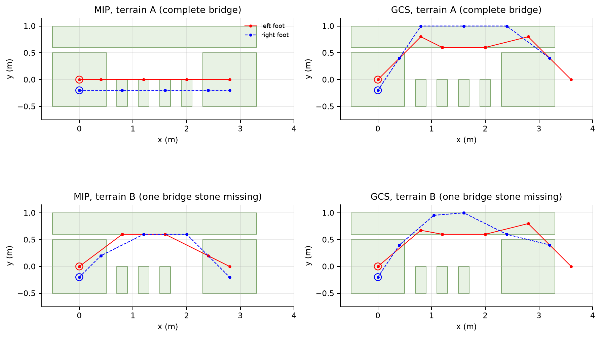
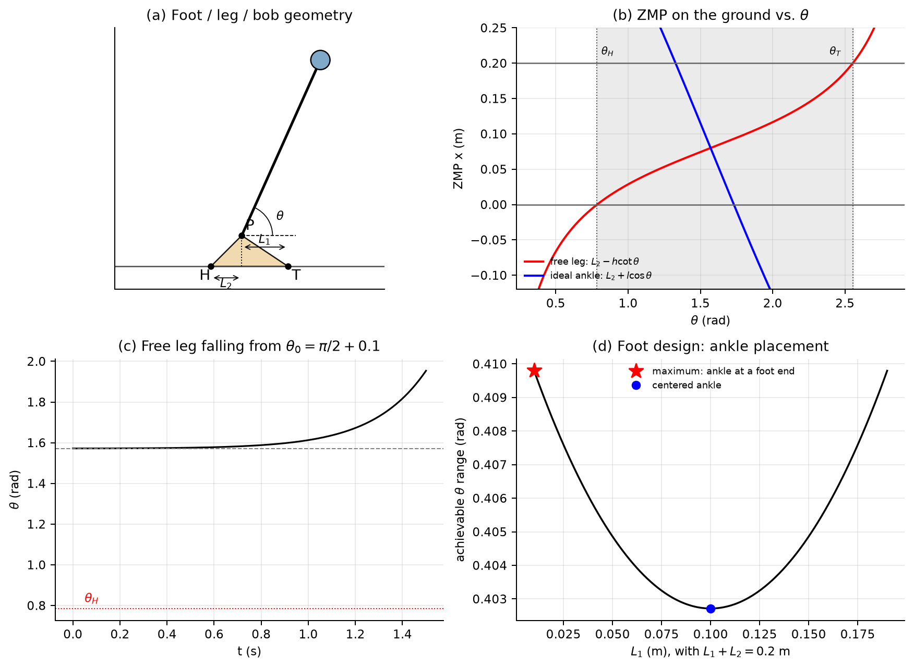

---

## 5.8 习题（Section 5.8）

Section 5.8 包含三道习题：

1. **Footstep Planning via Mixed-Integer Optimization**：用 MIQP 在 stepping stones 上规划落脚点。
2. **Understanding the zero-moment point**：解析分析一个"脚—腿—质点"模型的 ZMP、稳定性和脚设计。
3. **Footstep Planning via Graph of Convex Sets (GCS)**：把同一落脚点问题转成凸集图上的最短路。

前两节的编程习题分别由 `exercises/Exp5.8.1-footstep-mip.ipynb` 和 `exercises/Exp5.8.3-footstep-gcs.ipynb` 完成；第二题是纸笔推导，本笔记给出完整解答与数值验证。

### 5.8.1 Exercise 5.1：混合整数落脚点规划

#### (a) 问题

机器人要从初始石头走到目标石头。地形由若干矩形"踏脚石"（stepping stones）组成；脚只能踩在石头上，每一步的位移受限，两只脚不能相距太远。要求：

- 每一步选择左脚或右脚移动（交替）；
- 每只脚在每一时刻恰好属于一块石头；
- 最小化所有步长的平方和。

这是一个**混合整数二次规划（MIQP）**：脚的位置是连续变量，"踩哪块石头"是 0-1 变量。

#### (b) 石头与半空间表示

每块石头是一个轴对齐矩形，中心 $\mathbf c_i$，宽 $w_i$、高 $h_i$。点 $\mathbf x\in\mathbb R^2$ 在石头内当且仅当

$$
\mathbf A_i\mathbf x\le\mathbf b_i,
\qquad
\mathbf A_i=
\begin{bmatrix}1&0\\0&1\\-1&0\\0&-1\end{bmatrix},
\qquad
\mathbf b_i=
\begin{bmatrix}w_i/2\\h_i/2\\w_i/2\\h_i/2\end{bmatrix}
+\mathbf A_i\mathbf c_i .
\tag{5.59}
$$

这 4 行分别对应右、上、左、下四条边。

#### (c) 决策变量

对 $t=0,\dots,N$（$N$ 是最大步数）：

| 变量 | 维度 | 含义 |
|---|---|---|
| $\mathbf x^L_t,\mathbf x^R_t$ | $2$ | 左/右脚在第 $t$ 步的位置 |
| $\delta^L_{t,i},\delta^R_{t,i}$ | $\{0,1\}$ | 第 $t$ 步左/右脚是否在石头 $i$ 上 |
| $s$ | $\{0,1\}$ | 第一步是否左脚（1）或右脚（0） |

#### (d) 约束逐条推导

**1. 初始/目标位置**

$$
\mathbf x^L_0=\mathbf x^L_{init},\quad
\mathbf x^R_0=\mathbf x^R_{init},\quad
\mathbf x^L_N=\mathbf x^L_{goal},\quad
\mathbf x^R_N=\mathbf x^R_{goal}.
\tag{5.60}
$$

**2. 两脚相对位置限制**

每一时刻，一只脚必须位于以另一只脚为中心、边长为 $d$ 的正方形内：

$$
\|\mathbf x^L_t-\mathbf x^R_t\|_\infty\le\frac d2
\quad\Longleftrightarrow\quad
-\frac d2\mathbf 1\le\mathbf x^L_t-\mathbf x^R_t\le\frac d2\mathbf 1 .
\tag{5.61}
$$

这是 4 个线性不等式（$x,y$ 各两个）。

**3. 步态交替**

如果第一步用左脚（$s=1$），则偶数步左脚动、奇数步右脚动；反之亦然。对每一步 $t$：

$$
\begin{aligned}
\text{若 }t\text{ 为偶数:}&\quad
-\mathbf m_t\le\mathbf x^L_{t+1}-\mathbf x^L_t\le\mathbf m_t,\quad
\mathbf m_t=d\,[s,\;s]^\top,\\
&\quad
-\mathbf n_t\le\mathbf x^R_{t+1}-\mathbf x^R_t\le\mathbf n_t,\quad
\mathbf n_t=d\,[1-s,\;1-s]^\top,\\
\text{若 }t\text{ 为奇数:}&\quad
\text{左右互换}.
\end{aligned}
\tag{5.62}
$$

这里 $d$ 是单步最大位移（逐轴）。当某只脚不该动时，上界为 0，位置被锁死；另一只脚可以在 $\pm d$ 的方框内移动。

**4. 每只脚恰好在一块石头上**

$$
\sum_i\delta^L_{t,i}=1,\qquad
\sum_i\delta^R_{t,i}=1,\qquad
\forall t .
\tag{5.63}
$$

**5. big-M 石头归属约束**

若 $\delta^L_{t,i}=1$，则 $\mathbf x^L_t\in S_i$；否则该约束无效。用 big-M 写成

$$
\mathbf A_i\mathbf x^L_t\le\mathbf b_i+(1-\delta^L_{t,i})\mathbf M,
\qquad
\mathbf A_i\mathbf x^R_t\le\mathbf b_i+(1-\delta^R_{t,i})\mathbf M .
\tag{5.64}
$$

当 $\delta_{t,i}=1$ 时，右端为 $\mathbf b_i$，脚必须在石头内；当 $\delta_{t,i}=0$ 时，右端加上 $\mathbf M$，约束松弛。$\mathbf M$ 要"足够大"以覆盖整个地形，但**不能太大**，否则分支定界的 LP 松弛很差。

> **为什么 big-M 能表示"并集"**。单块石头是凸集，但"脚可以在这块或那块"是**并集**，非凸。引入 0-1 变量后，式 (5.64) 把并集拆成 $n$ 个条件凸约束：每个 $\delta_i$ 选择激活哪一个。这是混合整数规划中最基本的**析取（disjunctive）建模**技巧。

#### (e) 目标函数

$$
\min\ \sum_{t=0}^{N-1}
\left(
\|\mathbf x^L_{t+1}-\mathbf x^L_t\|^2
+\|\mathbf x^R_{t+1}-\mathbf x^R_t\|^2
\right).
\tag{5.65}
$$

用 `prog.AddQuadraticCost(step.dot(step))` 添加。目标鼓励小步，但不会直接惩罚"步数"；步数由 $N$ 和动力学/石头布局间接决定。

#### (f) 完整 MIQP

$$
\begin{aligned}
\min_{\mathbf x,\delta,s}\quad &
\sum_{t}\left(\|\Delta\mathbf x^L_t\|^2+\|\Delta\mathbf x^R_t\|^2\right)\\
\text{s.t.}\quad &
\text{(5.60)--(5.64)},\\
& \delta^L_{t,i},\delta^R_{t,i}\in\{0,1\},\quad
s\in\{0,1\}.
\end{aligned}
\tag{5.66}
$$

#### (g) 分支定界

Drake 的 `MixedIntegerBranchAndBound` 用 OSQP 解每个节点的 QP 松弛：

1. 把 0-1 变量松弛为 $[0,1]$，解 QP，得到下界；
2. 若解中所有 0-1 变量都是整数，得到一个可行上界；
3. 否则选一个分数变量分支（$\delta=0$ / $\delta=1$），递归；
4. 用上界剪枝。

复杂度最坏是指数级的，指数来自 0-1 变量的个数：

$$
\#\text{binaries}=2(N+1)n_{stones}+1 .
\tag{5.67}
$$

对本题 $N=8$、约 7 块石头，约 120 个 0-1 变量；分支定界在几秒内可解。

#### (h) 代码要点

```python
def one_stone_per_foot(prog, n_steps, decision_variables):
    stone_left, stone_right = decision_variables[2:4]
    n_stones = stone_left.shape[1]
    ones = np.ones(n_stones)
    for t in range(n_steps + 1):
        prog.AddLinearConstraint(ones, 1.0, 1.0, stone_left[t])
        prog.AddLinearConstraint(ones, 1.0, 1.0, stone_right[t])

def foot_in_stepping_stone(prog, terrain, n_steps, decision_variables):
    position_left, position_right, stone_left, stone_right = decision_variables[:4]
    M = get_big_M(terrain)
    for t in range(n_steps + 1):
        for i, stone in enumerate(terrain.stepping_stones):
            prog.AddLinearConstraint(
                le(stone.A.dot(position_left[t]),
                   stone.b + (1 - stone_left[t, i]) * M))
            prog.AddLinearConstraint(
                le(stone.A.dot(position_right[t]),
                   stone.b + (1 - stone_right[t, i]) * M))

def minimize_step_length(prog, n_steps, decision_variables):
    position_left, position_right = decision_variables[:2]
    for t in range(n_steps):
        step_left = position_left[t + 1] - position_left[t]
        step_right = position_right[t + 1] - position_right[t]
        prog.AddQuadraticCost(step_left.dot(step_left))
        prog.AddQuadraticCost(step_right.dot(step_right))
```

#### (i) 结果



在 `terrain_A = [1,1,1,1]`（完整桥）和 `terrain_B = [1,1,1,0]`（缺一块）上：

| 地形 | 最优目标值 | 自评分 |
|---|---|---|
| A（完整桥） | 4.159251 | 16/16 |
| B（缺一块） | 5.672129 | 16/16 |

- **地形 A**：机器人沿桥直走，左右脚交替落在桥石上；
- **地形 B**：由于最大步长限制，直走不可行，最优解绕到上方的 `lateral` 大石头，再回到目标。

> **读图要点**：红/蓝折线是左右脚的位置序列；空心圆是初始位置。地形 B 的绕行不是"局部最优陷阱"，而是 MIQP 的**全局最优**——分支定界能证明没有更短的直走方案。这是 MIQP 相对于局部 NLP 的核心优势。

> **自检 5.8**：
> 1. 如果把 big-M 取成 $10^6$，分支定界会发生什么？
> 2. 为什么目标函数用步长平方而不是步数？两者会给出不同的解吗？
> 3. 如果要处理不平坦地形，式 (5.59) 和 (5.64) 需要怎么改？

---

### 5.8.2 Exercise 5.2：理解零矩点



#### (a) 模型与坐标

取脚跟 $H$ 为原点，$x$ 轴指向脚尖 $T$，$z$ 轴向上。脚是三角形 $HTP$：

$$
H=(0,0),\qquad T=(L_1+L_2,0),\qquad P=(L_2,h),
$$

其中 $P$ 是踝关节（pin joint），$h$ 是踝高，$L_2$ 是脚跟到踝的水平距离，$L_1$ 是踝到脚尖的水平距离。腿长 $l$，末端质点 $m$；腿与脚在 $P$ 处用**无驱动**的 pin joint 连接（a–d 问）。

腿与水平线的夹角为 $\theta$（逆时针为正，$\theta=\pi/2$ 时竖直向上）。质点位置：

$$
\mathbf p_b=(x_b,z_b)=(L_2+l\cos\theta,\;h+l\sin\theta).
\tag{5.68}
$$

> **坐标约定**：$\theta$ 从 $+x$ 方向量起，不是从竖直方向。$\theta=\pi/2$ 是直立；$\theta<\pi/2$ 表示质点在踝的**前方**（向右）；$\theta>\pi/2$ 表示在**后方**（向左）。

#### (a) 受力图（FBD）

**质点 $m$**：

- 重力 $m\mathbf g=(0,-mg)$；
- 腿对质点的力 $\mathbf F_{leg\to b}$。

**腿（无质量）**：

- $P$ 处脚对腿的力 $\mathbf F_{foot\to leg}$；
- 质点对腿的力 $-\mathbf F_{leg\to b}$；
- 无质量 ⇒ 合力为零、绕任意点力矩为零。对 $P$ 点取矩：质点对腿的力必须沿腿方向（否则会产生非零力矩）。因此腿是**二力杆（two-force member）**，力沿 $\overrightarrow{Pb}$ 方向。

**脚（无质量）**：

- $P$ 处腿对脚的力 $\mathbf F_{leg\to foot}$，大小相等、方向相反于 $\mathbf F_{foot\to leg}$，沿腿方向；
- 脚跟 $H$ 处：法向力 $N_H\ge0$，摩擦力 $f_H$；
- 脚尖 $T$ 处：法向力 $N_T\ge0$，摩擦力 $f_T$；
- 无质量 ⇒ 合力为零、绕任意点力矩为零。对 $P$ 取矩：

$$
-L_2N_H+L_1N_T+h(f_H+f_T)=0 .
\tag{5.69}
$$

（$H$ 相对 $P$ 的向量是 $(-L_2,-h)$，$T$ 相对 $P$ 的向量是 $(L_1,-h)$；叉乘的 $y$ 分量用式 (5.2)。）

> **关键结论**：因为脚无质量且 $P$ 是无驱动的 pin joint，脚对 $P$ 的净力矩为零；腿力沿腿方向、经过 $P$，所以地面反力的合力**必须经过 $P$**。又因为腿是二力杆，腿力沿 $P$–$b$ 连线，所以地面反力的作用线**经过 $P$ 和质点 $b$**。这条线与地面的交点就是 ZMP。

#### (b) $\theta=\pi/2+10^{-3}$ 是否稳定？

质点的切向运动方程（绕 $P$ 的力矩）：

$$
ml^2\ddot\theta=-mgl\cos\theta
\quad\Longrightarrow\quad
\ddot\theta=-\frac gl\cos\theta .
\tag{5.70}
$$

在 $\theta=\pi/2+\epsilon$ 处，$\cos\theta=-\sin\epsilon\approx-\epsilon$，所以

$$
\ddot\epsilon\approx\frac gl\,\epsilon .
\tag{5.71}
$$

特征值为 $\pm\sqrt{g/l}$，一正一负：**不稳定**（鞍点）。扰动会指数增长，时间常数 $1/\sqrt{g/l}=\sqrt{l/g}$。对 $l=0.5$ m，$\sqrt{g/l}=4.43\ \mathrm{s^{-1}}$。

> **注意**：$\theta=\pi/2$ 是**平衡点**，但不是稳定平衡点。线性化后有一个正特征值，所以任何微小扰动都会让它倒下。这与第 3 章的倒立摆完全一致。

#### (c) ZMP 作为 $\theta$ 的函数

**方法一：几何（推荐）**

地面反力的作用线经过 $P=(L_2,h)$ 和质点 $b=(L_2+l\cos\theta,h+l\sin\theta)$。求这条线与地面 $z=0$ 的交点。

令 $\mathbf p(s)=P+s(b-P)$，则 $z(s)=h+s\,l\sin\theta$。令 $z=0$：

$$
s=-\frac{h}{l\sin\theta}.
$$

代入 $x$：

$$
x_{zmp}=L_2+s\,l\cos\theta
=L_2-\frac{h\cos\theta}{\sin\theta}
=\boxed{L_2-h\cot\theta}.
\tag{5.72}
$$

**方法二：动力学（验证）**

对质点，ZMP 的一般公式（由整机关于地面的力矩平衡）为

$$
x_{zmp}=x_b-\frac{z_b\,a_x}{a_y+g},
\tag{5.73}
$$

其中 $a_x,a_y$ 是质点加速度。由式 (5.70) 和圆周运动：

$$
\begin{aligned}
a_x&=-l\sin\theta\,\ddot\theta-l\cos\theta\,\dot\theta^2
=g\sin\theta\cos\theta-l\cos\theta\,\dot\theta^2,\\
a_y&=l\cos\theta\,\ddot\theta-l\sin\theta\,\dot\theta^2
=-g\cos^2\theta-l\sin\theta\,\dot\theta^2.
\end{aligned}
\tag{5.74}
$$

于是

$$
a_y+g=g\sin^2\theta-l\sin\theta\,\dot\theta^2
=\sin\theta\,(g\sin\theta-l\dot\theta^2),
\tag{5.75}
$$

$$
a_x=\cos\theta\,(g\sin\theta-l\dot\theta^2).
\tag{5.76}
$$

代入式 (5.73)：

$$
x_{zmp}=L_2+l\cos\theta
-\frac{(h+l\sin\theta)\cos\theta}{\sin\theta}
=L_2-h\cot\theta .
\tag{5.77}
$$

两种方法一致，且 $m,g,l,\dot\theta$ 都消掉了——**ZMP 只取决于脚/腿的几何和 $\theta$**。

> **理解提示：为什么这个结果如此简洁**。无质量腿是二力杆，地面反力的作用线被"钉死"在 $P$–$b$ 连线上；ZMP 只是这条线与地面的交点。动力学（速度、加速度）不影响作用线的**方向**，只影响力的大小。这是"无质量腿 + 无驱动踝"模型的特殊性质，不是普遍规律。

#### (d) ZMP 到达脚尖/脚跟的角度

**到达脚尖 $T$**：$x_{zmp}=L_1+L_2$：

$$
L_2-h\cot\theta=L_1+L_2
\;\Longrightarrow\;
\cot\theta=-\frac{L_1}{h}
\;\Longrightarrow\;
\boxed{\theta_T=\pi-\arctan\frac{h}{L_1}} .
\tag{5.78}
$$

**到达脚跟 $H$**：$x_{zmp}=0$：

$$
L_2-h\cot\theta=0
\;\Longrightarrow\;
\cot\theta=\frac{L_2}{h}
\;\Longrightarrow\;
\boxed{\theta_H=\arctan\frac{h}{L_2}} .
\tag{5.79}
$$

当 $\theta$ 从 $\pi/2$ 向后增大（质点向后倒），ZMP 向脚尖移动，$\theta=\theta_T$ 时到达脚尖；再往后，脚会绕脚尖转动（toe roll），平脚模型失效。当 $\theta$ 从 $\pi/2$ 向前减小（质点向前倒），ZMP 向脚跟移动，$\theta=\theta_H$ 时到达脚跟，脚会绕脚跟转动（heel roll）。

因此，**平脚接触的可行姿态范围**是

$$
\theta\in[\theta_H,\;\theta_T]
=\left[\arctan\frac{h}{L_2},\;\pi-\arctan\frac{h}{L_1}\right].
\tag{5.80}
$$

> **直觉：脚越高、越短，范围越小**。$h$ 越大，$\arctan(h/L_2)$ 越大、$\pi-\arctan(h/L_1)$ 越小，范围被压缩；$L_1,L_2$ 越大，范围越宽。这与图 5-5(b) 的红色曲线一致：$x_{zmp}=L_2-h\cot\theta$ 在 $\theta=\pi/2$ 附近穿越 $[0,L_1+L_2]$。

#### (e) 有踝关节驱动器时，"快要摔倒"意味着什么？

假设踝关节有一个控制器，**完美抵消质点重力绕 $P$ 的力矩**，使 $\ddot\theta=0$。准静态下（$\dot\theta\approx0$），整个系统（脚 + 腿 + 质点）的外力只有重力和地面反力；踝力矩是内力。因此地面反力的合力必须**竖直通过质心**：

$$
x_{zmp}=x_b=L_2+l\cos\theta .
\tag{5.81}
$$

"快要摔倒"意味着 ZMP 到达支撑多边形的边界：

- 如果 ZMP 到达**脚尖** $T$，脚即将绕 $T$ 转动，**脚跟的法向力 $N_H\to0$**，$N_T\to mg$；
- 如果 ZMP 到达**脚跟** $H$，脚即将绕 $H$ 转动，**脚尖的法向力 $N_T\to0$**，$N_H\to mg$。

在准静态下水平加速度为零，所以摩擦力 $f_H,f_T\to0$（更精确地说，它们的合力为零）。如果 $\dot\theta\ne0$，向心加速度会把 ZMP 拉离质心投影，边界条件需要修正。

> **注意**：踝力矩可以移动 ZMP 在支撑多边形内的位置，但**不能把 ZMP 移到支撑多边形外**而不翻倒。这就是"踝策略（ankle strategy）"的物理极限。

#### (f) 有驱动器时可达的 $\theta$ 范围

由式 (5.81) 和 $0\le x_{zmp}\le L_1+L_2$：

$$
-L_2\le l\cos\theta\le L_1
\quad\Longrightarrow\quad
\cos\theta\in\left[-\frac{L_2}{l},\;\frac{L_1}{l}\right].
\tag{5.82}
$$

对 $\theta\in[0,\pi]$：

$$
\boxed{
\theta\in\left[\arccos\frac{L_1}{l},\;\arccos\left(-\frac{L_2}{l}\right)\right]
}
\tag{5.83}
$$

前提是 $L_1\le l$、$L_2\le l$；否则区间被 $[-1,1]$ 截断（例如脚太长时，$\theta$ 可以覆盖整个 $[0,\pi]$）。

**数值例子**（$l=0.5$ m，$L_1=0.12$ m，$L_2=0.08$ m，$h=0.08$ m）：

$$
\theta\in[\arccos(0.24),\arccos(-0.16)]
=[1.328,\;1.731]\ \mathrm{rad}
=[76.1^\circ,\;99.2^\circ],
$$

宽度约 $23.1^\circ$。与无驱动器的情况（$[45^\circ,146.3^\circ]$）相比，有踝驱动器时范围**小得多**——因为 ZMP 必须跟随质心投影，而无驱动器的 ZMP 由腿的几何决定，可以"藏"在脚内更久。

#### (g) 设计脚以最大化姿态范围

**(i) 更高还是更扁（$h$ 大/小）？**

在"理想踝力矩 + 准静态"模型下，式 (5.83) **不含 $h$**。因此 $h$ 对姿态范围**没有影响**。$h$ 只影响力矩臂、踝关节所需力矩和脚的质量分布（本题脚无质量）。所以答案是：**无所谓**（在理想模型下）。

**(ii) 更长还是更短（$L_1+L_2$）？**

固定 $l$，式 (5.83) 的区间随 $L_1+L_2$ 增大而变宽（直到饱和到 $[0,\pi]$）。所以**更长的脚更好**。直观上，支撑多边形越大，质心投影可以离踝越远而不翻。

**(iii) 踝放在哪里？**

这是一个容易答错的点。设总长 $L=L_1+L_2$ 固定，定义

$$
R(L_1)=\arccos\left(-\frac{L-L_1}{l}\right)-\arccos\left(\frac{L_1}{l}\right).
\tag{5.84}
$$

求导：

$$
R'(L_1)=\frac{1}{\sqrt{l^2-L_1^2}}
-\frac{1}{\sqrt{l^2-(L-L_1)^2}}.
\tag{5.85}
$$

$R'=0$ 给出 $L_1=L/2$（踝在中间）。但二阶导数在 $L_1=L/2$ 处为正，所以这是**极小值**，不是极大值！最大值在可行域的**边界**：

- 若 $L\le l$：$L_1\to0$ 或 $L_1\to L$（踝在脚跟或脚尖），最大范围 $\arcsin(L/l)$；
- 若 $l<L\le2l$：边界为 $L_1=L-l$ 或 $L_2=L-l$，最大范围 $\pi-\arccos((L-l)/l)$。

数值对比：

| 总长 $L$ | 踝在中间的范围 | 踝在一端的范围 |
|---|---|---|
| 0.2 m ($l=0.5$) | 0.4027 rad | 0.4098 rad |
| 0.5 m ($l=0.5$) | 1.047 rad | 1.571 rad |

> **结论与直觉冲突**：如果目标是**总姿态范围最大**，踝应该放在脚的一端（极限情况），而不是中间。原因是对固定的 $\cos\theta$ 区间长度，$\arccos$ 在端点附近"更陡"，把区间推到 $[-1,1]$ 的端点能换来更大的角度跨度。中间放置是**范围最小**的配置。
>
> **但是**：中间放置使前后两个方向的裕度对称，抗扰/抗翻倒更均衡；实际脚设计通常选择接近中间，而不是追求极端的总范围。答题时应说明你优化的指标：**总范围**还是**最小裕度**。如果课程期望"中间"，那是对"对称裕度"的直觉；严格按"最大化范围"的数学答案是**一端**。

#### (h) 只向前走：让脚跟更容易抬起

向前走时，脚绕**脚尖** $T$ 转动，脚跟抬起。抬起发生在 ZMP 到达脚尖时：

$$
x_{zmp}=L_1+L_2
\;\Longrightarrow\;
L_2+l\cos\theta=L_1+L_2
\;\Longrightarrow\;
\cos\theta=\frac{L_1}{l}.
\tag{5.86}
$$

所以抬脚角度

$$
\theta_{lift}=\arccos\left(\frac{L_1}{l}\right).
\tag{5.87}
$$

**(i) 更高还是更扁（$h$）？** 式 (5.87) 不含 $h$，所以在理想模型中**无影响**。
**(ii) $L_1$ 更长还是更短？** $L_1$ 越短，$\cos\theta_{lift}$ 越小，$\theta_{lift}$ 越大（越接近直立），脚跟越容易抬起。所以**更短的 $L_1$** 更好。
**(iii) $L_2$ 更长还是更短？** 式 (5.87) 不含 $L_2$，所以对**抬脚跟的角度**无影响。$L_2$ 影响的是向后倒的范围（脚跟到踝的距离）和脚的总长度；如果总长固定，缩短 $L_1$ 必然增大 $L_2$。若必须二选一，**缩短 $L_1$（等价于加长 $L_2$）** 更容易抬脚跟。

> **注意**：以上结论都依赖"脚无质量、踝力矩无上限、准静态"三个假设。真实脚有质量、踝力矩有限、行走是动态的，$h$ 和 $L_2$ 会通过惯性、力矩臂和冲击影响抬脚难度。答题时先写出假设，再给结论。

> **自检 5.9**：
> 1. 为什么无驱动踝时 ZMP 与 $\dot\theta$ 无关？如果腿有质量，这个结论还成立吗？
> 2. 有驱动踝时，ZMP 为什么等于质心投影？如果质心在加速，还相等吗？
> 3. 脚设计题中，为什么"最大化总范围"和"最大化最小裕度"会给出不同的踝位置？

#### (i) 数值验证

`exp5_analysis/exercise52_zmp.py` 验证了：

- 几何法、动力学法、ZMP 定义三种计算的最大误差分别为 $0$、$10^{-16}$；
- 无驱动腿从 $\theta_0=\pi/2+0.1$ 开始仿真，ZMP 曲线与 $L_2-h\cot\theta$ 完全重合；
- 设计研究复现了图 5-5(d) 的"中间是极小、两端是极大"的结论。
